# 100th Tour Update

# Introduction

Amazingly, this the 100th Blog post I have written and I
would like to thank everyone who has come along on my journey and will
use this milestone to reflect on the stories. This post highlights some
of the family stories and other tour milestones. The map shows many of
the post locations, the red markers are family stories and the blue
markers are battlefield sites.

Click on the [interactive
map](https://pd-allen.github.io/docs/html/BattlefieldTourHistory.html)
to get an overview of the story and links to any posts you may have
missed.

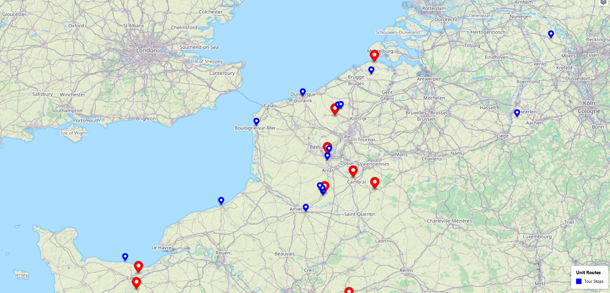

The links in the summary stories also will take you to the referenced
post.

# Canadian Liberation Tour

It has been just over three years since I posted my first Blog: [Travel
Time](https://www.paulsbattlefieldtours.com/post/travel-time),
describing my upcoming Canadian Battlefield Tour that was a great start
to my travels and battlefield adventures. It was an excellent tour, with
great dining and lodging. The histography was written by noted Canadian
Historian Mark Zeuhlke whose 14 Canadian Battle Series books document
the Canadian Experience in WW2.

I started the blog to document the tour I was on and help me remember
and reflect on the sights I had seen. It worked, as I was the star of
the departing lunch trivia challenge.

# Friends and Family Stories

## WWI

### Grandfather William Johnston

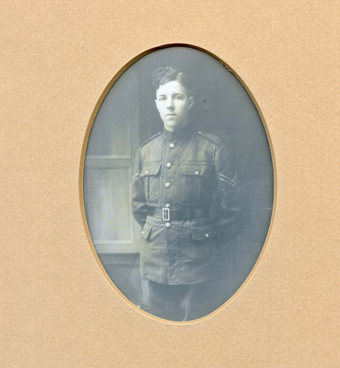

The story of [William
Johnston](https://www.paulsbattlefieldtours.com/post/following-grandfather-s-footsteps),
my maternal Grandfather, was the one that kicked off my interest in
military history. My sister, Dale, was writing our family history and
passed all the family members who served off to me. I found out all the
WWI records were available from the archive and my journey started.

Grandfather was wounded at Courcelette on 16 Sep 1916, his first real
action. This photo is from Courcelette around the time Grandfather was
wounded. It is likely not him, but he was wounded in the upper left arm,
so we claimed him.

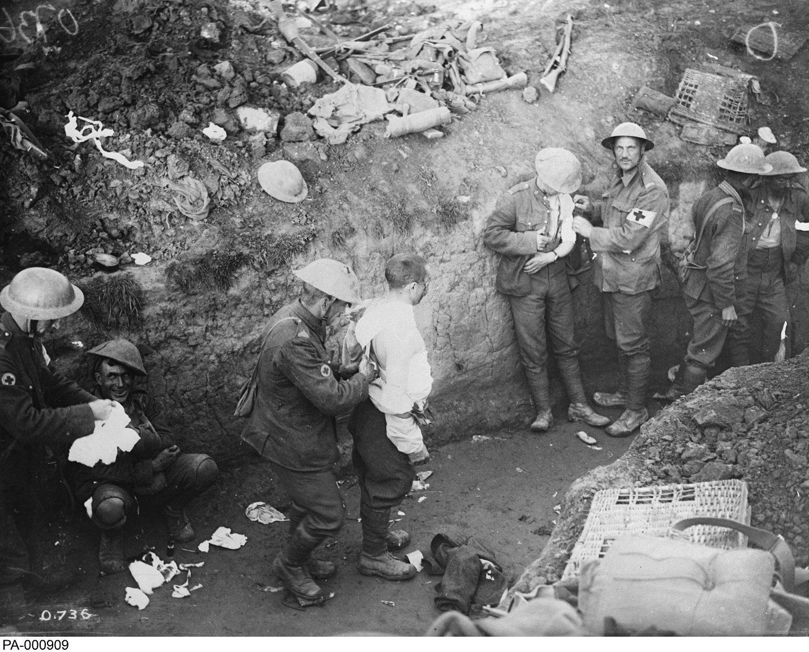

I was able to track down where his unit, the 58th Canadian
Battalion, was located and stood on the cart track that marked the
trench he came out of the day he was wounded. Walking the ground my
grandfather had more than 100 years earlier was an extremely moving
moment that I was able to share with my daughter
[Rachel](https://www.paulsbattlefieldtours.com/post/rachel-tours-the-somme)
the next spring while on a Tour of the Somme Battlefield. Standing on
the trench line, looking towards Courcelette.

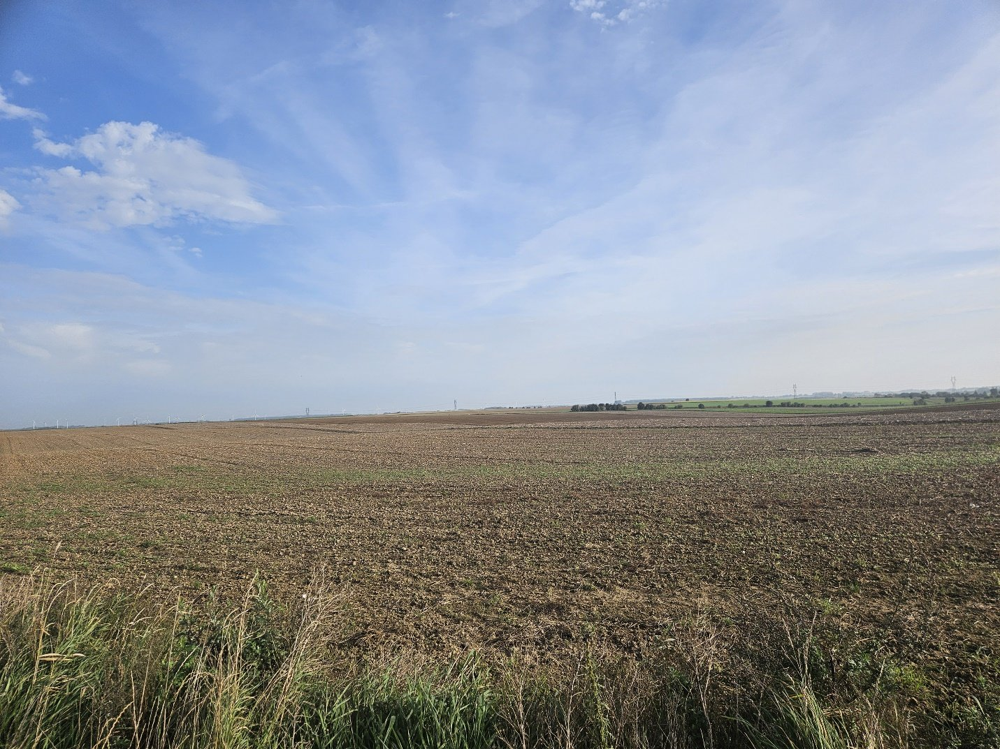

He spent the rest of the war in England at the Canadian Training Centre
and met my Grandmother Annie Goodfellow while there. Dale’s family tree
research of Annie led to her cousins, the Goodfellow Brothers.

### The Goodfellow Brothers

The [Goodfellow
brothers](https://www.paulsbattlefieldtours.com/post/goodfellow-brothers-last-stand)
were second cousins to my Grandmother Annie. All four brothers served in
WWI with three of them getting killed and the fourth surviving the war
but, having been gassed, was in ill health his entire life and died at
age 49.

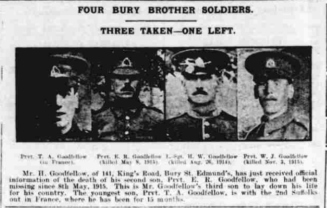

#### Henry Goodfellow

[Lance Sergeant Henry
Goodfellow](https://www.paulsbattlefieldtours.com/post/lance-sgt-6537henry-goodfellow)
joined the 2nd Battalion Suffolk Regiment in 1903, serving in
India, England and was in Ireland when war broke out. The 2nd
Suffolks sailed directly to Le Havre, France on 15 August and moved with
the rest of the British Expeditionary Force (BEF) to Mons where they
fought their first battle with the Germans. The BEF was overwhelmed and
was forced to retreat under fire for two days. On 26 August the decision
was taken to stand and fight at Le Cateau. The Suffolks were decimated,
suffering 720 casualties on a single day as their position was overrun.
Henry was killed in this action. Gen Smith-Dorrien, the British second
army commander, said that the stand at Le Cateau saved the BEF. Henry is
commemorated on the Suffolk Memorial at the site of their heroic stand.
His war lasted 11 days.

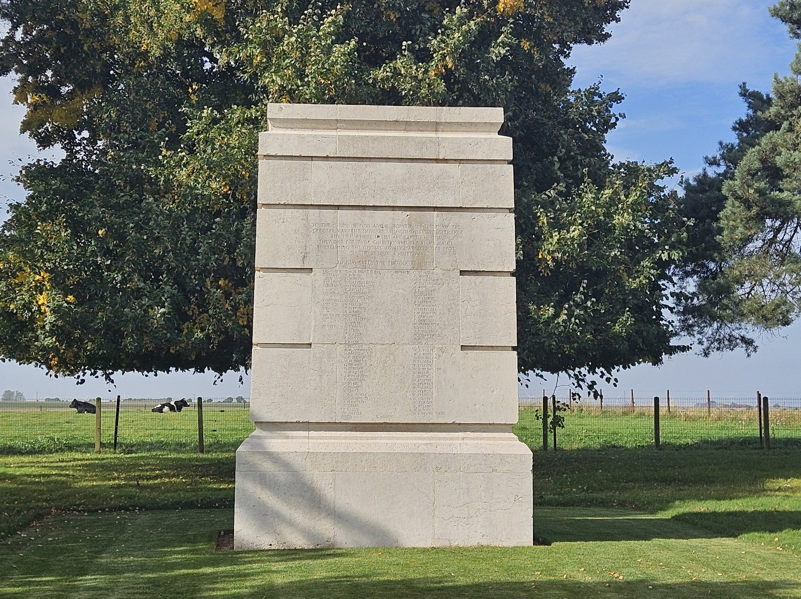

Henry has no known grave and is also commemorated on [La
Ferté-sous-Jouarre Memorial to the
Missing](https://www.paulsbattlefieldtours.com/post/pre-season-tour-la-ferté-sous-jouarre-memorial-to-the-missing)
on the River Marne where the French and BEF first stopped the German
Advance.

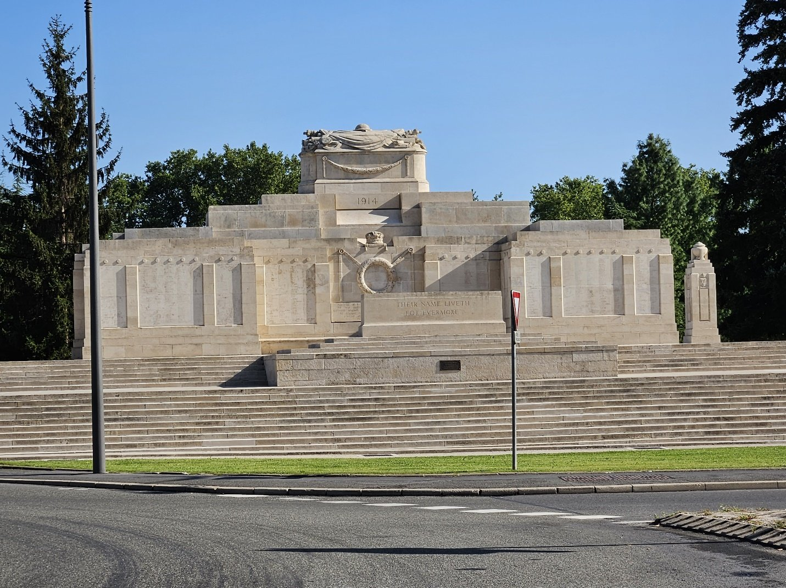

#### Ernest Goodfellow

[Private Ernest
Goodfellow](https://www.paulsbattlefieldtours.com/post/ernest-goodfellow-1st-battalion-suffolk-regiment)
joined the 1st Battalion Suffolk Regiment in 1912 and was
serving in Cairo, Egypt. His Battalion sailed for home and entered
France on 15 Jan 1915. On 22 Apr 1915, the Germans launched the first
gas attack and pushed the Allied front line back several km. The
1st Suffolks fought beside the Canadians to reestablish a
reduced front line.

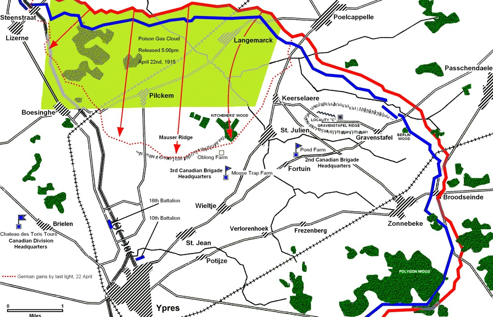

On 08 May, just north of Frezenberg, the 1st Suffolks were in
the front line when the Germans attacked again. By noon, the battalion
had been completely overwhelmed. The total number of casualties on 08
May amounted to over 400, including Ernest Goodfellow. He was reported
missing on 08 May and declared dead on 03 Jul 1916. His war lasted
nearly four months.

The 1st Suffolks had a mere 29 men survive the battle. Nearly
1000 men had been lost in 6 weeks and the 1st Suffolks were
merged with the survivors of the 84th Brigade to make a composite
battalion.

Ernest has no known grave and is commemorated on the Menin Gate.
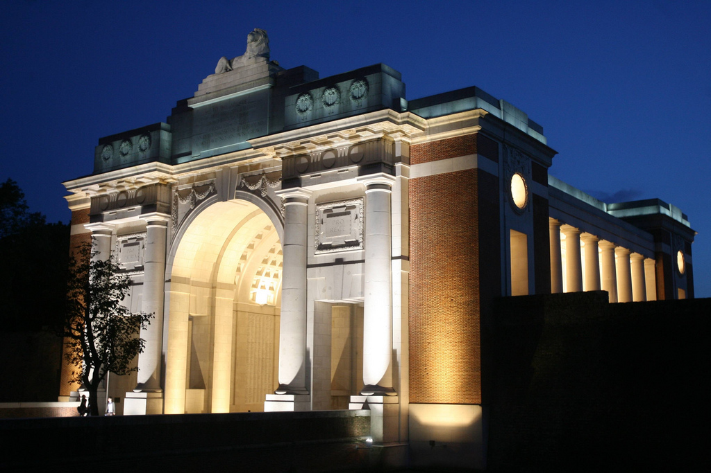

The Menin Gate has been under renovation for several years in advance of
its centenary in 2027, but when Wine Bob and I visited last May we were
able to see Ernest’s name.

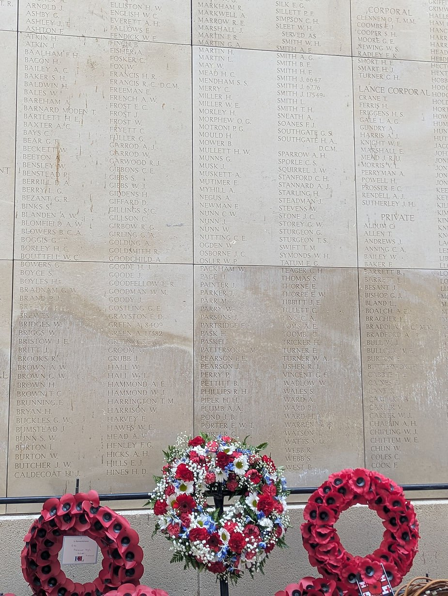

Closeup of his name.

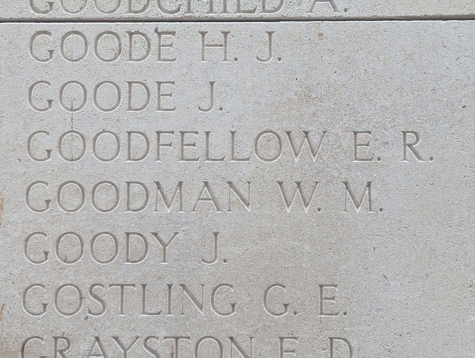

#### Walter Goodfellow

Walter enlisted in the 7th Battalion Suffolk Regiment; a Service
Battalion, raised in Bury St Edmunds on 20 Aug 1914 as part of
Kitchener’s Army. On 30 May 1915, the Battalion sailed to Boulogne. They
were moved to Loos on 30 Sep and participated in the Battle on
Hohenzollern Redoubt on 13 October.

The 7th Suffolks, as part of the 35th Brigade, attacked the Quarries
south of the Redoubt to prevent German reserves moving into position.

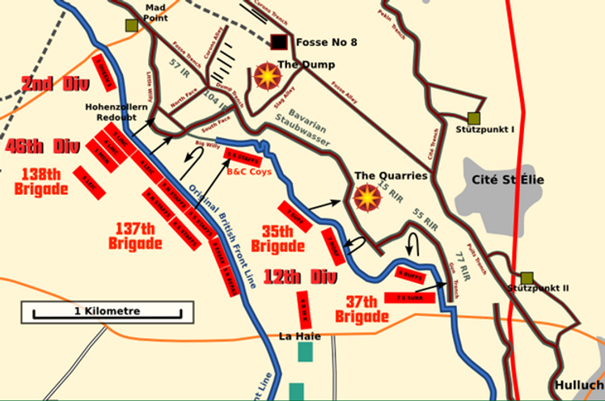

The 7th Suffolks remained in the area, rotating in and out of
the front line. On 03 Nov at 0900 the Suffolks started to relieve 9th
Essex in the front line. During the relief movement, the enemy shelled
the leading company as it crossed open ground West of Railway trench and
Walter was likely killed at this point. His war lasted 5 months.

Walter has no known grave and is commemorated on the Loos Memorial. The
walls of Loos Memorial list more than 20,000 names of the missing from
the Battle of Loos and surround
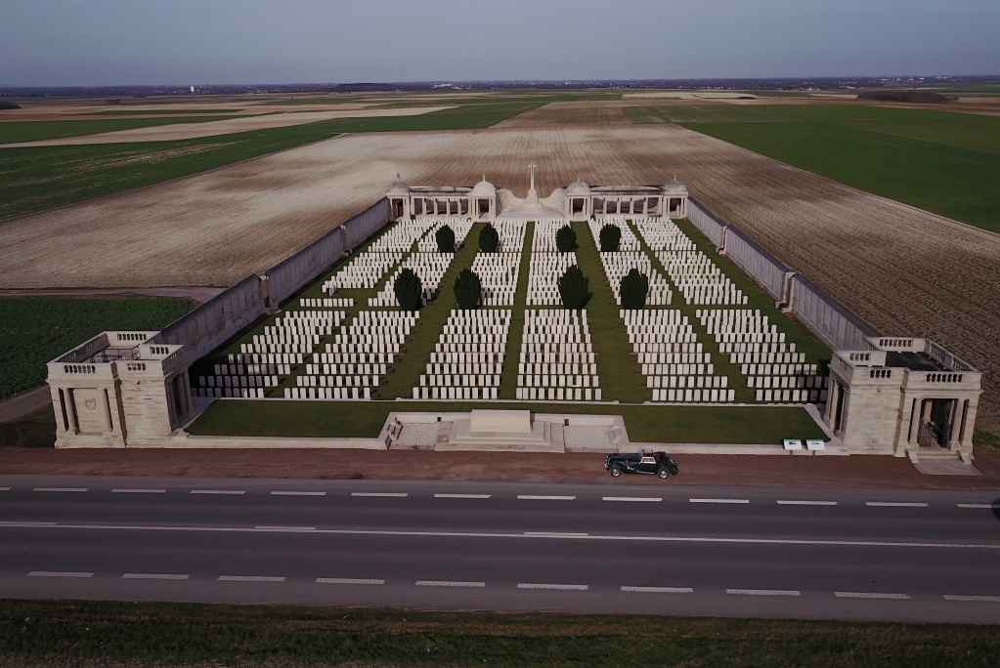

Dud Corner Cemetery. Visiting Walter in Jan 2024 with Wine Bob.

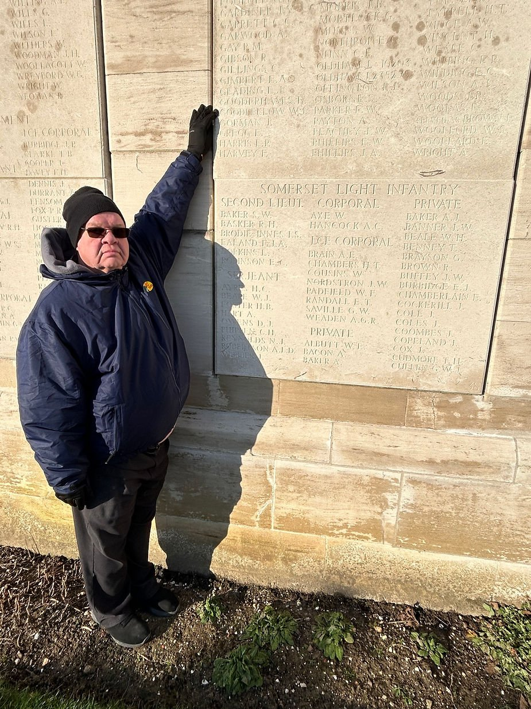

#### Thomas Goodfellow

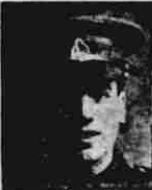

Thomas was only 18 when war broke out and signed up with the
2nd Suffolks, the same regiment as Henry. They would have
never served together as Henry was killed before Thomas enlisted.

Thomas made it to France on 27 Apr 1915 and managed to survive the war
despite being gassed. Like most other WWI veterans, his service records
were destroyed by German bombing in WW2, so the details of his service
are not known. Thomas was in ill health for the rest of his life and
died in 1945 at the age of 49. He was born in Bury St Edmonds and lived
there his entire life and worked at a printer at the Bury St Edmonds
newspaper.

Notes from the Bury St Edmonds archive indicate his wife was so incensed
at the meager pension she received after his death, that she destroyed
all his military records.

### Sgt Robert Connelly

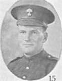

[Robert
Connelly](https://www.paulsbattlefieldtours.com/post/sgt-robert-connelly-1)
enlisted in North Bay, Ontario on the 9th of December 1915 at the age of
31, and was assigned to the 87th Battalion (Canadian Grenadier Guards).
The Guards were based in Montreal but recruited in mining towns of
Northern Quebec and Ontario. Robert was the uncle of my late
brother-in-law Lorne Ryan who was married to my sister Diane.

The 87th Battalion, including Robert and his brother Fred, sailed from
Halifax on the 23rd of April 1916 aboard the 'Empress of Britain.' They
arrived in Liverpool on the 4th of May, and were assigned to the 1st
Battalion on the 16th of June 1916, as replacement for the losses
suffered by the first Battalion at Mont Sorrel. The Canadian Corps lost
8,000 men killed or wounded and 536 taken prisoner during this period.
The 1st Battalion suffered 37 killed, 276 wounded and 69 missing, during
the Battle of Mont Sorrel.

In order to replenish the Battalion, a draft of 280 men from the 87th
Battalion was received on the 21st of June as the 1st Battalion was in
the rear at the Connaught Lines, resting and training.

Robert fought in all of the subsequent battles including Courcelette
(Somme), Vimy Ridge, Hill 70, Passchendaele, Amiens, Drocourt-Queant
Line and was killed during the Battle of Canal du Nord on 30 Sep 1918,
just 6 weeks before the end of the war.

Robert was awarded the Military Medal for his actions during the Battle
of Passchendaele. The citation reads:

> *At Passchendaele, on Nov 6th, 1917, this NCO was in charge
> of a Platoon, the Officer being called upon to take charge of the
> company upon the Commander of the Company becoming a casualty. This
> NCO displayed marked tact and efficiency in handling his men and
> guiding them to their objective. He consolidated his portion of the
> line and reported for further instructions during a heave bombardment
> by the enemy. He exposed himself to heavy shell fire in order to
> assist a wounded comrade whose escort was dispersed by a shell falling
> near and led him to the dressing station.*

#### Canal du Nord

Once the initial canal crossing was achieved, the 1st Battalion followed
the 4th Battalion to the red line. The Battalion crossed the canal at
06.20hrs, 60 minutes after the initial barrage. The 4th Battalion
secured their position at the red-line on schedule and at 08.24hrs the
barrage lifted, and the 1st Battalion advanced through the 4th Battalion
and headed to the green-line.

On the 30th of September, the 1st Battalion regrouped and prepared for
an assault on Abancourt on the 1st of October. Although there were no
advances, heavy shelling and machine gun fire harassed the battalion.

Sergeant Robert Connelly was killed by machine gun fire on the 30th of
September, just south of Epinoy - a mere six weeks before the end of the
war.

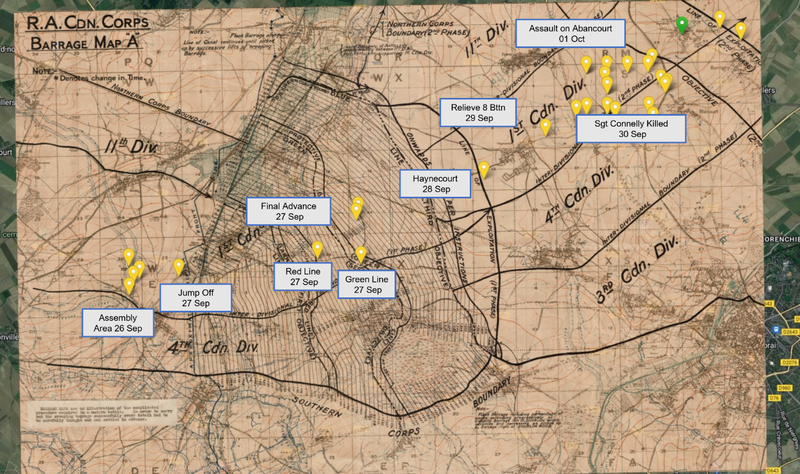

**<u>1st Battalion Progress at Canal du Nord 27-30 Sep
1918</u>**

#### Sancourt British Cemetery

The [Sancourt British
Cemetery](https://www.paulsbattlefieldtours.com/post/sancourt-british-cemetery)
is located Northeast of the village of Sancourt, about 1 km down a
single lane track amongst the fields.

Sancourt has 237 graves, only 20 of which are unknown soldiers. Despite
the name, only 6 British Soldiers are buried here, with the remainder
being Canadians. 71 of Robert’s 1st Battalion join him at
Sancourt.

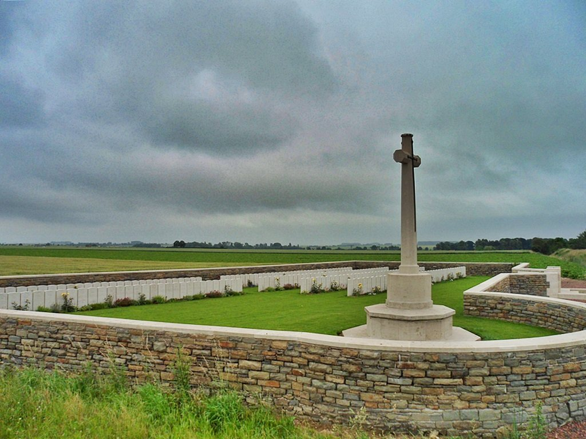

All but 5 of the soldiers were killed during the Battle of Canal du Nord
from 27 September to 01 October 1918. Although Canada’s Last Hundred
Days were very successful, the success came at a high cost.

Robert’s headstone.

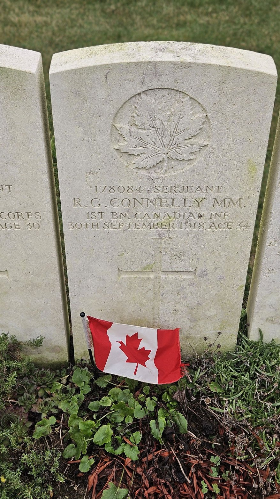

I first visited Sancourt British Cemetery in January 2024. When I
returned in Apr 2024 my entries in the visitor’s log were consecutive,
indicating a quiet cemetery.

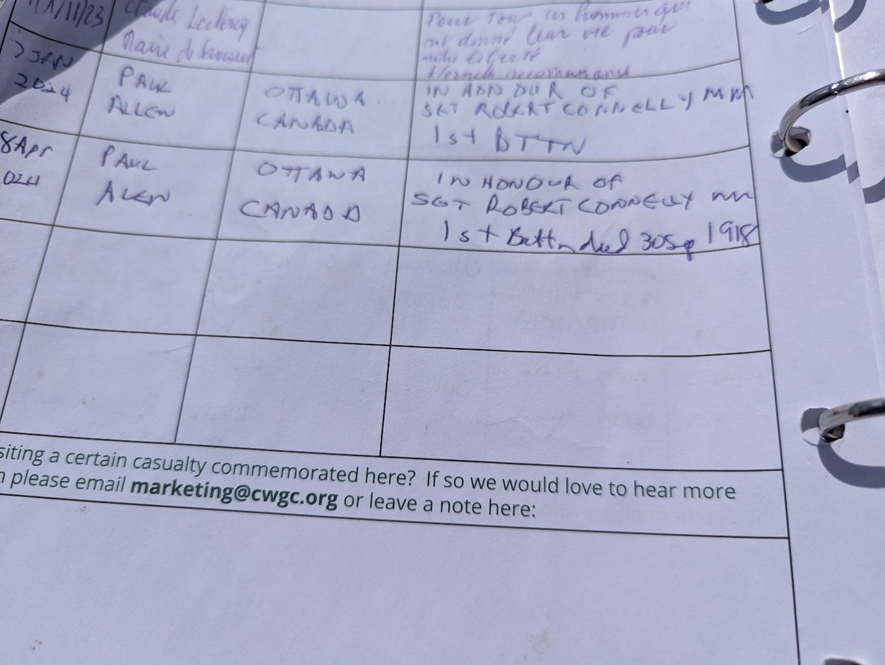

### Frederick Leach and Robert Phillips

A question about a map from a post about the Canadians at Second Ypres
led to the fascinating story of two grandfathers in the Great War. Steve
McKenna contacted me and mentioned his brother-in-law, Andrew Leach, had
spied the village of Wieltje on the map and wanted to chat.

Andrew had a letter from the Platoon commander of his Grandfather Robert
Phillips that referred to action at Wieltje and asked me if I was
interested. Of course, I said yes, and received details of Andrew’s
[Grandfathers Frederick Leach and Robert
Phillips](https://www.paulsbattlefieldtours.com/post/war-stories-of-the-rich-and-famous).

#### Robert Phillips

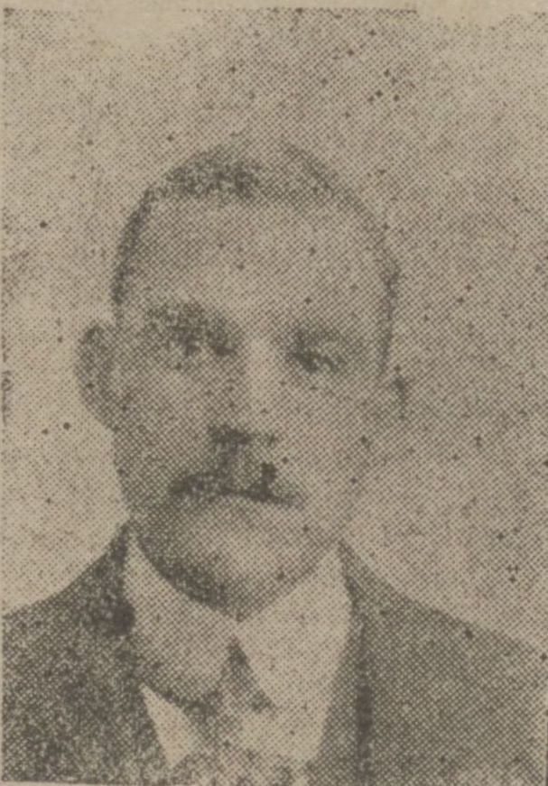

Robert was 31 when he sailed with the Brigade to France on 23 August
1914, indicating he had prior service and was integrated back into the
regular 1st Rifle Brigade. They fought at Le Cateau and the
Battle of the Marne. In 1915, they moved up to Ypres.

#### Battle of Frezenberg 08 MAY 1915

The Rifle Brigade was out of the line from 04 to 08 May and were
advancing when the Germans attacked at Frezenberg. They went into the
new line on 08 May at Mousetrap (Shelltrap) Farm — a group of buildings
surrounded by water, on the high ground north of Wieltje overlooking St.
Julien and the valley of the Steenbeek. The 1st Rifle Brigade is shown
on the left of the map, just before they moved into the front lines.

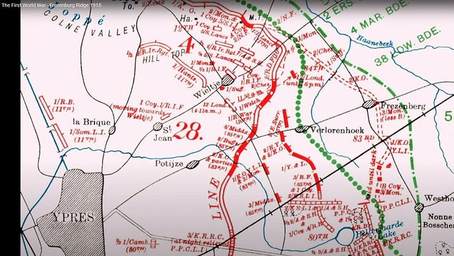

Their position was continually shelled and on 10 May Private Robert
Phillips was killed by an artillery shell. In May 1915 alone, the
Battalion had suffered 487 casualties, killed, wounded, shell-shocked or
missing. Robert has no known grave and is commemorated on Panel 48 of
the Menin Gate at Ypres.

Robert and Lucy had two children Albert, born 21 January 1911 and Violet
Victoria born 22 October 1913. Violet, Andrew’s Mother, never knew her
father and never spoke of him. The War Gratuity document indicated that
his wife Lucy received a little over 9 pounds as a survivor benefit.

Robert’s wife Lucy received a letter from his Platoon Commander after
Robert’s Death. The transcription as well as the original letter are
included in Andrew’s collection.

25 May 1915

Dear Mrs. Phillips

I had been away sick from the company, when I came back and heard of
your husband’s death, I was very much grieved to hear it and more sorry
still for you. He was one of my very best men in the platoon and I was
very fond of him. He was a fine soldier and a brave man and constantly
refused promotion to give younger men a chance. I know he died
absolutely without pain.

The Captain joins me in condolences and praise of your brave husband.

A shell exploded in his trench which was situated north of small village
called Wieltje and killed him instantly. May God help you to bear your
trouble for it is a great loss.

Yours very sincerely

B Gibbs, 2Lt.

#### Fredrick Leach

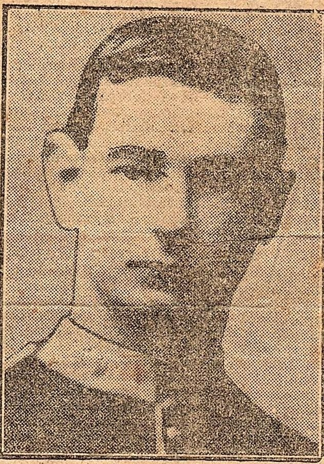

Frederick joined the 1st Battalion Wiltshire Regiment in 1908. The 1911
Census shows Frederick with the Battalion in South Africa. This
deployment lasted until 1913. Upon their return to England, the
Wiltshires were based at Tidworth Camp, Wiltshire. The Wiltshires were
part of the 7th Brigade, 3rd Division and sailed to Rouen on 14 August
1914. Frederick would have been 24.

Frederick fought at the Battle of the Mons, the first action of the BEF,
then at Le Cateau. Although they wouldn’t have known one another,
Frederick’s and Robert’s units fought next to each other at Le Cateau
(see the circles on the map).

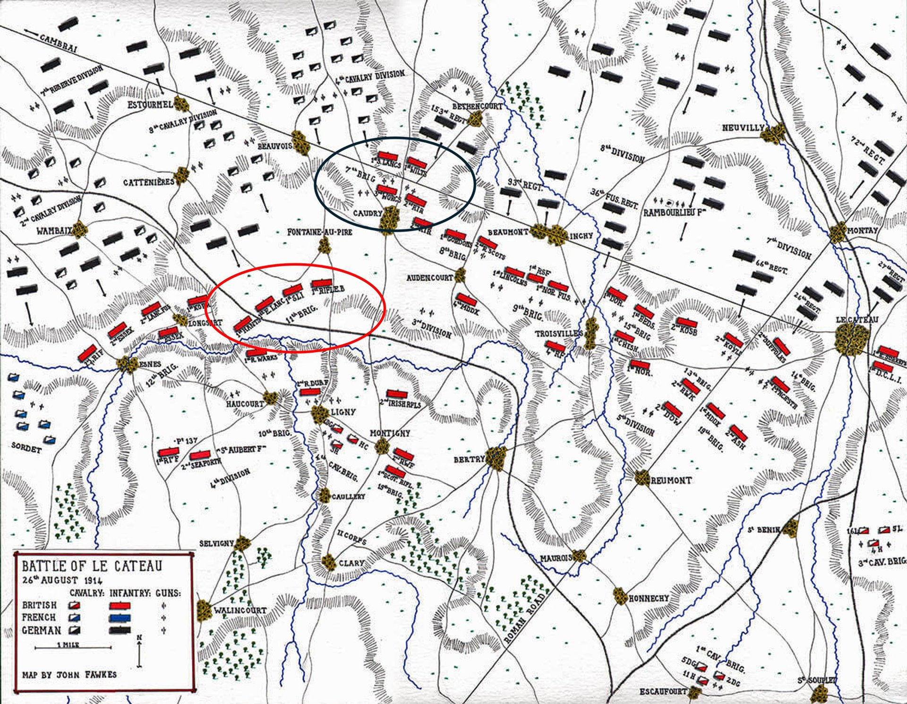

On 31 August 1915, Frederick Leach was awarded the Distinguished Conduct
Medal (DCM) for rescuing a comrade who was buried by a shell explosion.
The DCM citation reads:

*For conspicuous gallantry on the 31st of August 1915, at Hooge. During
the Bombardment of the trenches, a part of the parapet was blown in,
burying a man. Corporal Leach went round the debris across the open
under heavy fire and dug the man out just in time to save his life. He
had previously been brought to notice for his gallant conduct at St
Eloi, where he rallied his men and opened a rapid fire on the Germans
immediately after they had exploded a mine close to our parapet.
(9.10.15)*

Sgt Frederick Leach was honourably discharged from the Army on 11
October 1916 because of Wounds. Frederick had a son Donald born in 1914.

Donald and Violet Phillips had sons Robin (1941, of Lifestyles of the
Rich and Famous fame) and Andrew (1944).

Andrew happened on the letters and other documents while clearing out
his mother’s house or this story would never have been known.

### Newfoundland Grandfathers William Sullivan and Walter Pike

Last fall I did a [Tour of the
Caribou](https://www.paulsbattlefieldtours.com/post/following-the-caribou)
with my good buddies Terry Sullivan and Sandy Cyr, along with Terry’s
Brothers Michael, Brian and Pat, his sister Carol and her husband Rod
Pike. We visited all 5 Caribous in France and Belgium as well as the
places both grandfathers had been wounded.

#### 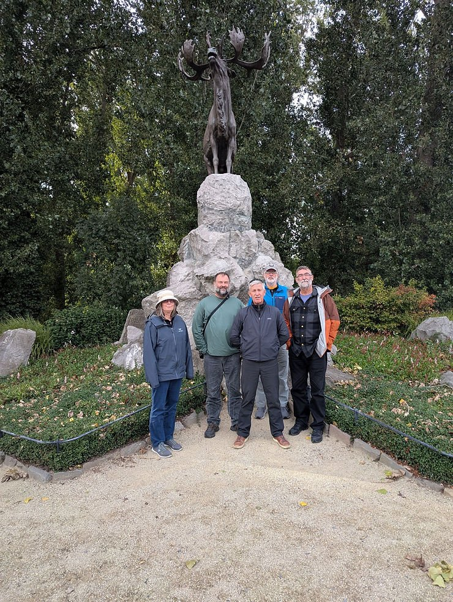

#### 

#### William Sullivan

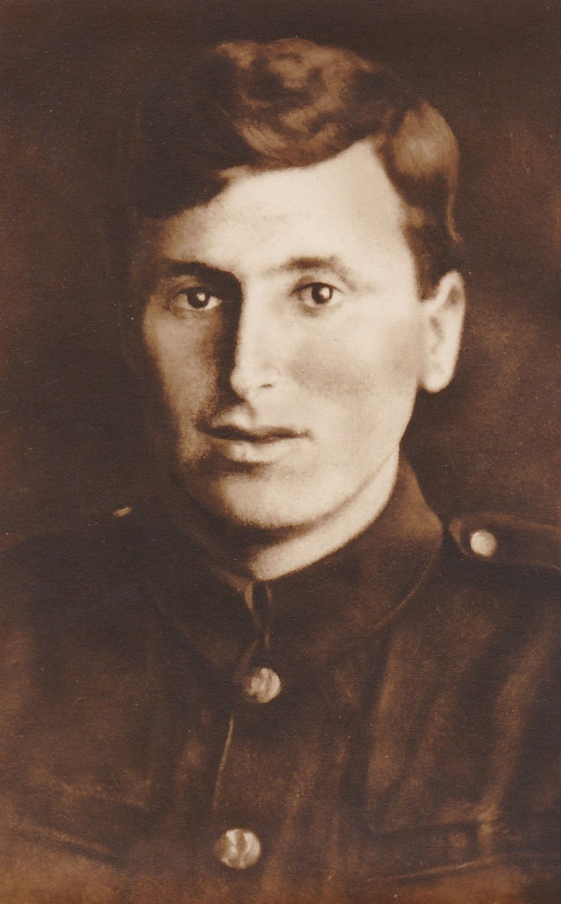

[William
Sullivan](https://www.paulsbattlefieldtours.com/post/corporal-william-sullivan-royal-newfoundland-regiment)
enlisted at St John’s on 24 Mar 1916 at age 23 and spent several months
at the Newfoundland Regiment training area at Pleasantville. Upon
arrival in England, he was sent to the 2nd Battalion (Reserve) in Ayr,
Scotland. After several months in Scotland, William was sent to France,
sailing from Southampton to Rouen on 30 Nov 1916, joining the 1st
Battalion on 12 December 1916, part of a draft of 173 soldiers, bringing
the Regiment strength up to 663 soldiers.

William was fortunate to miss two major, costly battles before joining
the regiment. He missed the 01 Jul 1916 Battle at Beaumont-Hamel where
619 of 721 troops (85 percent loss rate) became casualties. Only 68 men
answered roll call the next day. On 12 October 1916, William also missed
the Battle of Gueudecourt where the Regiment suffered 239 casualties.

On 02 Mar 1917, the Newfoundland Regiment moved into the frontline
trenches at Sailly-Saillsel. The next day the Germans attacked with
fierce hand to hand fighting, at times with both sides occupying the
same trench.

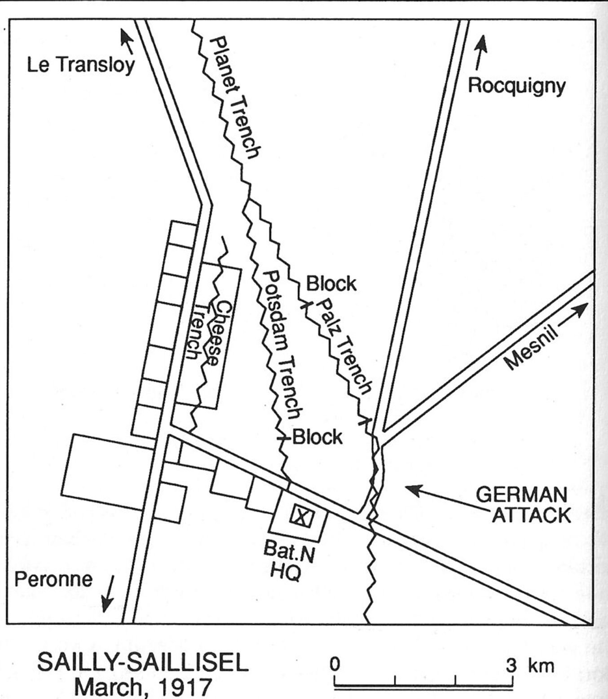

William suffered severe gunshot wounds in the left thigh (two large
wounds in the left thigh and two smaller wounds on the left leg) and
slight wounds on the left arm and forehead. By the time he got to the
hospital his wounds were septic and was diagnosed with Typhoid Fever.

William spent four months in the Wandsworth Hospital, another four
months in the Enteric Depot Convalescent Hospital, London before being
returned to the Newfoundland Regiment Depot in Ayr, Scotland.

William rejoined the 1st Battalion in Feb 1918 and after
another infection, fought with the unit until the end of the war.
William returned to Newfoundland and was demobilized in Apr 1919.

William continued to work at Ryan Brothers until it closed in 1952 and
then became caretaker of the property. William married Rose Hoskins in
1930, and they had three children, William (Bill) – Terry’s father,
Arthur and Lily.

Rose died of cancer on 17 March 1964. William then moved into St. John’s
to live with his son, Arthur, and his family. On 28 April 1978 William
Sullivan died of a heart attack at the Sullivan residence in St John’s.

#### Wallace Pike

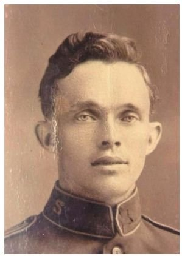

Rod Pike’s grandfather
[Wallace](https://www.paulsbattlefieldtours.com/post/private-wallace-pike-royal-newfoundland-regiment),
enlisted in Apr 1917, at age 17 lying about his age. Wallace wrote a
memoir that is extensively quoted in the post. Wallace’s first action
was at the Battle of Cambrai in Nov 1917.

Cambrai was a key rail hub for German resupply, so the British planned
an assault to break through the heavily defended Hindenburg Line and
take Cambrai. A new approach was taken, the British amassed 476 tanks to
lead the attack.

The tanks were used to crush the extensive lines of barbed wire, and no
preliminary barrage was used in hopes of surprising the Germans. 1,000
guns opened up at 0630 on 20 November and the infantry and tanks
advanced under a creeping barrage. The attack was spectacularly
successful, with advances of more than 5 miles on the first day.

The Newfoundland Regiment took and held Masnieres in heavy fighting.

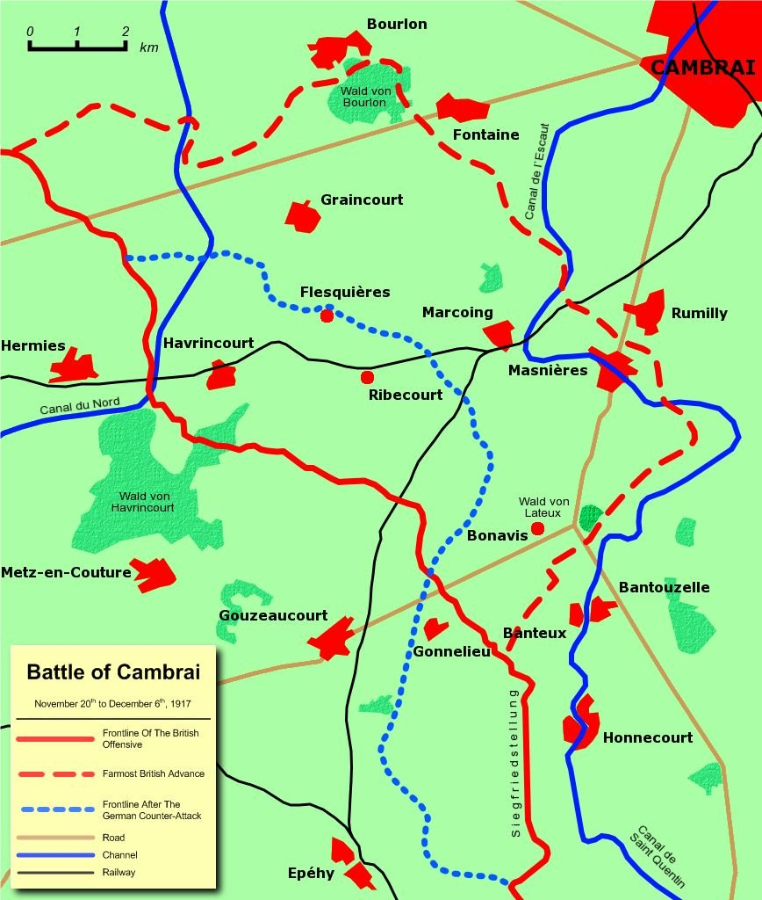

On 30 Nov, the Germans counterattacked and the Newfoundland Regiment led
a bayonet charge to stem the German advance ensuring their
29th Division was the only one that did not collapse on that
day. The Regiment suffered 493 casualties, an almost 80% casualty rate,
second only to the casualty rate suffered at Beaumont Hamel. Wallace’s
introduction to battlefield conditions had taken a heavy toll on the
Regiment.

This battle was the first combat Wallace Pike had seen. He wrote
extensively about the battle in his memoir that Carol and Michael read
in the shadow of the Masnieres Caribou. It was very moving to hear the
first-person account on the ground where it happened.

The initial phase of the German Offensive took place on the Somme in Mar
1918, followed by attacks around Ypres starting on 09 April 1918. The
Royal Newfoundland Regiment had just completed four days in the front
line near Passchendaele and were heading back to the rear when they were
diverted to Nieppe, France and immediately pressed into action.

Wallace, a stretcher bearer, was wounded in the foot by a machine gun
bullet on13 April while rescuing another wounded soldier and spent
nearly a month convalescing before rejoining the Regiment.

During the final advance in Sep and Oct 1918, the Newfoundland Regiment
was advancing rapidly east of Ypres.

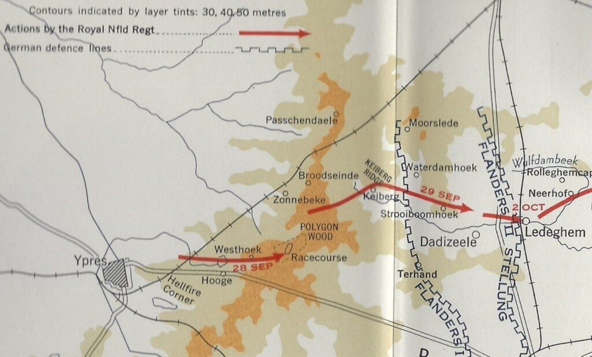

On 02 October near Ledegem, there were no existing trenches, so the
Regiment holed up in buildings. They were shelled and Wallace was hit on
the right hand with a shell fuse cap that subsequently embedded in his
thigh. Wallace was returned to a hospital in England; his war was over.
He returned home in Dec 1918 and served in the Salvation Army for more
than 40 years. When he passed away in 1999, he was commemorated as the
last surviving member of the WWI Royal Newfoundland Regiment.

The Regiment suffered 640 casualties during this final push in September
and October. Of the approximately 6,000 soldiers who served in the
Regiment, almost 3,000 became casualties.

## Norm Christie’s for King and Empire

Norm Christie, an Ottawa Historian and former member of the Commonwealth
War Graves Commission has produced an excellent collection of small
books detailing all the Canadian Action in WWI. The books were spawned
by Norm’s excellent six-part TV series also called [For King and
Empire](https://www.youtube.com/watch?v=JCeDt4SXPZI&list=PLecklOwGnUiq_QJP9u4wr_Jw0hjdnuA0U).

As well as a very good historical account, each book has a tour to
highlight the action. Since the best way to understand the battle is to
walk (or drive) the ground, I followed his books and wrote several
posts. In case you want to go through the Canadian war chronologically,
here is the list:

> [Second Battle of Ypres Apr-May
> 1915](https://www.paulsbattlefieldtours.com/post/canadians-at-second-battle-of-ypres-april-1915)
>
> [Battle of Mont Sorrel Jun
> 1915](https://www.paulsbattlefieldtours.com/post/canadians-at-mont-sorrel-june-1916)
>
> [Battle of Courcelette (part of the Battle of the Somme) Sep
> 1916](https://www.paulsbattlefieldtours.com/post/grandfather-s-war)
>
> [Battle of Vimy Ridge Apr
> 1917](https://www.paulsbattlefieldtours.com/post/vimy-memorial)
>
> [Battle of Hill 70 Aug
> 1917](https://www.paulsbattlefieldtours.com/post/focused-on-lens)
>
> [Last 100 Days - Amiens Aug
> 1918](https://www.paulsbattlefieldtours.com/post/focused-on-lens)
>
> [Last 100 Days – Arras Aug-Sep
> 1918](https://www.paulsbattlefieldtours.com/post/last-100-days-arras-26-aug-1918)
>
> [Last 100 Days – Cambrai Sep
> 1918](https://www.paulsbattlefieldtours.com/post/last-100-days-cambrai-27-sep-1918)

## WWII

### Sgt Norm Kightley

[Norm
Kightley](https://www.paulsbattlefieldtours.com/post/sergeant-norm-kightley-8th-hussars)
married my mother’s sister Marjorie in 1941 before he shipped overseas.

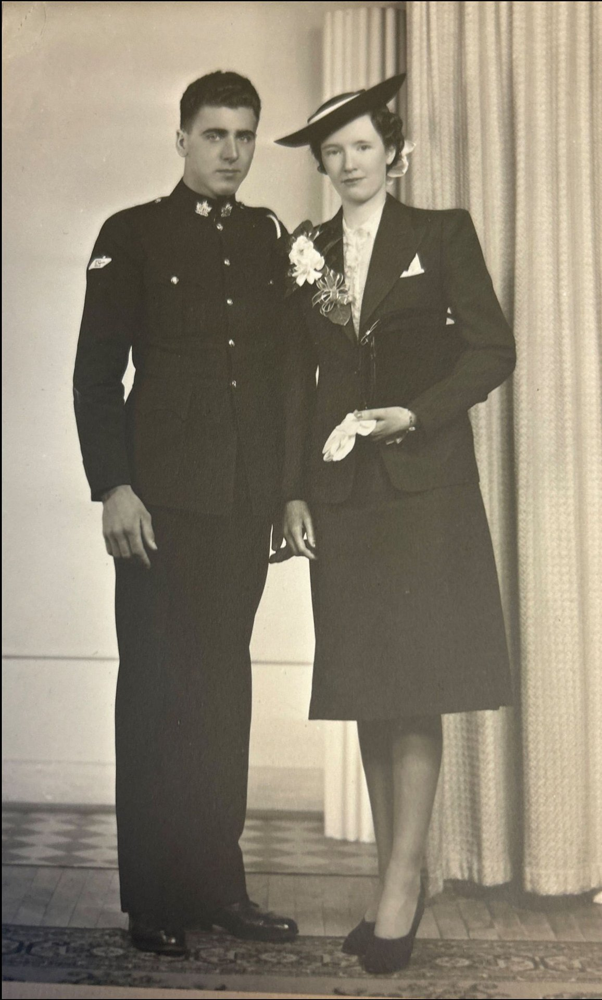

Norm was a tanker, training in Camp Borden then in England before
deploying to Italy as a member of the 8th (New Brunswick)
Hussars in Dec 1943. After a short stay near Ortona, the Hussars fought
in the Battle of Monte Cassino and up the Liri Valley towards Rome.

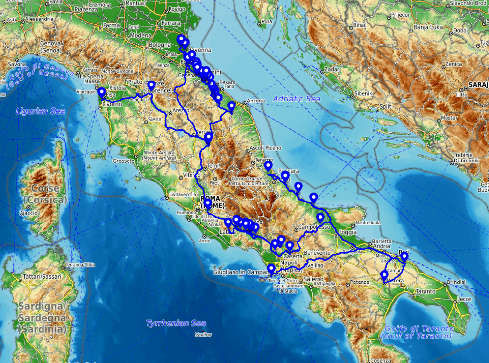

In Aug 1944, they moved over to the East Coast of Italy, working their
way up to
[Coriano](https://www.paulsbattlefieldtours.com/post/breaking-the-gothic-line),
[Rimini and
Ravenna](https://www.paulsbattlefieldtours.com/post/the-river-battles-italy-1944).
My daughter Rachel and I visited the area last Easter and traced Norm’s
Route. The Hussars stayed in Italy until Feb 1945 then were shipped to
Belgium to finish off the war in Europe.

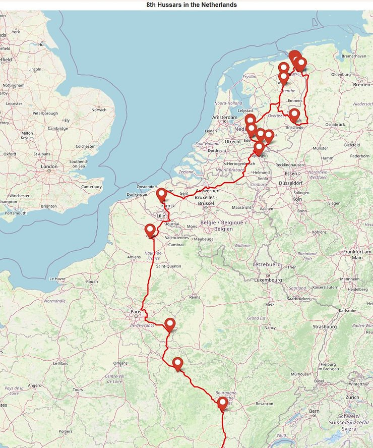

### Great Uncle George Johnston

[George
Johnston](https://www.paulsbattlefieldtours.com/post/uncle-george-johnston),
my maternal grandfather’s brother, enlisted in the Canadian Forestry
Corps in Nov 1942 at the age of 33. He worked cutting trees less than 10
km from his farm until Jul 1944 when he was reclassified to Infantry. He
landed in England in Sep 1944 and joined the Argyll and Sutherland
Highlanders of Canada on 24 Oct 1944 near Bergen Op Zoom in the
Netherlands. In Feb 1945, the Argylls were pushing into Germany at the
Batlle of the Hochwald Gap.

Photo of George’s Unit. He is in the third row, second from the right.

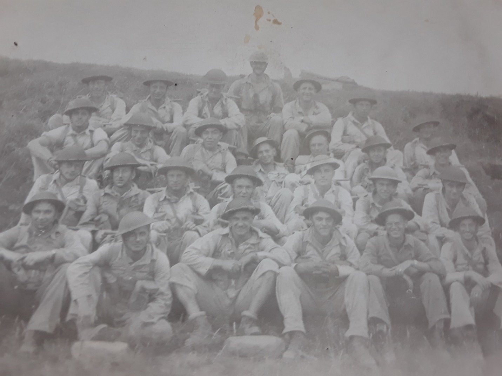

At 0800 on 06 March, the Argylls moved from Sonsbeck towards Veen. The
land was very wet so the tanks were forced to stay on the roads which
were heavily cratered and mined. They advanced with little resistance
until 800 yards from Veen where they faced a storm of small arms,
mortars and artillery fire. They waited until last light then B and D
companies with tanks went forward into Veen. They could make no headway
and were ordered to withdraw, but Capt Perry did not receive the order
and stayed in place.

At dawn they were in shallow pits and dominated by German fire from 3
sides. Movement was impossible and the ammunition used up, so Capt Perry
surrendered his force. A total of 31 members were taken prisoner
including our great Uncle George Johnston.

George spent a little over a month as a Prisoner of war in Stalag XIb in
Fallingbostel before being rescued by the Brits on 16 Apr 1945. He was
returned to England where he spent the last days of the war.

### Uncle Les Allen

My father’s older brother [Les
Allen](https://www.paulsbattlefieldtours.com/post/uncle-les-allen-in-operation-totalize),
enlisted in the Algonquin Regiment in Nov 1941 at the age of 22. The
Algonquins were assigned to Newfoundland in Feb 1942. In Aug 1942, the
Disaster at Dieppe decimated the Royal Regiment of Canada. Of the 554
members of the regiment who embarked on the raid, only 65 returned to
England, an 88% loss rate.

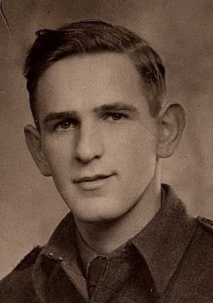

In October 1942, the Algonquin Regiment transferred 157 other ranks to
the Royal Regiment of Canada (RRC), including Uncle Les Allen. He spent
nearly 2 years in the UK and landed in France in Jul 1944 as a Mortar
Crew Chief. The RRC fought several battles in Normandy.

On the night of 07 Aug 1944, the Canadians pushed towards Falaise as
part of Operation Totalize. The Canadians made a daring nighttime
Armoured Advance and the RRC took their objective at Point 122. During
the counterattack, the mortar platoon’s vehicles were all destroyed and
many soldiers wounded including Uncle Les. He met his Scottish wife Jean
while in the hospital and spent the rest of the war in England.

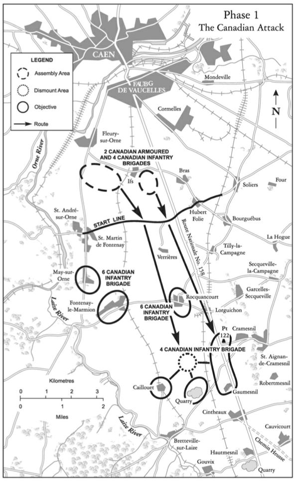

### Private Christopher Cadeau

[Christopher
Cadeau](https://www.paulsbattlefieldtours.com/post/joseph-christopher-raymond-cadeau)
was a cousin to my sister-in-law Marg Columbus (Allen). I was visiting
my brother Kurt and his family in PEI and Marg happened to mention she
had a cousin buried in Belgium. Christopher enlisted in Nov 1943 and
trained as an armoured crew member. He went overseas in Aug 1944 and was
remustered to Infantry to help fill the desperate shortages due to the
heavy losses since D-Day. On 17 October Christopher was sent to Belgium,
and on 24 Oct he joined the Canadian Scottish Regiment. The Canadian
Scottish had been involved in the D-Day landings then the battles
inland.

The Can Scots were in the midst of the Battle of the Scheldt when
Christopher joined the unit. Tragically he was killed on 27 Oct 1944
after only 4 days in combat. The map shows his 4 days around Breskens on
the Bank of the Scheldt Estuary.

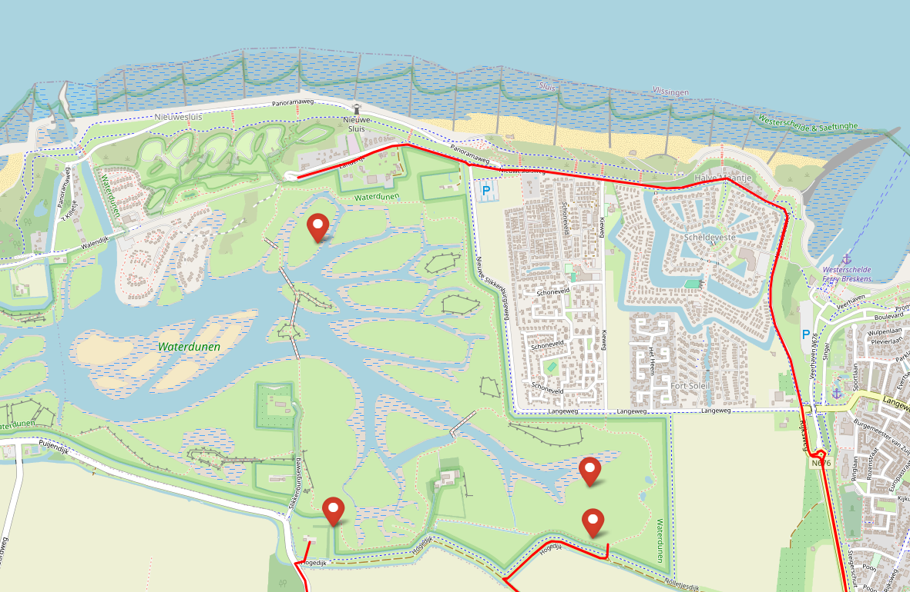

Christopher is buried in Adegem War Cemetery, and we visit him every
year as part of the Canadian Liberation March.

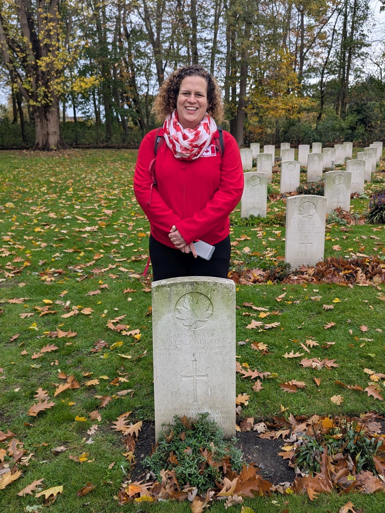

### Private Percy Mervyn

[Percy
Mervyn](https://www.paulsbattlefieldtours.com/post/private-percy-mervyn-at-the-leopold-canal)
was the uncle to my sister Diane’s best friend, Barb Drury. He joined
the Army in Jan 1944, just after he turned 19, went to England in Aug
1944 and was assigned to the 3rd Division Royal Winnipeg
Rifles on 19 Sep.

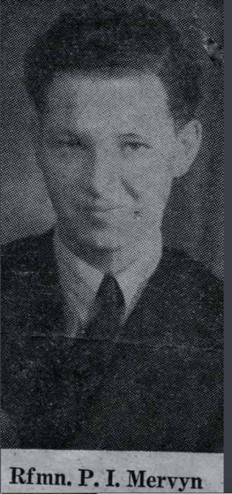

Percy joined the RWR in time for the clearance of Batterie Todd, a gun
emplacement south of Calais with massive guns capable of firing 380 mm
shells over a 55 km range, so able to hit the port of Dover in the UK.

The RWR then moved up to the Leopold Canal. After several days of fierce
fighting, the Winnipegs crossed the canal and held on to a tiny
bridgehead despite constant shelling and counter attacks.

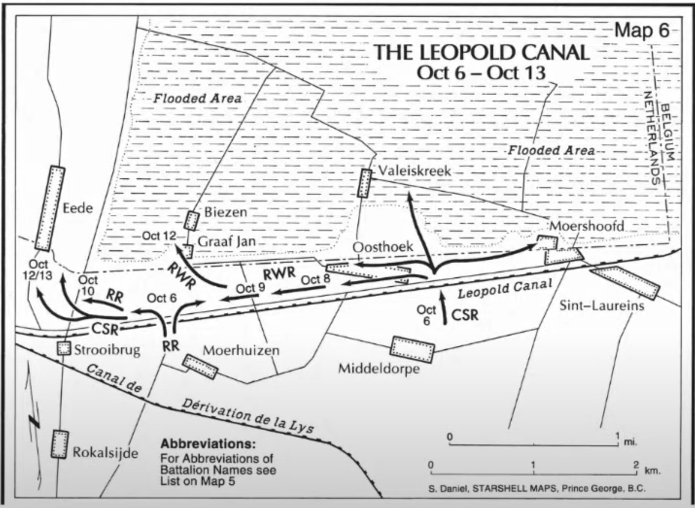

Private Percy Mervyn was one of the numerous casualties who was killed
on 10 October. The details of his death are not known, but there were
many ways to die in this bitter conflict. Like so many of his comrades,
Percy was thrown into combat and was killed three weeks after joining
the Royal Winnipeg Rifles.

Percy is buried in the Adegem Cemetery just south of the Leopold Canal.
We visit the cemetery as part of the Canadian Liberation March each
November and stop by to pay our respects.

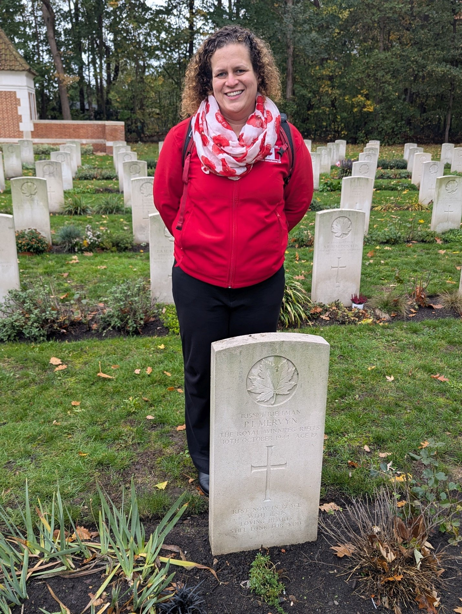

### John Scholte

[John (Jan)
Scholte](https://www.paulsbattlefieldtours.com/post/john-scholte-and-the-dutch-princess-irene-brigade)
is the Dutch grandfather to my good buddy Sandy Cyr. John was born in
1907 in the Netherlands. He left home at 18, moved to Canada, got
married and had two children when the Second World War broke out. A
photo of John and Anna after John had enlisted.

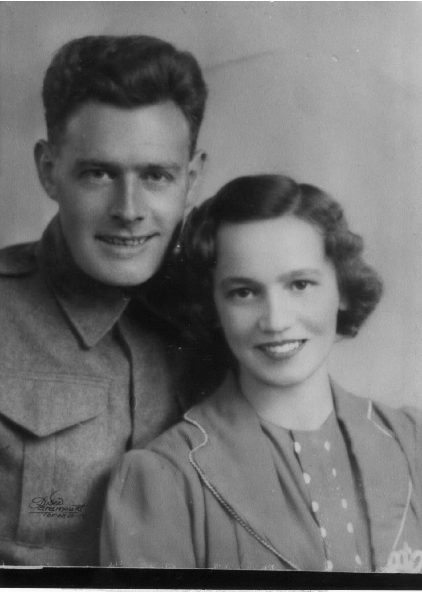

All Dutch citizens were obligated to join the Dutch army so John
enlisted on 19 March 1941, just before his 34th birthday. He
sailed to England in Jun 1941 then was sent to Suriname where he stayed
until Dec 1943. The unit returned to England then went to Normandy in
Aug 1994 as part of the Dutch Princess Irene Brigade. The Irene’s served
mainly under Canadian command and fought their way through France and
Belgium before finally participating in the Liberation of the
Netherlands.

My daughter Rachel and I visited several of the memorials in the
Netherlands. The memorial at Beringen is at the location where the
Bailey Bridge crossed the Albert Canal.

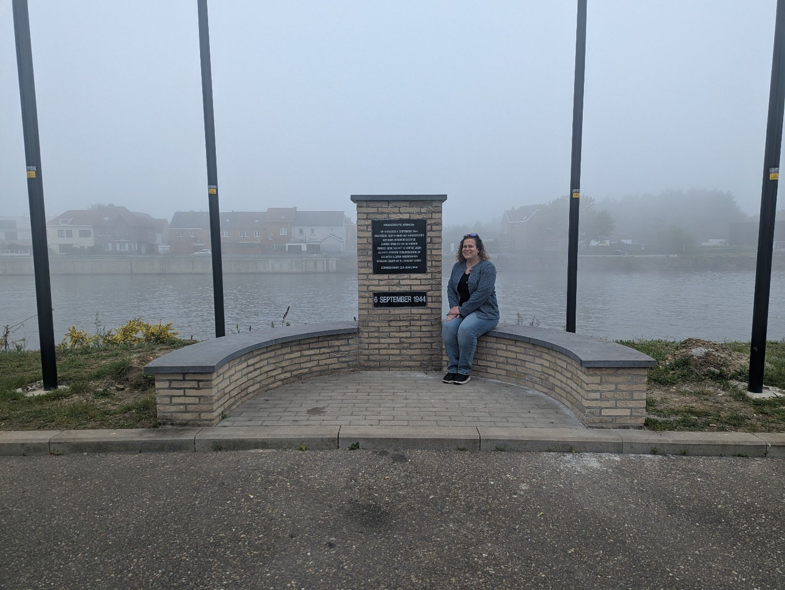

After the war, John visited his parents for the first time since leaving
the Netherlands in 1925, then returned to Canada, living the remainder
of his life in the Toronto Area.

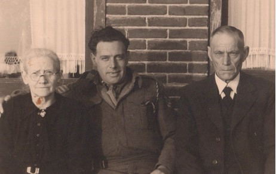

# Travel

I’m often asked which country is my favourite from all of my visits and
I usually answer whichever was most recent. Putting aside the awesome
visits I have had to many Canadian First and Second World War
battlefields, I think my current top visits list includes Malta,
Slovenia and Gdansk.

## Malta

We stayed in the magnificent capital city of
[Valletta](https://www.paulsbattlefieldtours.com/post/historic-malta).
The construction of Valletta began immediately after the Great Siege of
1565. The massive walls (up to 30 m thick in places) were built first,
then the city was laid out in a grid form with several wide streets for
ventilation and transport of troops. The city is built of limestone, and
the buildings were built with flat roofs and underground cisterns to
store water. They also dug extensive tunnels under the buildings, to
provide a safe escape in case of invasion. A view of Valletta from Fort
St Elmo to the city Centre.

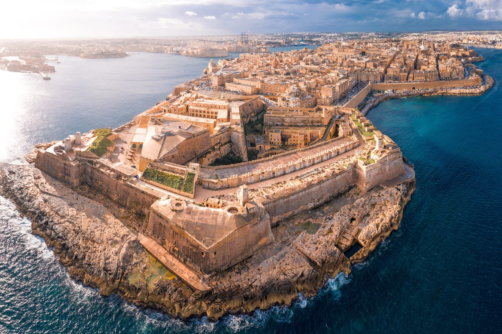

Malta was the most heavily bombed country in the [Second World
War](https://www.paulsbattlefieldtours.com/post/the-siege-of-malta) and
the city of Valletta was largely left in ruins. After the war, they
rebuilt the city in limestone so most buildings look like they have been
there since 1565. The island of Malta is largely covered in limestone
with some areas being more than 100 m deep. Limestone is one of the few
natural resources on Malta so it made sense to rebuild using the same
materials.

Ancient temples of giant stones are more than 5,000 years old. The
ancient city Mdina was first occupied in the 8th century BC,
and the medieval city from the 11th century remains largely
intact today.

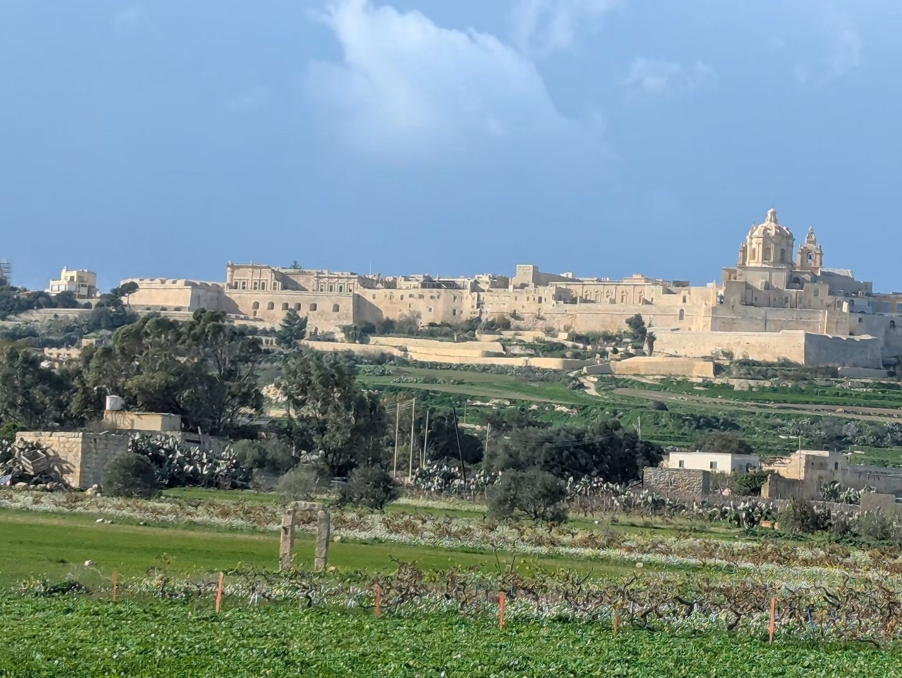

Everywhere we went there was great architecture and wonderful history
and I’d love to spend more time on this beautiful island chain.

## Slovenia

[Slovenia](https://www.paulsbattlefieldtours.com/post/remind-me-where-slovenia-is)
is also frequently vying for top spot on my must visit list. Slovenia
has been inhabited for more than 60,000 years and like most places in
the Mediterranean/Adriatic occupied by many different cultures. For a
small country, the geography is remarkably varied, from the Venice
inspired coastal town of Piran to the mountains bordering Italy and
Austria, to the caves and castles, to the plains near Ljubljana and of
course the picturesque Lake Bled. And of course, there were lots of cool
[WWI
battles](https://www.paulsbattlefieldtours.com/post/slovenia-in-wwi)
between Italy and Austria-Hungary along the Isonzo (or Soca) river.

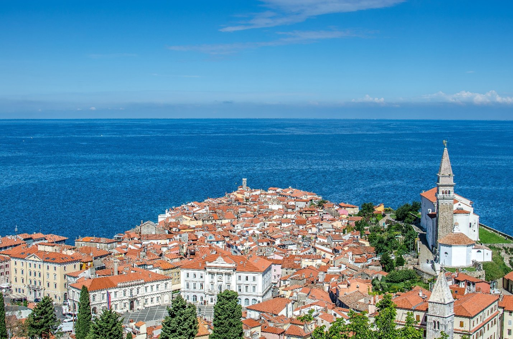

Postojna Cave System is the most popular tourist attraction in Slovenia,
with over 1 million Visitors a year. The cave system was discovered in
the 17th century although it had been in use since medieval times.
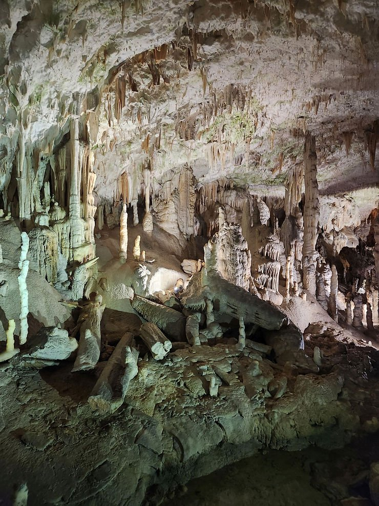

One of the coolest things we did is spend the night in a modern chalet
that was inspired by the traditional cattle herder cottages. We had to
take a gondola then a chair lift to the chalet.

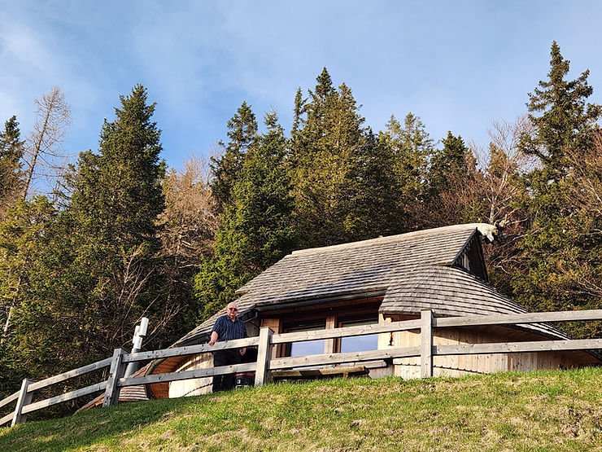

Lake Bled is the most photographed site in Slovenia and a trip to the
island church is essential.

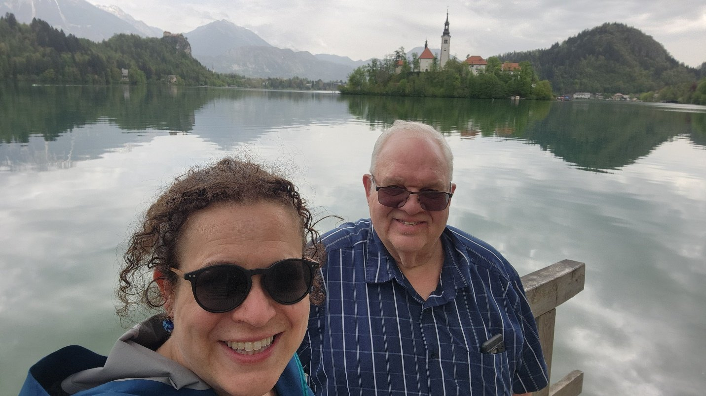

## Gdansk

Our recent visit to
[Gdansk](https://www.paulsbattlefieldtours.com/post/gdansk-the-first-shots-of-the-second-world-war),
Poland was another highlight. It has been a key port on the Baltic Sea
since the 10th Century due to its natural harbour and the
Vistuala River system which provides a route throughout Poland. On the
surface, Gdansk looks like a standard Dutch/Flemish influenced Medieval
town with tall, narrow houses.

Gdansk was almost totally destroyed during the Second World War and
ancient plans and paintings were used to faithfully rebuild the downtown
area.

The first shots of the Second World War were fired in Gdansk on 01 Sep
1939. Rachel in front of the Westerplatte memorial.

# Acknowledgements

## Commenters

I must recognize my sister Dale as my most consistent commenter. With
only minimum sibling pressure she has commented on almost all of my
posts. She also helped with the research of the soldiers, pre and post
war. My brother Kurt and fellow history buff and battlefield traveler
Wine Bob are runners up in the commenter category. Thank you all for all
of your time and attention. Now is the time to step up and challenge
Dale!

## Vimy Centre

I received a comment from the Vimy Centre on one of my [Rachel
Posts](https://www.paulsbattlefieldtours.com/post/rachel-tours-arras).
I’ve done several posts on Vimy, talking about the monument, the
sculptures and the amazing ground, but the comment was an
acknowledgement of the shout out for the Lego model of the Vimy Memorial
in the Visitors centre. I figured it was probably from the poor beggar
who actually had to build it!

> *In the display area, they have a Lego model of the Vimy Memorial.
> Very impressive, the model uses 11,285 bricks, the exact number of
> names listed on the memorial. The model took more than 200 hours to
> build.*

It is a remarkable structure (both the Lego and Real versions) and well
worth a visit!

## Canadian Memorials and Liberation of the Netherlands

My two posts, [Canadian Memorials in the
Netherlands](https://www.paulsbattlefieldtours.com/post/canadian-memorials-in-the-netherlands)
and [Canadian Liberation of the
Netherlands](https://www.paulsbattlefieldtours.com/post/canadian-liberation-of-the-netherlands)
got way more views than normal. I hope its because there is not a handy
list of Canadian Memorials anywhere and I spent a bunch of time
researching and visiting the memorials while following my relatives
throughout the Netherlands.

In Apeldoorn, the only official Canadian memorial in the Netherlands,
the Man with Two Hats Statue resides. The man is holding a hat in each
hand, raised in a gesture of celebration or gratitude. The two hats
symbolize the dual connection between the Netherlands and
Canada—liberation and remembrance, celebration and sorrow, and the
geographical bridge between the two nations. It also represents the "joy
of liberation" and eternal gratitude of the Dutch people to the
Canadians who helped free them from Nazi occupation. There is an
identical statue at Dow’s Lake in Ottawa. I visited the Ottawa statue
with my good buddy Jim Pickell in May 2022. Two men with two hats, but
the sentiment is clear!

\
Canadian Liberation March
--------------------------------------------------------------

I have done three posts on [the Canadian Liberation
March](https://www.paulsbattlefieldtours.com/post/canadian-liberation-march-november-2025)
that the Military Personnel and the teachers at Rachel’s school in the
Netherlands participate in. It is a 33km march with multiple stops for
memorial ceremonies. The Dutch and Belgian people like a good hike and
normally more than 2,000 people make the full trek, with many more (like
me) doing a part of the route.

This journey traces the steps of the First Canadian Army, during the
Battle of the Scheldt, which played a critical role in clearing German
defenses and reopening access to the port of Antwerp, an essential
supply route for the Allies.

This post is popular because Rachel passes it to her colleagues so the
newbies can know what to expect and many people send it to the folks
back in Canada to acknowledge the importance of the march.

I always tease Rachel that the posts with her in them gets more views,
but the posts with her buddy and fellow marcher, Christine and Rachel
get way more views!

\
Pfc James Loterbaugh
-----------------------------------------------------------------------------------------------------------

Recently I did a post about [Pfc James
Loterbaugh](https://www.paulsbattlefieldtours.com/post/pfc-james-loterbaugh-us-army),
US Army. I happened to be visiting the beautiful US Cemetery at
Margraten, about 15 minutes from Rachel’s place on a beautiful day in
November just before heading back to Canada.

While I was there, I noticed a workman drilling a hole next to James’
name on the wall of the Memorial to the Missing. When a missing soldier
is identified, the US places a rosette beside their name to indicate
they have been found.

When I went back in the Spring, James’ Rosette was in place and I wrote
the story.

Just after the US Memorial Day this year, I received a number of
comments, first from people in James’ hometown then from his family
members. It is extremely gratifying to have a post reach his family. One
person said they used my post to give a Memorial Day talk about James’
journey and a family member sent me a picture of James’ grandson who
accompanied his remains to his final resting place in the Dayton
National Cemetery.

# Final Thoughts

Thank you all very much for coming along on my tours. Rachel is in her
last year in Europe so I have one more cycle of tours left and hopefully
many new places to explore.
