# Bomber Command Casualties Venray Cemetery

# Introduction

In preparation for the [Rededication
Ceremony](https://www.paulsbattlefieldtours.com/post/venray-cemetery-burial-rededication)
at Venray Military Cemetery, I looked at the Canadians buried in the
cemetery since all of the service records of the Canadian fallen are
readily available on the Library and Archives Canada Website. There was
a crew from the Canadian 426 Squadron that I particularly wanted to take
a look at. I like looking at Aircrew, the unit diaries list every person
on every flight, so it is possible to follow every mission they flew.
You can get a feeling of the operational tempo, flying conditions and
the variety of missions flown. While I was at the cemetery, I looked for
grouped headstones that usually means a bomber crew buried together.

There has also been extensive research on the crew and aircraft, so many
details of the crash and crew dispositions are often available.

For NP771 from 426 Squadron for example, the following websites have
details:

1.  International Bomber Command Centre

    1.  <https://losses.internationalbcc.co.uk/loss/206014/>

2.  Air Crew Remembered

    1.  <https://aircrewremembered.com/goreham-rodney-shand.html>

3.  Canadian Air Serials Personnel Information Resource

    1.  <https://caspir.warplane.com/personnel/unit-search/p/600004134>

4.  Aviation Safety Network

    1.  <https://aviation-safety.net/wikibase/49719>

I looked at all of the Canadians who flew the missions, their locations,
age and progress through the British Commonwealth Air Training Plan
(BCATP). The size, scale and the speed with which the plan was set up in
Canada is most impressive.

The BCATP was a large-scale multinational military aircrew training
program created by the United Kingdom, Canada, Australia and New Zealand
during the Second World War. The BCATP remains one of the single largest
aviation training programs in history and was responsible for training
nearly half the pilots, navigators, bomb aimers, air gunners, wireless
operators and flight engineers who served in the Commonwealth Air
Forces. More than 150 training schools were established to train more
than 130,000 aircrew in Canada. Many people consider the BCATP to be
Canada’s most important contribution to World War II.

There is a Jewish proverb that states:

> *"A man is not dead while his name is still spoken."*

In order to honour the fallen, I am speaking some of the names of Bomber
Command aircrew from Venray cemetery.

# 426 Squadron Halifax Mk VII NP771 - 01 Nov 1944

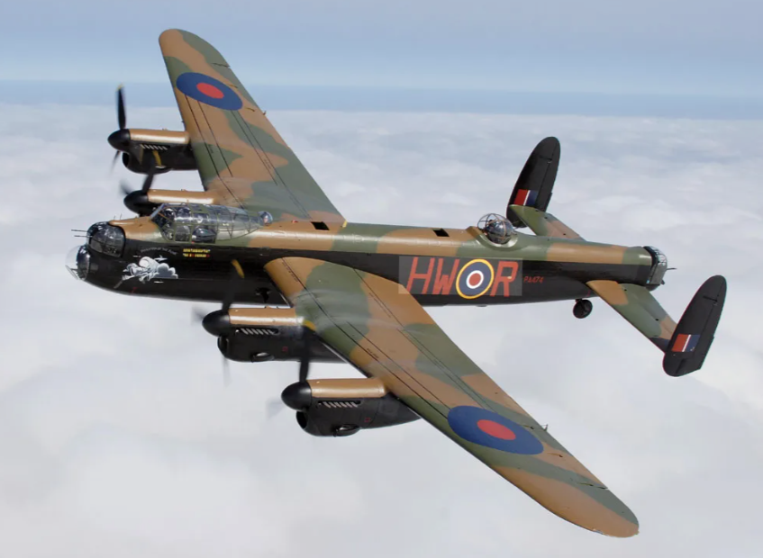

## Crew

> Pilot: Pilot Officer R S Goreham RCAF J/88475 \[PoW\]\
> Flight Engineer: Sergeant Ronald Charlton RAFVR 1594899 \[Killed\]\
> Navigator: Pilot Officer Ernest Edward Courtis RCAF J/92724
> \[Killed\]\
> Bomb Aimer: Pilot Officer Allister Currie McLeod RCAF J/95367
> \[Killed\]\
> Wireless Operator / Air Gunner: Pilot Officer James Frederick
> Gladstone Weedon RCAF J/95498 \[Killed\]\
> Mid-Upper Gunner: Sergeant W E Morrison RCAF R/188162 \[PoW\]\
> Rear Gunner: Pilot Officer Andrew George Balfour RCAF J/95200
> \[Killed\]

The crew positions in the Halifax:

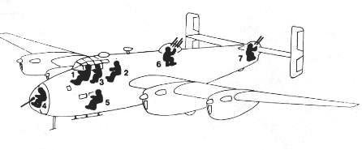

**Aircrew Positions**\
**1**. Pilot,\
**2**. Navigator,\
**3**. Flight Engineer,\
**4**. Bomb-aimer,\
**5**. Wireless Operator,\
**6**. Mid Upper Gunner,\
**7**. Rear Gunner.

The crew had been posted into 426 Squadron from Base 61 where they had
completed their operational training. They were one of 10 crews posted
to 426 Squadron in September. 1944. They completed 8 missions from 27
September to 28 October before this final flight.

## Flight

Halifax NP771 took off from RAF Linton-on-Ouse, North Yorkshire at 17:23
hrs for a bombing operation against Oberhausen in Germany. 288 aircraft
were involved in the raid with 4 losses (1.4%). The target was
cloud-covered and bombing was scattered resulting in little damage to
the target. On the return trip, NP771 was shot down by a twin-engined
night fighter. Three separate German pilots claimed the kill and
according to the survivor testimony, the aircraft was hit multiple
times.

## Crash

The tail section was hit first, causing the aircraft to dive and likely
killed the rear gunner. The pilot regained control and ordered the crew
to bail out. The aircraft was hit for a second time below the pilot,
then a third time in the mid-section where the crew was preparing to
bail out. With the remaining crew either dead or severely wounded the
Pilot and Mid Upper Gunner were able to bail out, and both were taken
prisoner. A letter from the pilot to Andrew Balfour’s mother stated that
he and the Mid Upper Gunner were blown free of the aircraft and managed
to open their parachutes despite both being wounded.

The plane crashed 1.5 km south of Tienray at map reference qe861218
(Latitude **51.4838 °**\
Longitude: **6.09707)**

Mrs. Verlinden of Eikelenbosch, Horst, who together with three
daughters, witnessed the crash of this aircraft and provided the
following information:

> *On the 1st of November 1944, the aircraft was seen flying
> very low, apparently in trouble, when it suddenly dived and hit the
> ground at the above position. No explosion took place but the aircraft
> burned fiercely. In Mrs Verlinden’s house as well as in the one of her
> brothers about a kilometer away, German soldiers from a Flak Unit were
> billeted. Mrs. Verlinden and her family were not allowed to leave the
> house. The Germans, however, went over to the crashed aircraft,
> removing, everything of value which included rings, wrist watches,
> footwear and even uniforms. Five practically intact bodies were buried
> by Mrs. Verlinden’s son - in their shirts and nothing else.*

Tienray is only a few kilometres from Venray Cemetery, so I visited the
crash site after the ceremony. There is no marker here but according to
the map reference, the aircraft crashed in a field at the edge of a
woods. The field is down a few country lanes that are used mainly by dog
walkers who took a dim view of a car driving down their road. Visiting
the crash site makes me feel close to the crew even though there is no
sign of the crash remaining.

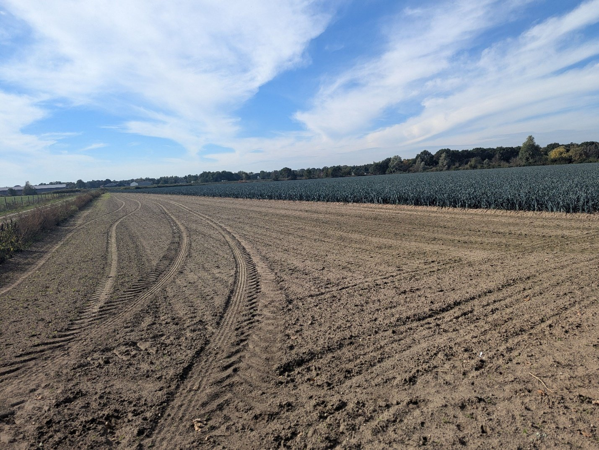

## Burial

After the war, the bodies were reinterred in Venray Cemetery.

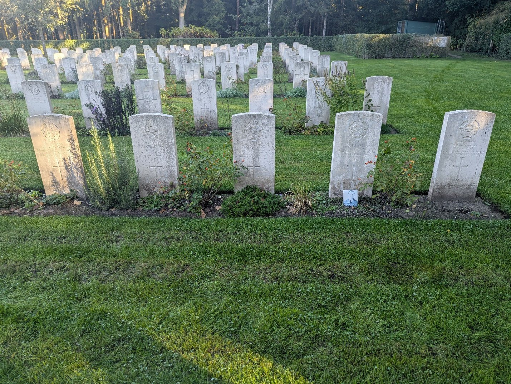

**Wireless Operator / Air Gunner: Pilot Officer James Frederick
Gladstone Weedon RCAF**

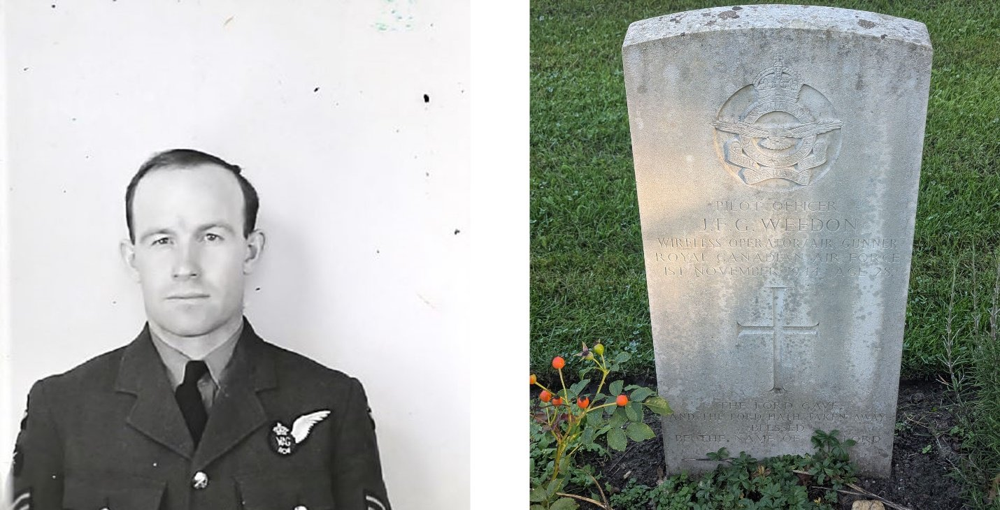

James Weedon was born on 07 June 1916 in Paddockwood, SK and enlisted in
February 1943 at \#3 Manning Depot in Edmonton at the age of 26. He
briefly attended \#7 Service Flight Training School in Fort Macleod, AB
in March 1943 and then was reassigned \#3 Wireless School in Winnipeg,
MB before being posted to \#5 Bombing and Gunnery School in Dafoe, SK in
January 1944 to complete his Wireless Operator/Air Gunner Training. He
landed in the UK in April 1944 and conducted additional training before
joining 426 Squadron on 11 September 1944.

**Flight Engineer: Sergeant Ronald Charlton RAFVR** 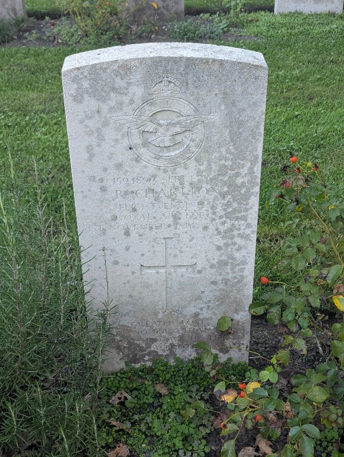

**Bomb Aimer: Pilot Officer Allister Currie McLeod RCAF** 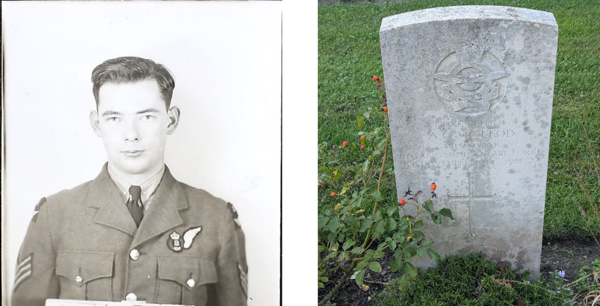

Allister McLeod was born on 26 October 1922 in Balmoral MB and enlisted
in \#2 Manning Depot Brandon, MB on 09 November 1942 at the age of 20.
He attended \#3 Wireless School in Winnipeg MB in February 1943.
Allister then converted to pilot training attending at \#12 Service
Flight Training School in Brandon MB in April 1943 and \#7 Initial
Flight School in Saskatoon, SK in May 1943. He did not successfully
complete flight training and subsequently attended \#5 Air Observer
School in Winnipeg MB in October 1943 then \#7 Bombing and Gunnery
School in Paulson, MB in November 1943. He completed his Bomb Aimer
training at \#4 Aircrew Graduate Training School in Valleyfield QC in
Jan 1944. He landed in the UK in April 1944 and after additional
training arrived on 426 Squadron on 11 September 1944.

**Rear Gunner: Pilot Officer Andrew George Balfour RCAF** 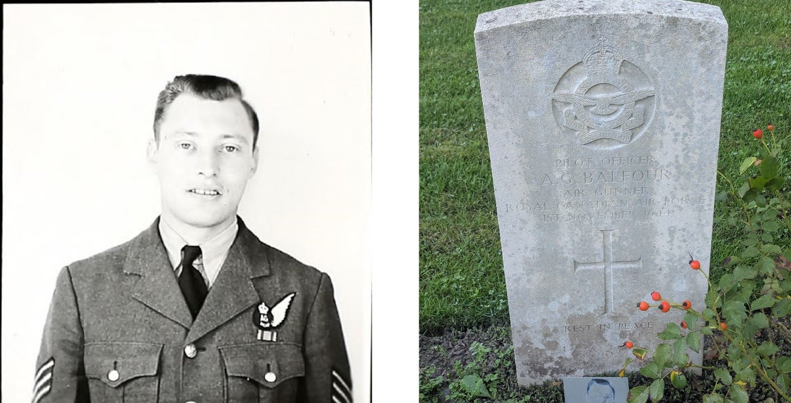

Andrew Balfour was born on 25 September 1920 in Guelph, ON and enlisted
in June 1941 as a security guard at the age of 20, serving mostly in
Trenton, ON. In October 1943, he transferred to Air Gunner attending \#9
Bombing and Gunnery School in Mont Joli, QC in November 1942 then \#4
Aircrew Graduate Training School in Valleyfield, QC. He arrived in the
UK in April 1944 then after additional training, joined 426 Squadron on
11 September 1944.

**Navigator: Pilot Officer Ernest Edward Courtis RCAF**

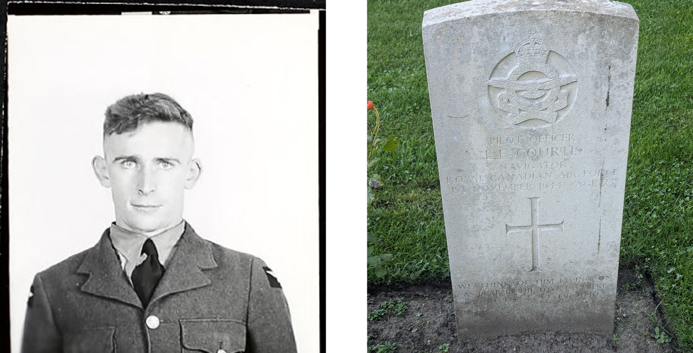

Ernest Courtis was born on 06 June 1921 in Wallaceburg, ON and enlisted
in London, ON in July 1942. He started pilot training in January 1943 at
\#13 Service Flying Training School in St Hubert, QC, progressing to \#3
Initial Training School in Victoriaville, QC in February 1943 then \#11
Elementary Flying Training School in Cap de la Madeline, QC in March
1943. He did not successfully complete pilot training so was
reclassified as a Navigator and attended \#4 Air Observer School in
London ON in June 1943 and \#1 Operational Training School, Bagotville,
QC before being sent to the UK in April 1944. After additional training
he joined 426 Squadron on 11 September 1944.

On 03 July 1943 Ernest married Jean Mowers in Harwich, ON.

# 15 Squadron Lancaster LM465 – 13 June 1944

While looking for the crash site for NP771, I looked on the Traces of
War website to see if there was a memorial. There wasn’t one for NP771,
but just down the road was a memorial to Lancaster LM465, so of course I
took a look.

## Crew: -

> Pilot : Pilot Officer Carlton Stewart Thompson RCAF J/86074
> \[Killed\]\
> Flight Engineer : Sergeant Maurice Bernard Pelham RAFVR 1890440
> \[Killed\]\
> Navigator : Warrant Officer Class II Roderick McMillan RCAF R/143734
> \[Killed\]\
> Bomb Aimer : Warrant Officer Class II Ronald George Lemky RCAF
> R/162667 \[Killed\]\
> Wireless Operator : Flight Sergeant Jack Melville Trend RAF 1397945
> \[Evaded\]\
> Mid-Upper Gunner : Sergeant Thomas Edward Stubbs RAFVR 1805250
> \[Killed\]\
> Rear Gunner : Sergeant Richard Sidney Mobbs RAFVR 1874047 \[Killed\]\
> \
> All except Flight Sergeant Trend lie at the Jonkerbos War Cemetery,
> Netherlands (51.822371 / 5.830618).
>
> The crew completed 18 missions between 01 March 1944 and the crash of
> their 19th Flight on 13 Jun 1944.

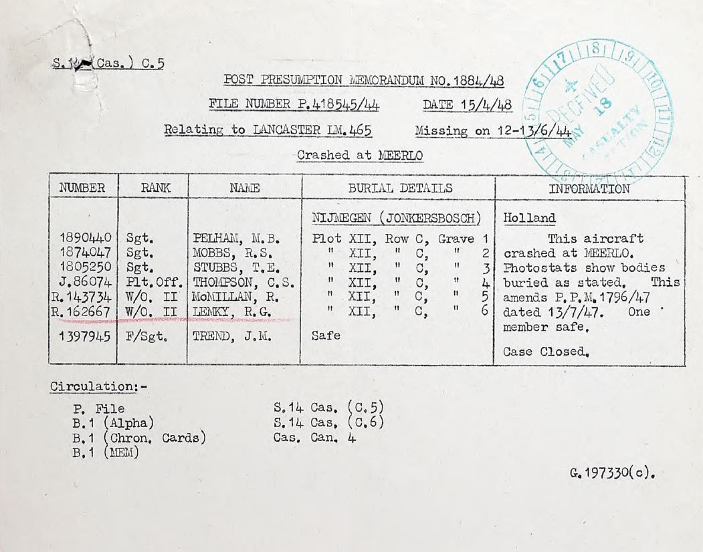

The records of the Canadian servicemen are available, so a brief
biography is provided.

### Pilot Officer Carleton Thompson

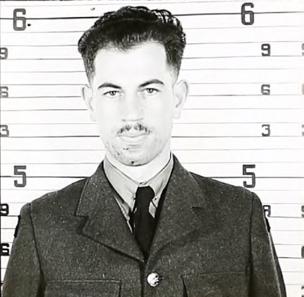

Carlton was born on 26 September 1917 at Wells, Michigan, USA. He
enlisted on 27 November 1941 (while the United States was still neutral)
and embarked from Halifax for the U.K. on 4 January 1943. He arrived in
the U.K. at 3 PRC on 13 January 1943 and then went through 18(Pilot)
Advanced Flying Unit at RAF Church Lawford on5 April 1943, 82
Operational Training Unit at RAF Ossington flying Wellington Bombers on
20 July 1943, 1651 Heavy Conversion Unit at RAF Waterbeach 22 October
1943 and 15 Squadron 2 January 1944.

### Navigator Roderick McMillan

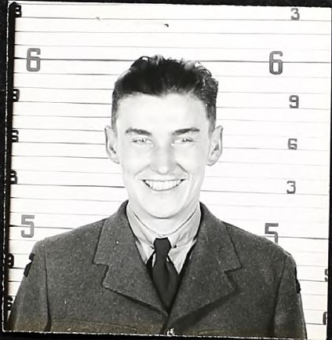

Roderick was born in Victoria, BC and initially enrolled in the RCAF as
a pilot in December 1941. At \#12 Elementary Flying School in Goderich,
ON he washed out as a pilot, and retrained as a Navigator. He trained at
\#4 Air Observer School in London, ON before shipping off to the UK in
January 1943. He spent another year in training before joining 15
Squadron in January 1944.

### Bomb Aimer Ronald Lemky

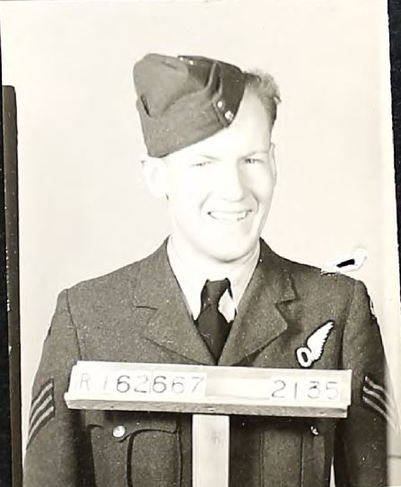

Ronald Lemky was born in Saskatoon, SK and enlisted in the RCAF in April
1942. Ronald initially trained as a pilot at \#11 Initial Flight School
in Yorkton before being remustered to Air Bomber and training at \#2
Bombing and Gunnery School in Mossbank, SK. He continued training in the
UK in June 1943 before joining 15 Squadron in January 1944.

## Flight

Lancaster LM465 took off from RAF Mildenhall at 23:15 hrs on 12 June
1944 for a bombing operation against the Nordstern synthetic oil plant
at Gelsenkirchen in Germany. 303 aircraft took part in the raid, with17
losses (6.1%). The first non-communications related raid in some time.
This raid was to target the Nordstern synthetic oil plant at
Gelsenkirchen, which was close enough to England to allow the new,
improved Oboe marking to be used, with great accuracy. Early bombing was
exceptionally accurate but as time progressed, the smoke from the raid
obscured the target and bombing became less accurate as a result. The
German report states that all production ceased at the plant with the
loss of 1000 tons of aviation fuel output per day. The report also
states that 1500 tons of bombs fell in the compound.

At 0115 on 13 June, the aircraft was intercepted and shot down by night
fighter pilot Unteroffizier Gustav Sarzio of the 6. /NJG 1, who was
flying a Bf 110 G-4 from Deelen airfield; crashing 2 km SW of Meerlo in
the Dutch Province of Limburg. All who died taken to Venlo., since then
their remains have been reinterred in Jonkerbos War Cemetery.

## Flight Sergeant Trend - Evasion Story

Twenty-one-year-old F/Sgt. Jack Melville Trend was the wireless operator
of Lancaster LM465 and the only survivor of the crash. After bailing out
he landed near Meerlo. Soon after he contacted members of the Dutch
resistance who took him to Arcen. From this town he went via Horst to
Griendtsveen (or America) where he stayed four days. It was here that he
joined F/Lt. Erasmus Wardzinsky. On 17 June (or 18 June) Trend was
escorted by bicycle to some straw huts in the middle of a forest, the so
called ‘sanatorium’. This was Kamp 'Dennenlust' in the woods south of
Moorsel near Lierop. Here he joined about fifteen Dutchmen who hid for
the Germans as they didn’t want to go to Germany to work and some other
airmen. According to his own briefing report Trend met here F/Sgt. R.H.
Punter (E0507), F/Sgt. E. Grisdale (E0506), F/Sgt. Roger Gardner (E0441)
and F/Sgt. S. Sparkes (E0451). At a later moment they were joined by
F/O. Dennis F. Walker (E0494) and Sgt. Ed Shimmons (E0492) of the RAF
and Sgt. W.C. Kinney (E0370) and 2/Lt. H.F. Cooper (E0368) of the USAAF.
They remained in the camp until 7 July.

On this date most of the above men - at least Grisdale, Punter, Trend
and Gardner - left the ‘sanatorium’ and were taken to the farm of Family
Poels in Amerika. The next day they were taken to the railway station of
Venray and installed in a small hut next to the station. Via Venlo they
travelled to Sittard. Here they walked to a three-storey house opposite
the hospital, where they would hide for about three weeks. They were
escorted by a man on the train to Roermond. After arriving here, he took
the two to a house on the outskirts and told them they would cross the
Maas River that night. They emerged from the house in the early hours of
the morning and walked for about two hours before arriving at the bank
of the river. They swam to the other side and then walked to the village
of Roggel. Their escort brought them to a large country mansion and
left.

The following morning, they moved to a small thin hut in a nearby wood.
There followed, according to Grisdale, ‘a series of miserable moves,
where we slept rough in an orchard containing quite foul apples and
pears. We also crept into a chicken house near Hunsel’, They now had
joined up with six other allied airmen evading capture. A smuggler
helped them across the Dutch Belgian border and handed them over to
three or four Belgians who led them to 'a hole in the ground' where they
hid for the remaining of the night and until late in the evening of the
next day. After being released from the hole the airmen were led to a
small brick barn close to Kinrooi.

The group was taken further south to a wood near Ellan. Here they were
told that they could join a group of Belgian partisans. Hunter, Grisdale
and Gardner decided to do so. Their first task was to guard a railway
bridge near Rothem, preventing the Germans to blow it up. After a few
quiet days a German detachment turned up which resulted in an intense
firefight. The Germans eventually withdrew and Grisdale, Gardener and
Punter survived. They returned to the main camp of the partisans. After
a few more days they decided to try to reach the Allied lines on their
own. After a few more days Grisdale, Punter, Trend and Gardner contacted
American troops near Rothem in the evening of 12 September 1944.

## Lancaster LM465 Memorial

The 'Lancaster Monument' in Meerlo (municipality of Meerlo-Wanssum) is
an aluminium plate originating from the crashed bomber. Text, including
the names of the victims, and an image of the aircraft have been
inscribed on it. The plate is housed in a weather-resistant cabinet.

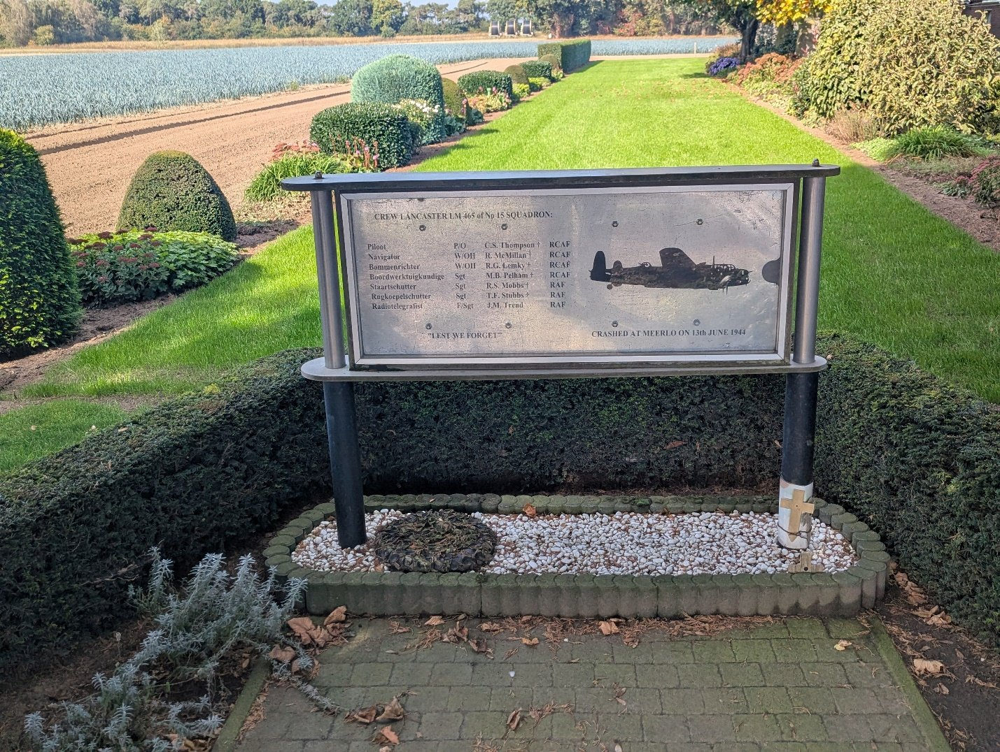

The 'Lancaster Monument’ was erected in memory of the British crew of a
Lancaster bomber that crashed here on the night of June 12–13, after
being attacked by a German night fighter.

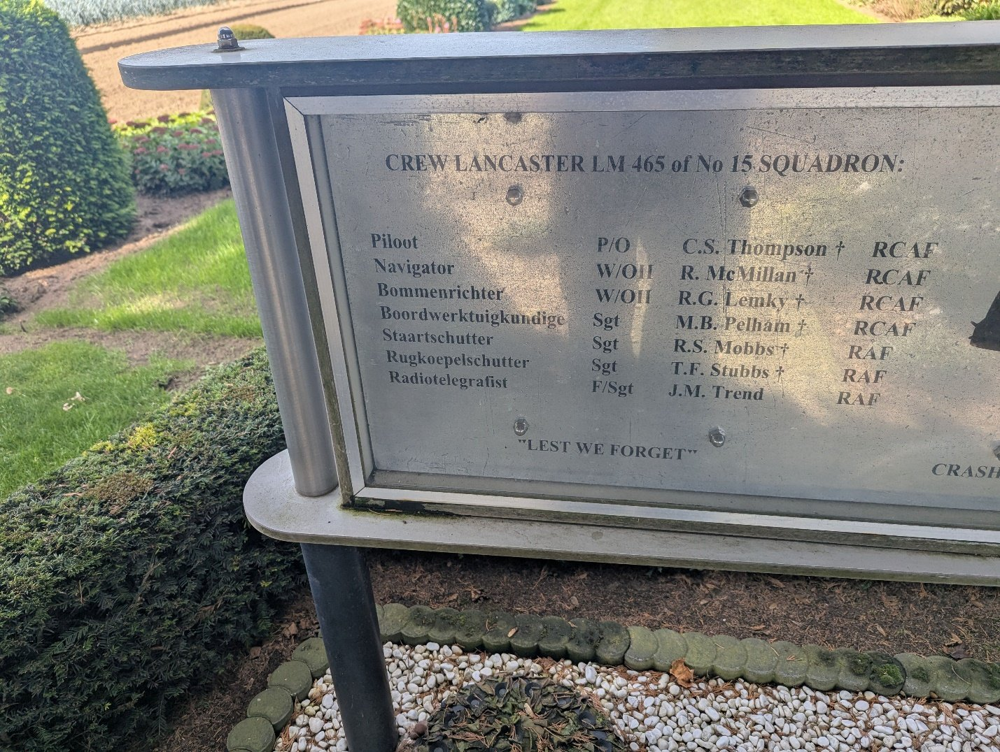

Six of the seven crew members lost their lives in the crash: American
pilot Carl Thompson (27 years old), Canadian navigator Roderick McMillan
(25 years old), Canadian bomb aimer Ronald Lemky (23 years old), British
turret gunner Tom Stubbs (20 years old), British flight engineer Duke
Pelham (20 years old), and tail gunner Dick Mobbs (20 years old). The
21-year-old British radio operator Jack Trend survived the crash.

The Lancaster LM 465 LS-U of the RAF's 15th Squadron was ordered to
participate in an attack on the Nordstern Synthetic Oil Refinery in
Gelsenkirchen. The seven-man crew departed from Mildenhall Air Base in
Suffolk, England, at 23:15 on June 12 and set course for the Dutch
coast. Everything proceeded smoothly until the aircraft was suddenly
attacked by a German night fighter around 01:00. The inner starboard
engine and the middle section of the fuselage were so severely damaged
that pilot Carl Thompson gave the order to abandon the aircraft. The
Lancaster crashed shortly thereafter onto a piece of farmland near
Meerlo in Limburg. Six of the seven crew members did not survive; their
bodies were recovered and transferred to the Roman Catholic Cemetery in
Venlo. Radio operator Jack Trend managed to reach safety at the nearest
farmhouse. There, he received help from the local resistance. Three
months later, he was able to return to his base in England. After the
liberation, the remains of the victims were reburied at the British
Military War Cemetery Jonkerbos near Nijmegen.

## Monument Establishment

At the initiative of the Van de Winkel-Vissers family, Messrs. Ad van
Zandvoort, Arnold Holl, and René Poels united in a committee with the
aim of creating a lasting memorial to this event. According to them,
with the erection of this monument, the community of Meerlo renders a
great service not only to Jack Trend and the family members of the
fallen soldiers, but also to all other liberators who fell in the
municipality. 'They risked their lives for our freedom. The unveiling of
this monument is a gesture from our generation to those who did not
survive the war,' stated the committee.

The monument was unveiled on June 7, 2008, by RAF war veteran Jack
Trend. He had been campaigning for the erection of a memorial for
several years. Representatives of the Royal Air Force's 15th Squadron
were also present at the unveiling.

After the unveiling, the monument was blessed by the English priest Ref.
Tim Wright.

The monument is in a very serene setting in the side yard of the
farmhouse, with the field in the background.

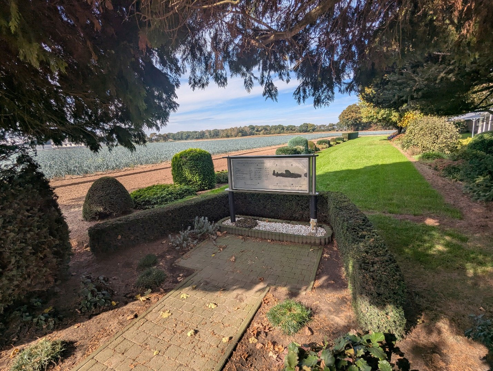

# 408 Squadron Halifax Mk VII- NP781 – 24 December 1944

Crew:\
Pilot: Flying Officer William Henry Dunwoodie RCAF J/88187 \[PoW\]\
\
Flight Engineer: Pilot Officer William Bruce Allan RCAF J/95205
\[Killed\] Son of William and Catherine Allan of Welland Ontario Canada.
Age:21\
\
Navigator: Flight Lieutenant Walter Louis Friker RCAF J/13140
\[Killed\]\
\
Bomb Aimer: Flying Officer David Garfield Kellar RCAF J/38411 \[Killed\]
Son of George Robison Kellar and Ethel Blanche Kellar of Stoney Creek
Ontario Canada. Husband f Mary Kellar. Age:28\
\
Wireless Operator / Air Gunner: Pilot Officer Donald Clifford Tonkin
RCAF J/95500 \[Killed\] Son of Harry P. and Marjorie B. Tonkin of
Toronto Ontario Canada. Age:20\
\
Mid-Upper Gunner: Flight Sergeant Joseph Alcide Chiasson RCAF R/37475
\[PoW\]\
\
Rear Gunner: Pilot Officer Gerald Roch D'Amour RCAF J/95221 \[Killed\]
Son of Anthony and Luce Damour of Ottawa Ontario Canada. Age:19

The crew had completed 4 missions prior to their crash.

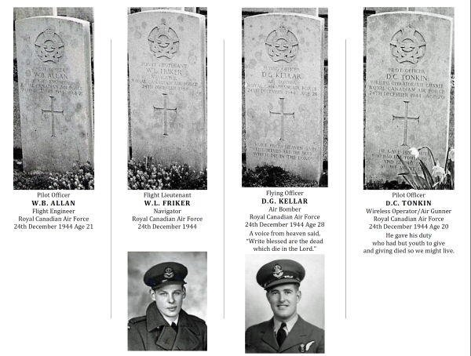

### Flight Engineer William Allan

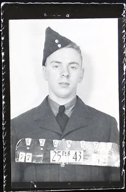

William Allan was born in Welland, ON on 11 April 1923 and enlisted in
the RCAF in November 1942 in Hamilton, ON. In June 1943 he commenced
pilot training attending \#3 Initial Training School in Victoriaville,
QC then \#11 Elementary Flight Training School in Cap de la Madeliene in
September 1943. He did not successfully complete pilot training so
remustered to Flight Engineer. He attended the Technical Training School
in St Thomas, ON in November 1943 and completed his training at \#4
Bombing and Gunnery School, Fingal, ON, \#4 Aircrew Graduate Training
School in Valleyfield, QC. He arrived in the UK in June 1944, completed
additional training before joining 408 Squadron on 11 November 1944.

### Navigator Walter Fricker

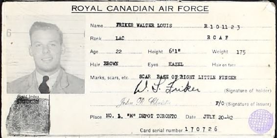

Walter Fricker was born in Victoria, BC on 15 December 1918 and enlisted
in the RCAF in April 1941 at \#2 Manning Depot, Brandon, MB. In July
1941 he trained as a pilot, attending \#2 Initial Training School in
Regina, SK, followed by \#2 Elementary Flying Training School in Ft
William, ON in August 1941 and \#13 Service Flying Training School in St
Hubert, QC in October 1941. He was not successful in his pilot training
and was remustered to Navigator. In March 1942 he attended \#1 Air
Observer School in Malton, ON, then \#1 Air Navigation School in Rivers,
MB in August 1942. He was posted to \#9 Air Observer School in St Jean,
QC in September 1942 and remained there as an instructor until December
1943. He arrived in the UK in January 1944 where he completed additional
training before joining 408 Squadron on 11 November 1944.

### Bomb Aimer David Kellar

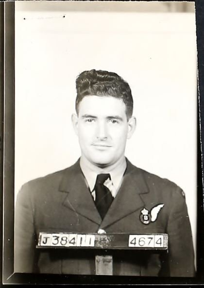

David Kellar was born in Hamilton, ON on 05 June 1916, and enlisted in
the RCAF in June 1942 at \#1 Manning Depot, Toronto ON. He had married
Mary Morris on 30 August 1940. He trained as a pilot first at \#9
Service Flying Training School at Centralia, ON starting in January
1943. He was not successful on the course and remustered to Bomb Aimer
Training at \#1 Bomb and Gunnery School in Jarvis Ontario in June 1943.
In December 1943 he attended \#1 Air Observer School in Malton, ON and
in January 1944 \#3 Aircrew Graduate Training School in Trois Rivieres,
QC. He arrived in the UK in April 1944 and completed additional training
before joining 408 Squadron on 11 November 1944.

### Wireless Operator/Air Gunner Donald Tonkin

### 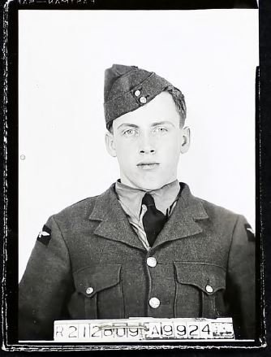

Donald Tonkin was born in Toronto, ON on 29 July 1924 and enlisted in
the RCAF in December in 1942 at \#1 Manning Depot in Toronto at the age
of 18. He attended \#18 Pre Aircrew Education Detachment at Queens
University in Kingston, ON in May 1943 to improve his academic skills
before attending \#4 Wireless School in Guelph, ON in June 1943. In
January 1944 he attended \#1 Bombing and Gunnery School in Fingal, ON
then \#31 Operational Training Unit in Debert, NS in February 1944. He
arrived in the UK in April 1944 and completed additional training before
joining 408 Squadron on 11 November 1944.

### Air Gunner Gerald D’Amour

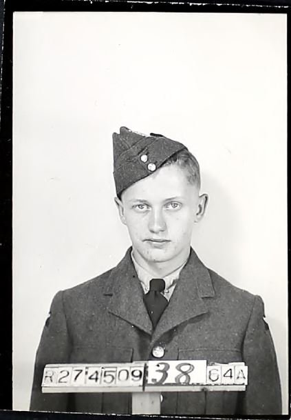

### 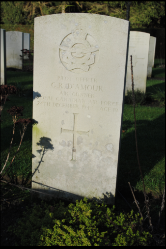

Gerald D’Amour was born in Montebello, QC on 05 March 1925 and enlisted
in the RCAF in September 1943 in Ottawa, ON at the age of 18. He
attended \#18 Pre Aircrew Education Detachment at Queens University in
Kingston, ON in October 1943 to improve his academic skills before
attending \#10 Bombing and Gunnery School in Mount Pleasant, PEI in
December 1943. He attended the \#4 Aircrew Graduate Training School in
Valleyfield, PQ in March 1944. He arrived in the UK in May 1944 and
completed additional training before joining 408 Squadron on 11 November
1944.

## The Crash

Halifax B.VII NP781 ("BQ-U") of 408 (Goose) Squadron, RCAF, lost on
operations on Christmas Eve 1944: Airborne at 11:34 on 23/12/1944 from
Linton-on-Ouse to attack the Luftwaffe Airfield at Düsseldorf-Lohausen
Airport, which was believed to be a key supply point for the German Army
offensive in the Ardennes. The Halifax was brought down by flak/AAA at
Stürzelberg, North-Rhine Westphalia. Five of the seven crew were killed.
Those killed are buried in the Venray War Cemetery, Limburg,
Netherlands.

The Pilot, Flying Officer Dunwoodie stated the aircraft was hit with
flak and he was blinded. He issued the command to bail out, but could
not locate any other crew members. He reported that he and Flight
Sergeant Chaisson were blown out of the aircraft, managed to open their
parachutes despite being wounded, and both were taken prisoner.

The aircraft exploded and was widely scattered. Ground reports from the
local Chief of Police indicated it was not possible to identify the
remains. The remaining crew was originally buried in Sturzelberg,
Germany, then transferred to the American Cemetery in Margraten in two
coffins before being transferred to Venray Military Cemetery in 3
coffins as Flying Officer D’Amour’s body had been identified. Four of
the crew were buried in a communal grave. Only Flying Officer D’Amour
was identified and buried in a separate Grave.

# 78 Squadron Halifax Mk III – LK838 – 04 November 1944

Flying Officer Edwin Love, pilot of LK838, is the only crewmember with a
known grave. Flight Sergeant Roach was taken Prisoner of War after
bailing out. The other crewmembers are commemorated on the Runnymede
Memorial to the missing aircrew, in the UK.

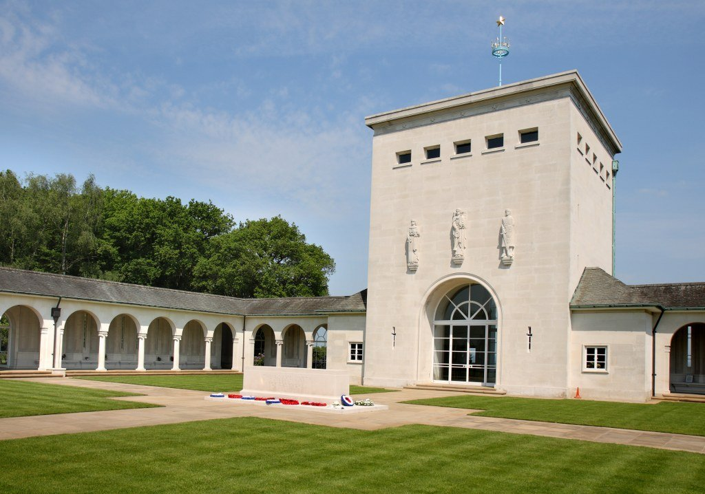

## Crew

> Pilot / F/O. E.A. Love J/27205 RCAF / Venray War Cemetery (the
> Netherlands)\
> Flight Engineer / Sgt. G.F. Harding 1691596 RAF / Runnymede Memorial\
> Navigator / F/Sgt. C.D. Evans 1492815 RAF / Runnymede Memorial\
> Bomb Aimer / F/O. K.B. Brooks J/26706 RCAF / Runnymede Memorial CWGC:
> 28 Sqdn\
> Wireless Operator / F/Sgt. K.C. Collins R/206087 RCAF / Runnymede
> Memorial\
> Mid Upper Gunner / F/Sgt. N.F. Jodrell R/217129 RCAF / Runnymede
> Memorial\
> Rear Gunner / F/Sgt. A.J. Roach R/198169 RCAF / prisoner of war

The Crew had completed 6 missions before their crash on 04 November
1944.

### Pilot Edwin Love

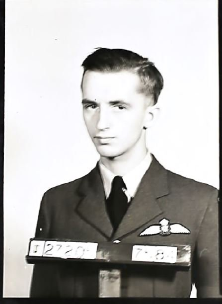

Edwin Love was born on 12 May 1923 in Chatham, ON and enlisted in the
RCAF in April 1942, just before his 19th birthday. He trained
at \#7 Elementary Flying Training School in Windsor, then at \#2 Service
Flying Training School in Uplands, ON before being posted to the UK in
October 1943. He completed further training in the UK including
transition to the Halifax before arriving at 78 Squadron on 14 Sep 1944.

The plane crashed near Siersdorf, Germany close to the Netherlands
border. Love’s body was retrieved fairly quickly by US forces and
temporarily buried in Margraten Cemetery near Maastricht. He was
reinterred in Venray Cemetery in November 1946.

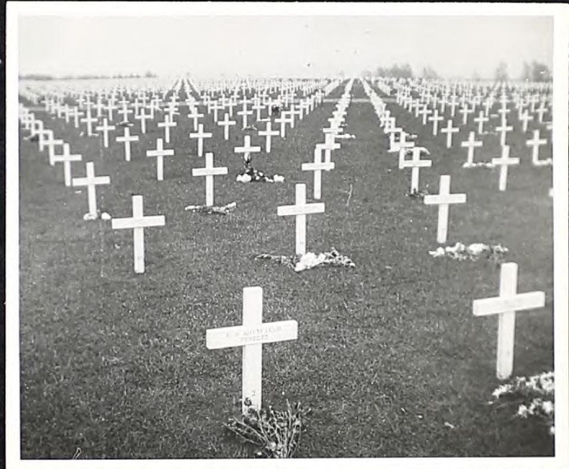

### Bomb Aimer Keith Brooks

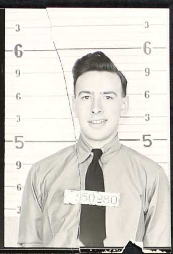

Keith Brooks was born on 02 April 1922 in Stony Plain, AL and enlisted
in Mar 42 at the age of 19. He initially trained as a pilot at \#5
Elementary Flying Training School at High River, AB. He did not solo in
the required time, his landings were unsafe and he demonstrated little
talent as a pilot so was reclassified as a Bomb Aimer and trained at \#1
Bombing and Gunnery School at Jarvis, ON. He arrived in the UK in August
1943 and underwent further training before joining 78 Squadron on 14 Sep
1944.

### Wireless Operator Keith Collins

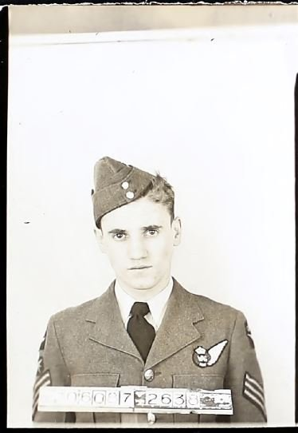

Keith Collins was born on 07 April 1924 in London, ON and enlisted in
the RCAF in November 1942 at the age of 18. He trained as a Wireless
Operator/Air Gunner at \#2 Wireless School in Calgary, AB and \#6
Bombing and Gunnery School in Mountainview (Trenton) ON. He arrived in
the UK in February 1944 and underwent further training before joining 78
Squadron on 14 September 1944.

### Mid Upper Gunner / F/Sgt. N.F. Jodrell

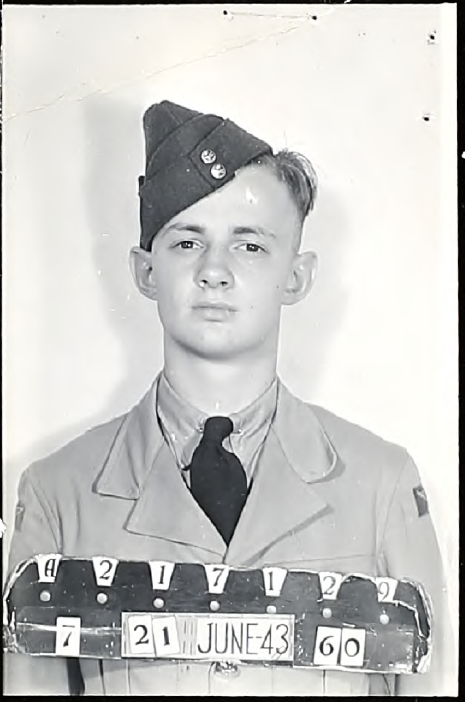

Norman Francis Jodrell was born on 23 November 1924 in Toronto, ON and
enlisted in the RCAF in January 1943 at the age of 18 at \#1 Manning
Depot in Toronto, ON. In August 1943 he attended \#23 Pre Aircrew
Education Detachment at the University of Toronto to upgrade his
academic skills. In October 1943 he attended \#10 Bombing and Gunnery
School at Mount Pleasant, PEI. In January 1944 he attended the \#3
Aircrew Graduate Training School at Trois Rivieres, QC. He arrived in
the UK in April 1944 and after completing additional training joined 78
Squadron on 14 September 1944.

## The Flight

Handley Page Halifax Mk III (serial LK838, call sign EY-E) of No. 78
Squadron RAF took off from Breighton airfield on November 4, 1944, at
17:30 hrs for a bombing operation against Bochum, Germany. A total of
749 aircraft were involved in the mission, with 28 losses (3.7%), mainly
due to night-fighters. 346 Free French Squadron lost 5 out of its 16
Halifaxes. A very successful attack with severe damage to the centre of
Bochum. More than 4000 buildings were destroyed, including the steel
works. 994 people were killed. This was the last major raid on Bochum.
The plane crashed near Siersdorf, Germany, close to the Netherlands
border. Flight Sergeant Roach bailed out of the aircraft near Bochum and
reported he did not see any other crew escape and reported the plane
crashed near Bochum. German records indicated the aircraft crashed near
Seisdorf, approximately 100km southeast of Bochum. It is not known if
the rest of the crew bailed out during the flight and were lost, or
whether they were still in the aircraft and buried as unknowns at the
American Cemetery at Margraten, Netherlands.

# 619 Squadron Lancaster PB405 19 September 1944

## The Crew

All eight men are RAF servicemen who rest in the Venray War Cemetery. A
second Bomb Aimer was on board, likely as part of an orientation flight.
The crew is buried in a collective grave, with 2 names on each
headstone.

Pilot: 176559 Fg Off Leslie William Leonard - Venray War Cemetery Plot V
Row A Collective Grave 10-11.

Flight Engineer: 1398317 Sgt Donald John Carter - Venray War Cemetery
Plot V Row A Collective Grave 10-11.\
Navigator: 1317991 Flt Sgt John Montague Davies - Venray War Cemetery
Plot V Row A Collective Grave 10-11.\
Bomb Aimer: 1610176 Flt Sgt John William Charles Mabbutt - Venray War
Cemetery Plot V Row A Collective Grave 10-11.\
2nd Bomb Aimer: 1549518 Flt Sgt Joseph Kenneth Stobbs - Venray War
Cemetery Plot V Row A\
Collective Grave 10-11.\
Wireless Operator/Air Gunner: 1077210 WO James Webster - Venray War
Cemetery Plot V Row A Collective Grave 10-11.\
Mid Upper Gunner: 1835421 Sgt William Johnson - Venray War Cemetery Plot
V Row A Collective Grave 10-11.\
Rear Gunner: 2220532 Sgt John Rennie Sutherland - Venray War Cemetery
Plot V Row A Collective Grave 10-11.

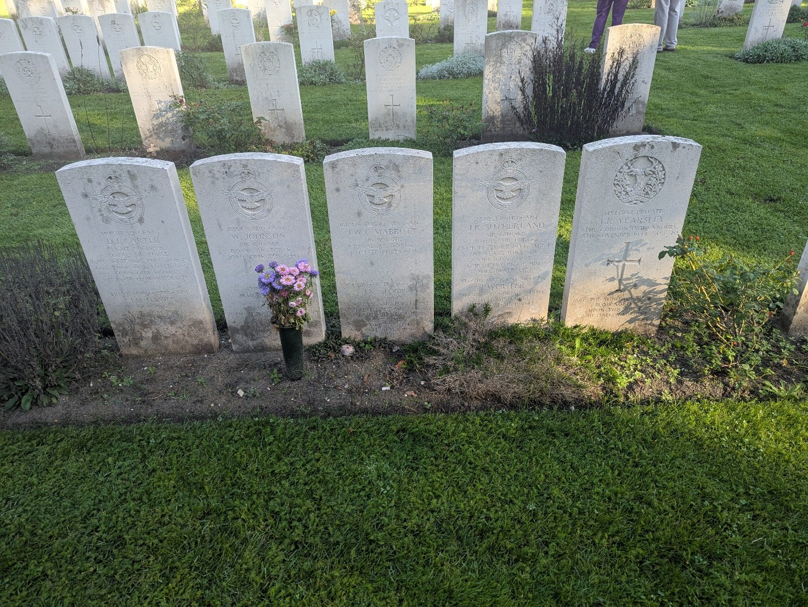

A close up of the collective graves.

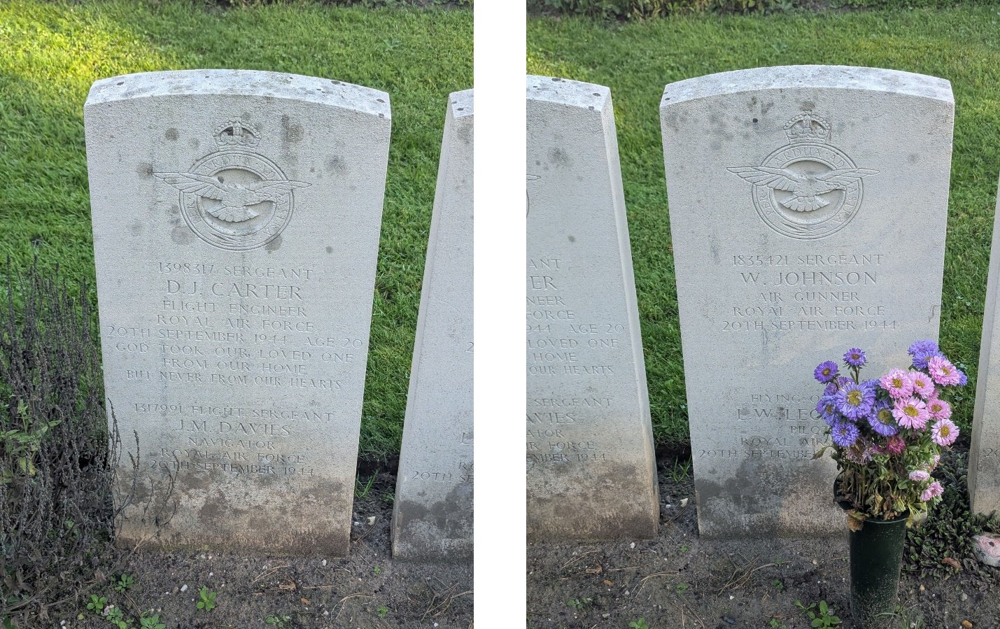

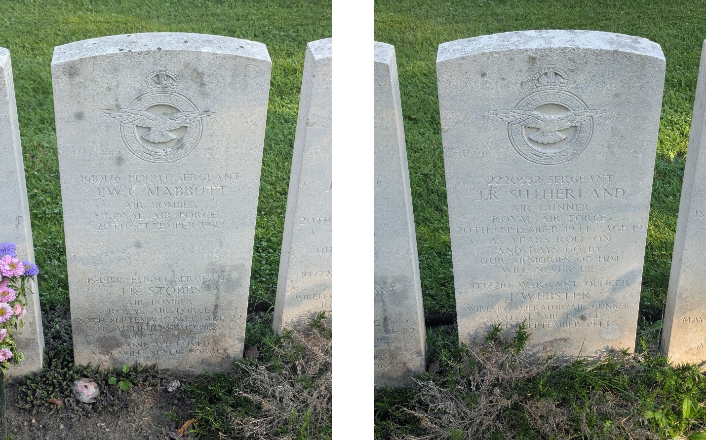

Although the photo above shows 5 graves together, the fifth one is of
Pvt Yearsley who just happened to be buried nearby.

He 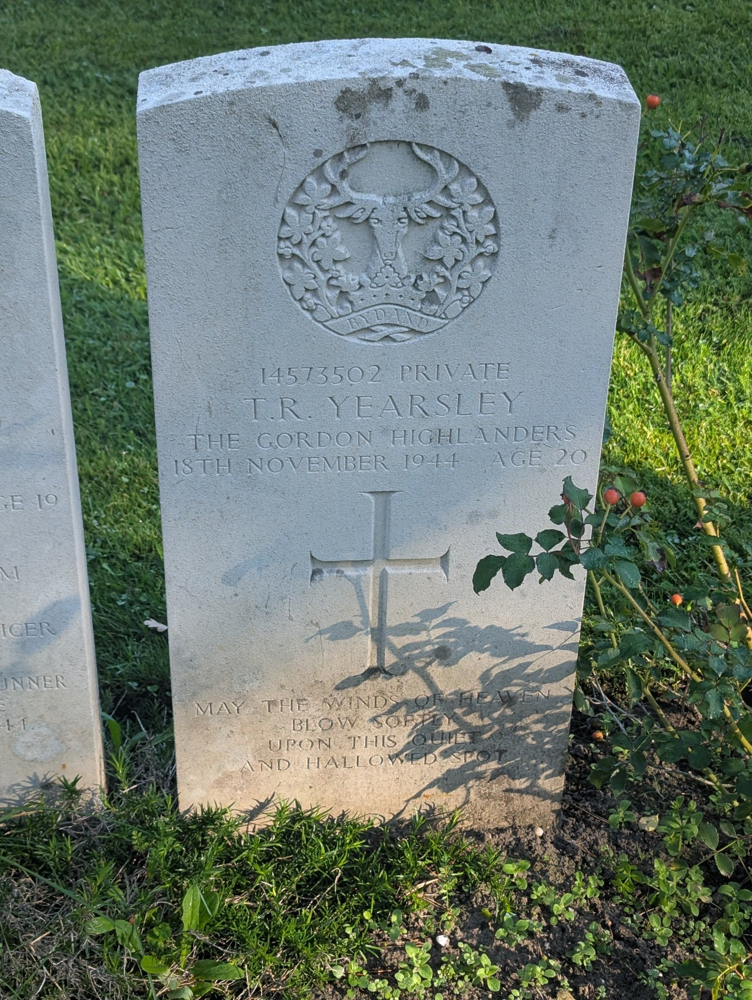

## The Flight

PB405 departed from RAF Dunholme Lodge, Lincolnshire, United Kingdom,
taking off at 19:04 on 19 September 1944. Their target was
Mönchengladbach / Rheydt, Germany. The aircraft was shot down by a
German night fighter flown by Oberleutnant F. Lau of 4./NJG. The crash
location was between Roggel and Heythuysen (near Heibloem), Limburg,
Netherlands. An information board now marks the crash site near a local
canal. Wreckage pieces (such as steering devices and bomb stabilizers)
have been documented by local aviation research groups.

Various components from PB405 have been discovered.

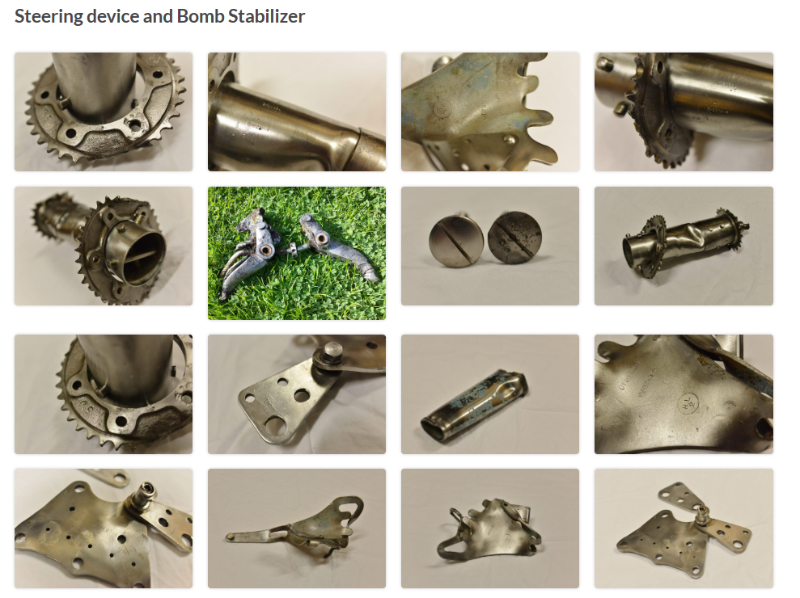

# 153 Squadron Lancaster NG185 - 22 January 1945

## The Crew

> Pilot : Flying Officer Kenneth William Winder RAF 53989 \[Killed\]
>
> Flight Engineer : Sergeant David Burrows George RAFVR 1796593
> \[Killed\]\
> Navigator : Sergeant Alfred Jack Rabin RAFVR 1804931 \[Killed\]\
> Bomb Aimer : Flying Officer Matthew Arnold Smith RCAF J/40650
> \[Killed\]\
> Wireless Operator : Sergeant Robert Evans RAFVR 1671641 \[Killed\]\
> Mid-Upper Gunner : Flight Sergeant Gerald Burton Hamilton RCAF
> R/280563 \[Killed\]\
> Rear Gunner : Sergeant Thomas O'Gorman RAFVR 1901574 \[Killed\]

The crew joined 153 squadron on 02 December 1944 and crashed during
their 8th mission on 22 January 1945.

Four members of the crew are buried in a common grave as it was not
possible to positively identify the bodies. The other 3 crew members are
buried next to the collective grave.

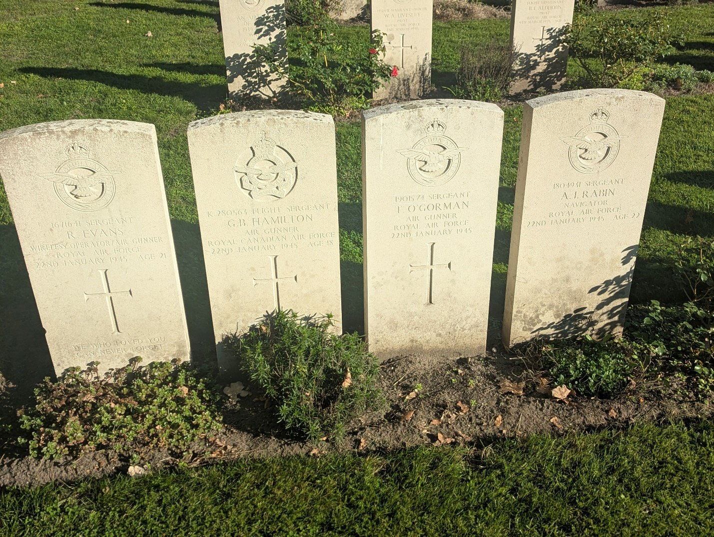

Evans, Hamilton, O’Gorman, Rahin

## Canadians

### Flight Sergeant Gerald Hamilton

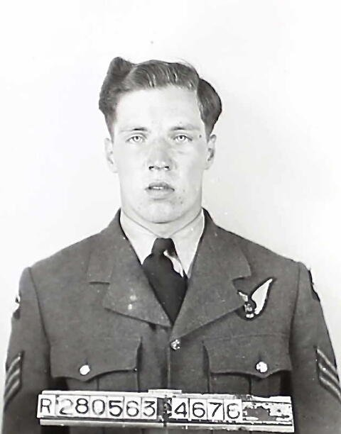

Gerald Hamilton was born on 15 February 1926, in Truro NS. He served as
an air cadet before joining the RCAF on 01 October 1943 at \#5 Manning
Depot in Lachine, QC. In January 1944 he attended \#10 Bombing and
Gunnery School in Mount Peasant, PEI, training as an Air Gunner, before
arriving in the UK on 24 Jun 1944. He joined 153 Squadron on 02 December
1944 and was killed on 22 January 1945, three weeks before his
19th Birthday.

### Flying Officer Matthew Arnold Smith

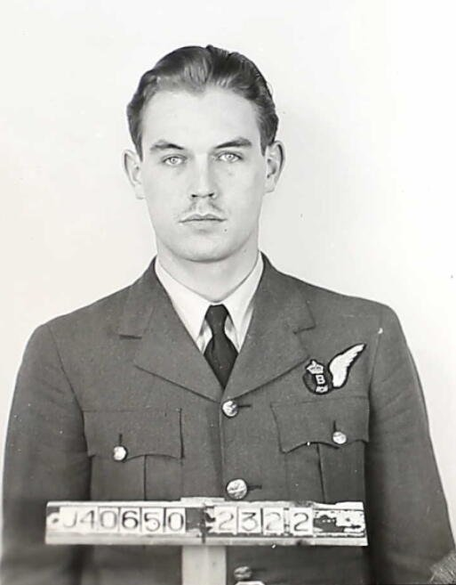

Matthew Arnold Smith (known as Arnold) was born on 22 August 1923 in
Lucky Strike, AB. He married Eveline Dumas, in Montreal on 06 March 1944
not long before shipping out to the UK and had a son Matthew Phillipe
Smith born 26 November 1944. Arnold would have never seen his son.
Arnold enlisted on 11 August 1942 in Vancouver, BC, just before his
19th birthday. He enrolled in pilot training at \#3 Service
Flying Training School (SFTS) in Calgary, AB in March 1943. He was sent
to \#6 Elementary Flying Training School in Prince Albert, SK in May
1943. He did not successfully complete Flying Training so was reassigned
to \#7 Bombing and Gunnery School in Paulson, MB (near Dauphin, MB) in
July 1943 training as a Bomb Aimer. He arrived in the UK in Apr 1944,
and after further training joined 153 Squadron on 2 December 1944.

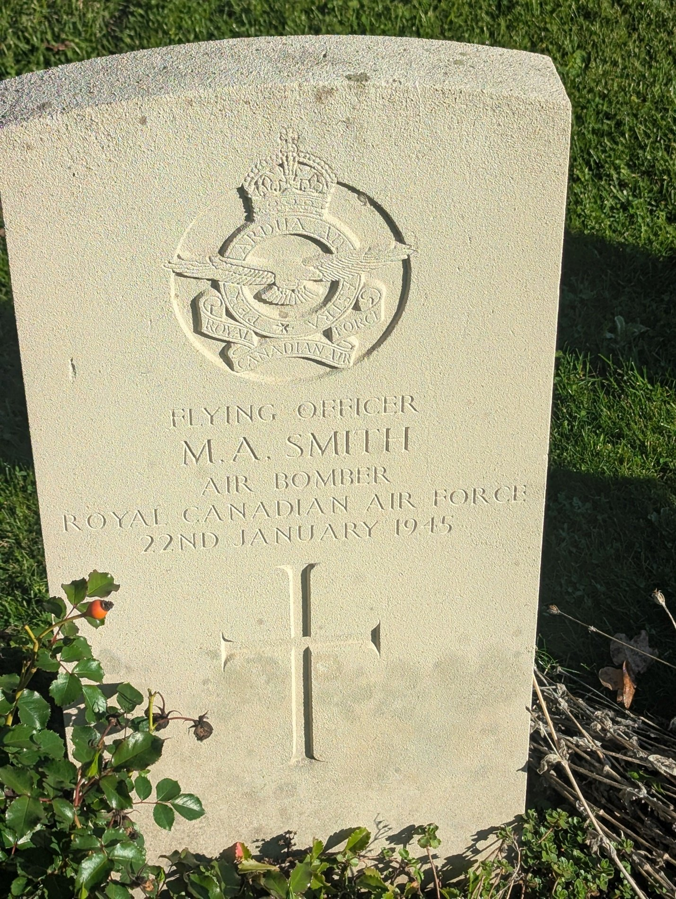

## The Flight

On 22 January 1945, the aircraft NG185 took off from RAF Scampton at
1640 hrs to attack a synthetic oil plant at Duisburg with 19 Squadron
Aircraft. Defences consisted of heavy flak in barrage form, inclined to
increase and burst mainly above our aircraft. Searchlights were active
aided by contrails, and several were seen to have been coned
(illuminated by multiple searchlights). The wreckage of the aircraft was
found near Hamborn, Germany 5 miles north of the intended target of
Duisburg, where the bodies of the crew were either discovered by an
American Grave inspection team, or found almost immediately by US
Forces, as all were taken into Holland and interned at Margraten. Since
then, their remains have been transferred to Venray War Cemetery. At 18,
Sgt Hamilton RCAF was one of the youngest Canadians killed on bombing
duties during 1945.

The bomb load that night:

> 1x4000 lb High Capacity (HC) bomb
>
> 14 x 500 lb ANM64 (US bombs)
>
> 2 x 500 lb Low Drag (LD) bombs

# 625 Squadron Lancaster NG238 16 November 1944

# 207 Squadron Lancaster NF979 16 November 1944

These two crews are listed together as both aircraft crashed nearby on
the same day and the two crews were buried in a communal grave. NF979
took off from RAF Silsby and NG238 flew from RAF Kelstern.

## 625 Squadron Crew

Pilot : Flying Officer James Ross Copland RNZAF NZ/426165 \[Killed\] /
grave 5 C 5-8\
Flight Engineer : Sergeant Donald George Bayliss RAFVR 1622664
\[Killed\] / grave 5 C 5-8\
Navigator : Flight Sergeant Kenneth Martin RAFVR 1514078 \[Killed\] /
grave 5 C 5-8\
Bomb Aimer : Flight Sergeant John Meredith Taylor RAFVR 1419271
\[Killed\] / grave 5 C 5-8\
Wireless Operator : Sergeant Grahame Arthur Levings RAFVR 1606948
\[Killed\] / grave 5 C 5-8\
Mid-Upper Gunner : Sergeant Kenneth Sawkins RAFVR 1318133 \[Killed\] /
grave 5 C 5-8\
Rear Gunner : Sergeant Henry Sapsed RAFVR 1897020 \[Killed\] / grave 5 C
4

Photo of Copeland’s crew with Copeland rear left and Levings front left.

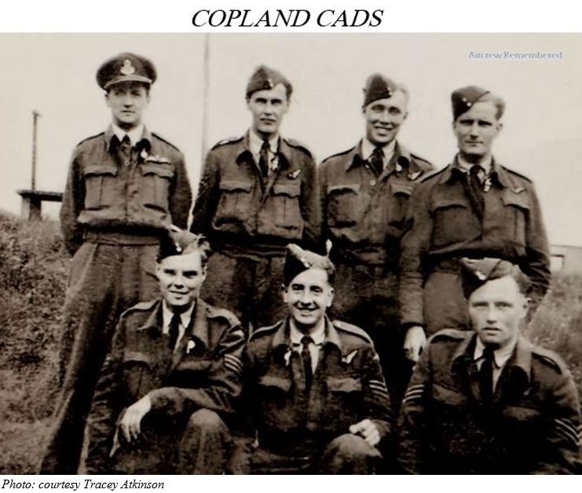

## 207 Squadron Crew

Pilot F/O. J.G. Anderson 421344 RNzAF / grave 5 C 5-8\
Flight Engineer Sgt. P.C. Russell 842512 RauxAF / grave 5 C 5-8 / R. Aux
Air Force\
Navigator F/Sgt. S. Eccleston 1684843 RAF / grave 5 C 5-8\
Bomb Aimer F/O. J.N. Clark 415076 RNzAF / grave 5 C 5-8\
Wireless Operator/Air Gunner F/Sgt. T.L. Wright 1678692 RAF / grave 5 C
5-8\
Air Gunner Sgt. J.D. Rushworth 1399814 RAF / grave 5 C 5-8\
Air Gunner Sgt. J.G. McIlveney 1821827 RAF / grave 5 C 5-8

Sergeant Sapsed was buried separately to the left of the communal
burials as his aircraft exploded in flight and he was found in the rear
turret some distance from the remainder of the aircraft.

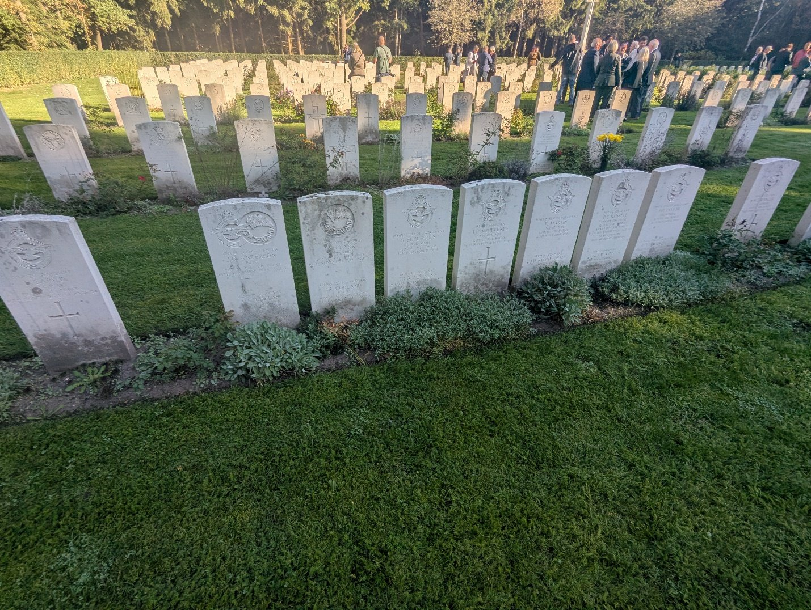

The communal graves are shown in two photos showing the headstones from
left to right.

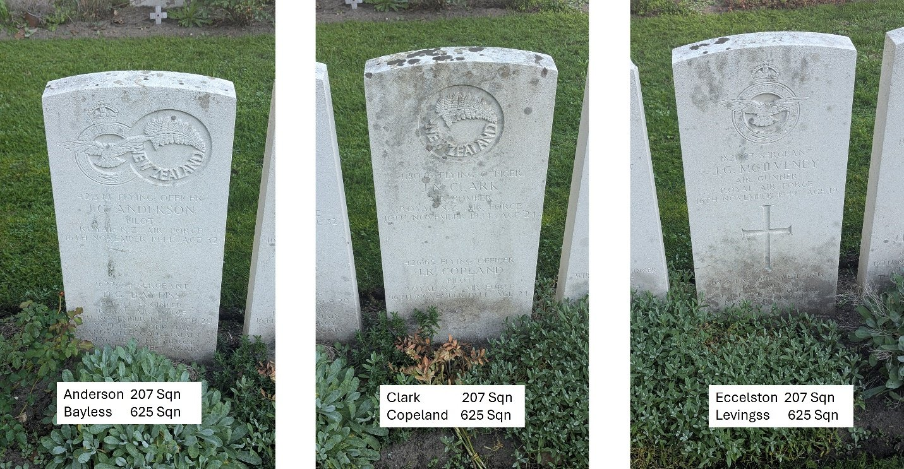

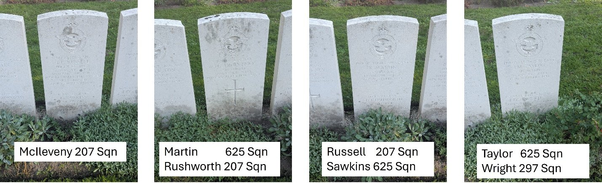

### The Flights

On 16 November NG238 of 625 Squadron s NF979 of 207 Squadron were part
of the 485 Lancasters and 13 Mosquitoes designated to attack Düren some
20 miles east of Cologne in a daylight raid. It would be operation
number 20 for NG238.

In an attack lasting 36 minutes 474 aircraft delivered 2751 tons of
incendiaries and high explosive bombs on Düren completely destroying the
town. 99.2% of dwellings were destroyed and 3106 people were killed.
More than 40000 survivors were necessarily evacuated to central Germany
with just four people choosing to remain in the town. It was not until
the summer of 1945 that the citizens of the town began to gradually
return and in the months that followed the removal of debris and the
reconstruction of the town began.

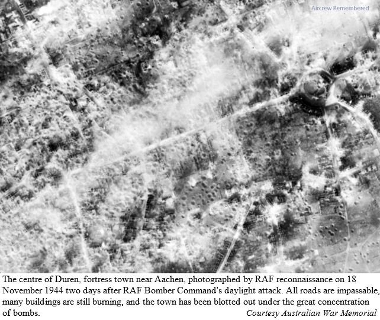

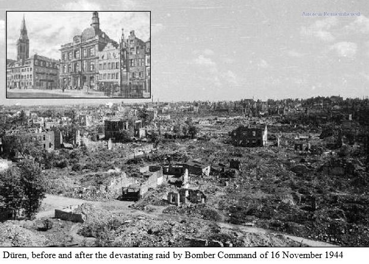

From the post war analysis:

> *I am of the considered opinion that all members of the crew of
> Lancaster NG238 perished in the crash. With the exception of Sgt.
> Sapsed, who was buried under the ruins of Gothe's factory, which was
> hit at the end of the attack, and whose body is therefore better
> preserved, the bodies were lying in the open for a considerable time.
> Duren was evacuated immediately after the attack (the Gothes e.g. did
> not even go back to their factory on the eve of the attack) and did
> not return until the British troops began to occupy the town several
> months later. It is also possible that fragments of bodies were buried
> in later sealed off craters together with the many civilian dead (a
> theory confirmed by the ex-Chief of Police). I am of the opinion that
> the remains of the bodies were buried in graves 1-3 in the Stadgarten
> \[sic\], the Map Reference contained in Smith's report being that of
> this location. It is assumed that grave 5 also contains the remains of
> \[the crew of\] Lancaster NF979.*

# Final Thoughts

I always find visiting a cemetery to be very emotional and like to have
some specific servicemen to visit in order to not be too overwhelmed. I
then wander around and take photos of any interesting groupings or
unusual headstones for further research. I identify with these young men
who are all around the age I was when I joined the Air Force and had my
first posting in Cold Lake.

Many of the World War II cemeteries have produced data bases of the
fallen. The Venray site is <https://www.adoptiegraven-venray.nl/>. It
contains basic information on the serviceman as well, in many cases,
photos of the fallen to help put a face to the name.

The efficiency of the BCATP and the long training cycles and the
sometimes tragically short operational careers of the aircrew is
endlessly fascinating to me. In reviewing the service records of the
Canadians in this post, I was struck by the number of men who started
out as pilots but ended up training for other aircrew positions.

Remembering a few of the more than 10,400 Canadians killed in Bomber Command actions.
