# Uncle Les Allen in Op Totalize

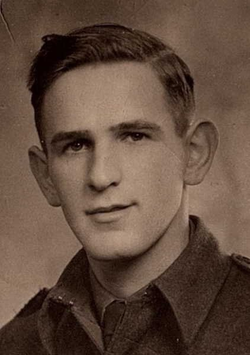

# Introduction

During my recent visit to Normandy, I traced the path of my Uncle Les
Allen, a Corporal in the Mortar Platoon of the Royal Regiment of Canada.
They landed on Juno Beach a month after D-Day and fought their way south
in several operations leading up to Operation Tractable 8-10 Aug 1944.

# Personal History

Leslie Orllian Allen was born on 07 December 1922 in Kingsville, ON, to
Orillian Allen and Mary Alice Rawson, the sixth of eleven children. The
last two children were twins who died in childbirth and tragically, his
mother passed away a week later.

In 1927, Orillian built a grist mill on the Main Street in Kingsville.
His Uncle Sam Quick was a carpenter on the mill. He was a successful
grocer and grain and implement dealer. The building is next to the Bell
building and has been converted into an apartment building. For a long
time, the stone inscribed with Allen was on this building, but it has
since been removed. Orillian was quite successful at this time, but the
depression took all of this away.

On November 6, 1933, Mary Alice passed away. Orillian and his family
decided to go North for a fresh start.

Orillian first went to Monetville, where his older brother Wilbur was
living. Orillian’s oldest daughter, Lois, stayed behind to finish her
nurses training but the other eight children moved with him. They lived
in a little log cabin there. The younger children went to school briefly
in Monetville.

With his background in retail, both with a general store and a grist
mill, Orillian realized that one thing that was always in demand in the
retail business was baskets of various sizes, from bushel baskets down
to pint sized. Orillian’s bushel baskets were made of very thin wooden
slats about two inches wide. In 1935, Orillian leased crown land in
Phelps Township, back the North River Road and set up his basket
factory. There were a lot of ash trees available that were valuable in
making the baskets.

He then expanded his business on his leased land and started a logging
and lumbering operation. This became a very large operation with over
100 men working there at its peak. Most young men in the area and from
farther afield, got their start, working for Orillian. His eldest son
Reg ran the Basket Factory and Orillian ran the rest. His nick name was
“Timmy”, short for Timber. In the winter, the loggers would go back into
the bush and stay at the logging camps where they cut down logs with
their cross-cut saws and used horse to haul the logs back to the mill.
The men would stay in these camps most of the winter and would enjoy the
wonderful meals put on by the cooks. Most of the workers did not eat as
well as they did when back in the bush.

When the operation was at its peak size, there were a lot of people
living on site in bunk houses or with their families in cabins and
houses. Orillian could not leave his retail background behind and opened
a small general store at the mill area. The mill operations were quite
far from any other store, so this provided a benefit to his workers. His
daughter, Helen, ran the store for him, in addition to looking after the
younger children.

Les left school after Grade 8 and worked for Orillian, driving a truck
to haul logs and lumber.

# Military Service

On 21 Oct 1941, Les enrolled in the Algonquin Regiment, the local
Regiment in North Bay, ON at the age of 22 years and 7 months. He was
single and his occupation listed as truck driver.

# Algonquin Regiment

The Algonquin Regiment was mobilized on 22 July 1940 in North Bay. The
Regiment moved to Camp Borden, ON on 7 Sep 1940 for training. By Mar
1941 Borden was overcrowded so the Regiment moved to Current River Camp
in Port Arthur (Thunder Bay) ON. On 04 Jun 1941 they moved to Camp
Shilo, MB and in Nov 1941 transferred to Niagara-on-the-Lake, ON to
guard the Niagara and Welland Canals. Les joined the Algonquin Regiment
on 21 Oct 1941 in Shilo where he did his basic training, then moved to
Niagara-on-the-Lake with the Regiment. In Feb 1942 the Regiment was sent
to Newfoundland to guard Torbay Airport and Cape Spear for coastal
defence.

Following the Disaster at Dieppe, Les and 157 men of the Algonquin
Regiment were sent to the UK to reconstitute the Royal Regiment of
Canada.

# Dieppe

## The Plan

The raid on the port of Dieppe in 1942 was designed to boost Allied
morale, test the feasibility of a landing and placate the Soviet Union
who had been demanding the Allies open a second front to relieve
pressure on the Soviet troops. The Canadians had been keen to be
involved as many Canadians had been in the UK for two years with no
combat action. The raid was originally scheduled for July 1942 as OP
Rutter but was cancelled due to bad weather after the troops had been
fully briefed and loaded on the landing ships. Unbelievably, despite
severe security issues, it was decided to remount the same raid in
August 1942 as OP Jubilee. A previous
[post](https://www.paulsbattlefieldtours.com/post/disaster-at-dieppe)
provides the details.

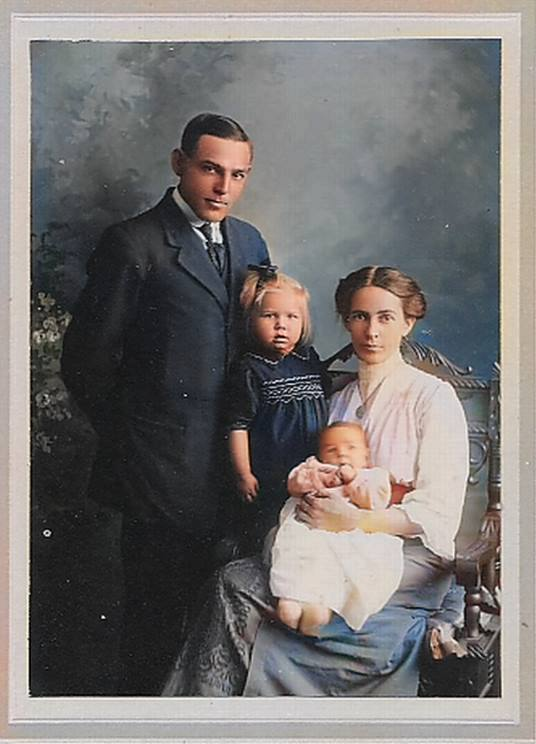

More than 5,000 Canadians, 1000 British Commandos and 50 US Rangers were
involved in the assault. Intelligence concerning enemy strength was
ignored as to not cancel the invasion.

## The Raid

The Royal Regiment of Canada was to land on Blue Beach at Puys, take the
guns on the cliffs that were covering the main landing beach. The
invasion force encountered a small German fleet at 0300 ruining any
surprise so the defences were all manned. The Royals were also delayed
about 20 minutes, so instead of landing in darkness landed as the sun
rose and were easy targets. The landing beach was a narrow strip of land
backed by a high seawall and towering cliffs, so the men who made it to
the seawall were gunned down by enfilade fire. Only 20 men made it over
the wall and were quickly captured. The navy couldn’t get the landing
craft back in to evacuate, so the survivors were captured by 0830.

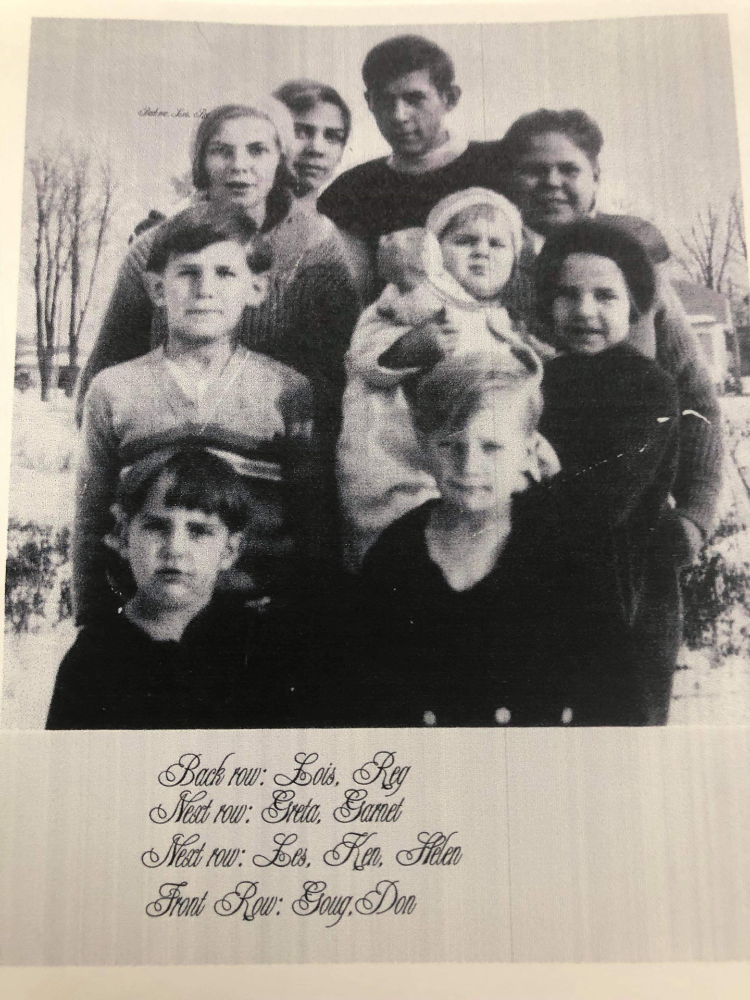

This gun position at the eastern end of the beach wreaked havoc with the
Royals. The steepness of the cliffs is evident from the staircase.

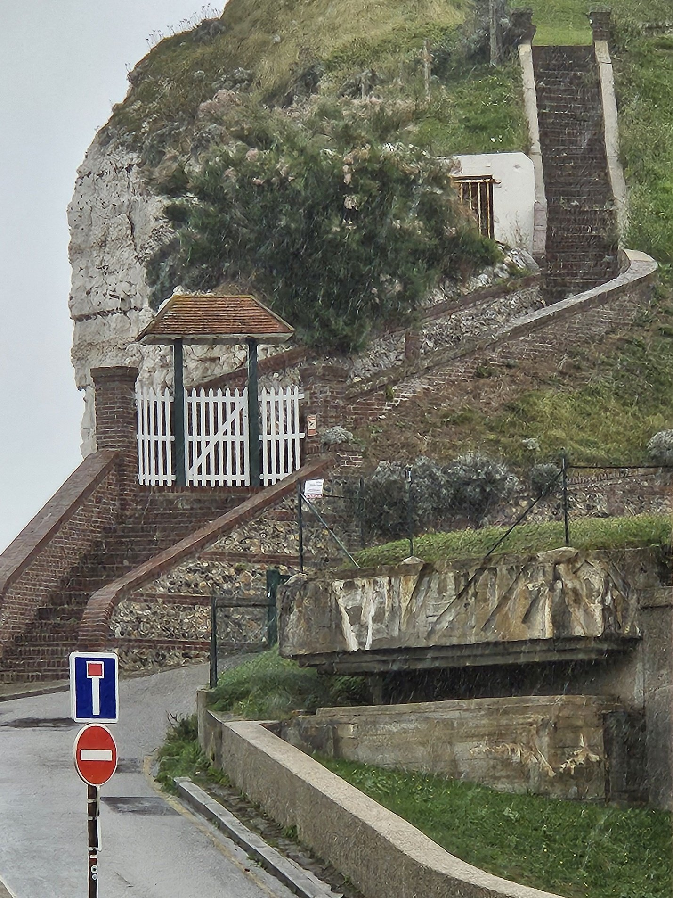

This then and now picture shows the carnage.

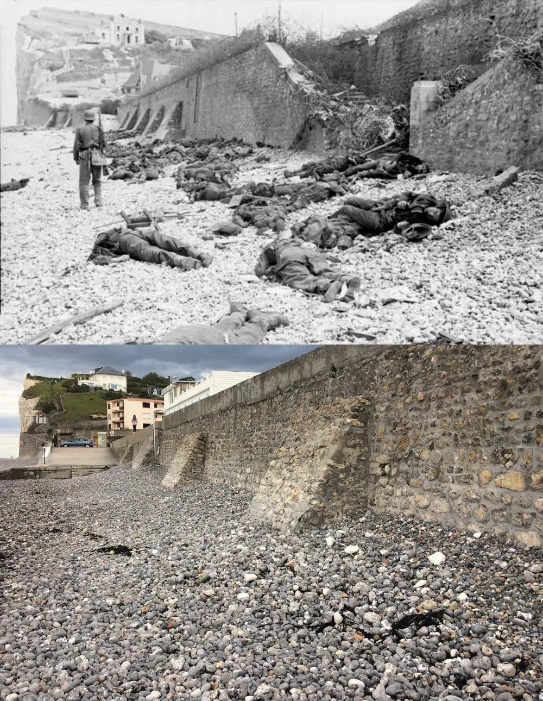

A view of the cliffs looking towards the main port. A ferry is visible
in the port. The main beach was just around the headlands.

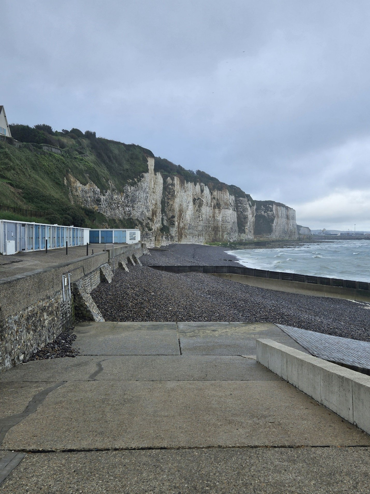

Of the 554 members of the regiment who embarked on the raid, only 65
returned to England, an 88% loss rate. 227 were killed and 264 taken as
prisoners of war. 103 of the POWs were wounded and 33 of the returnees
were also wounded. The raid was over by mid-day. In nine hours, of the
nearly 5,000 Canadians participating in the raid, 907 Canadian soldiers
were killed, 2,460 were wounded, and 1,946 were taken prisoner. This was
the Canadian's largest single day loss of the war. Fewer than half the
Canadians who departed for Dieppe made it back to England.

The memorial to the Royals is appropriately next to the gun emplacement
that caused so much damage.

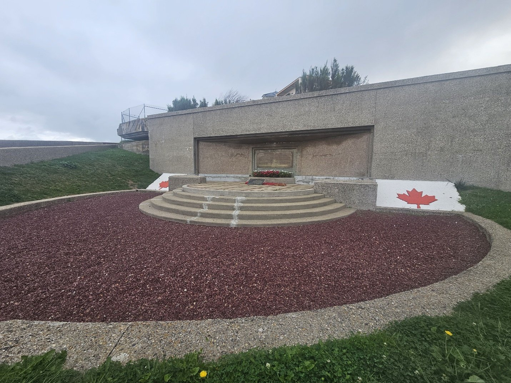

The memorial plaque.

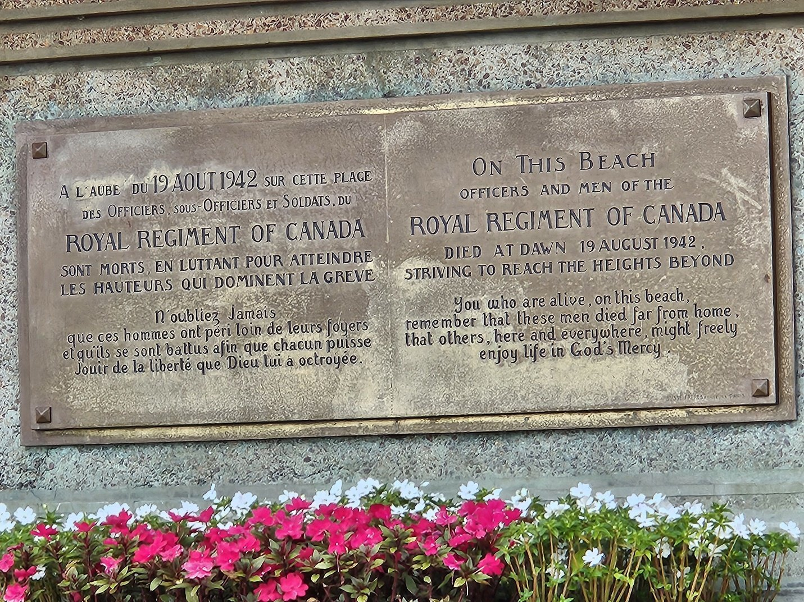

## Rebuilding

This disaster forced the Regiment to be completely rebuilt. New
personnel were brought in from Reinforcement units in Canada and UK;
troops and officers were transferred from other Battalions to fill the
vacuum. The 2nd Infantry Division was held out of conflict
for two years to allow the Regiments to rebuilt and strengthen under
constant training.

In October 1942, the Algonquin Regiment transferred 157 other ranks to
the Royal Regiment of Canada. Uncle Les Allen was part of the transfer,
having originally signed up with the Algonquin Regiment from North Bay.
The Algonquins were on garrison duty in Newfoundland at the time of the
raid and provided a pool of seasoned reinforcements. Many Officers and
NCOs were immediately transferred and entire platoons moved to rapidly
rebuild.

Les, in the middle of the back row, with some of his army buddies.

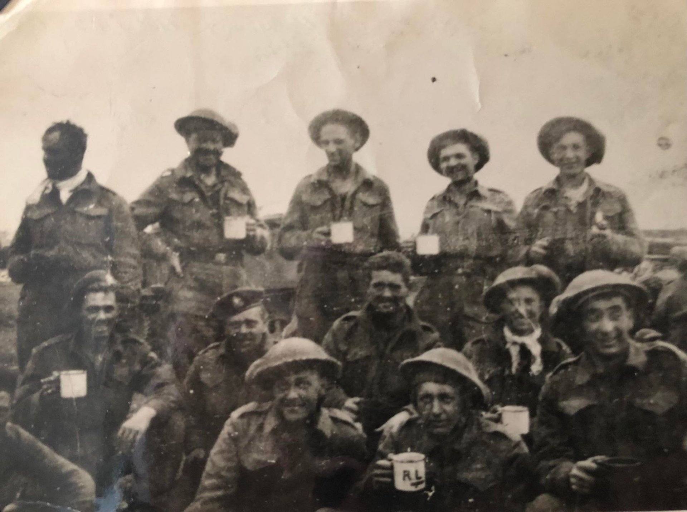

# Royal Regiment of Canada In UK

The organization of the Royal Regiment of Canada:

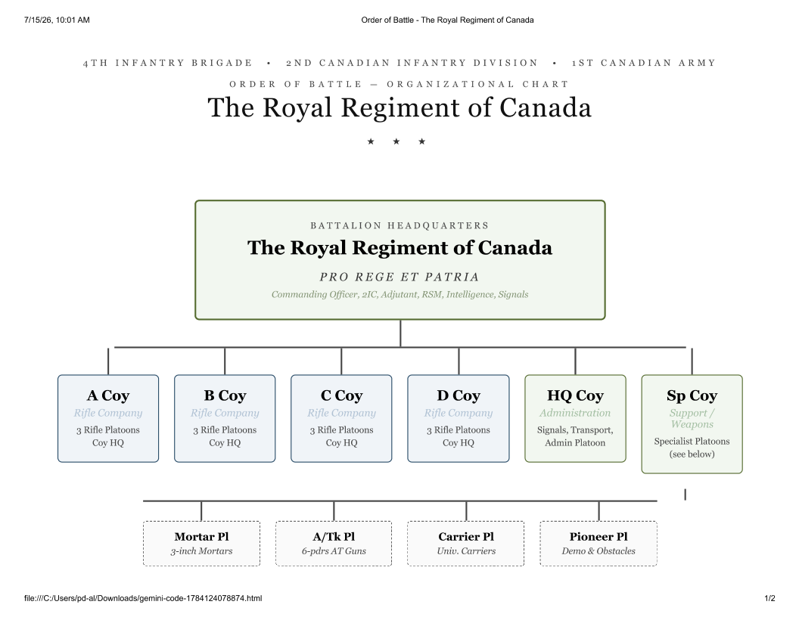

Les Allen was a Corporal in charge of a three-inch mortar section in the
Mortar Platoon. There were 6 mortars in the platoon, each with 6-8 men.
They travelled in Universal Carriers, one to carry the mortar and one or
two additional carriers to transport ammunition and other supplies. The
mortar could be fired from the carrier or dismounted and fired from the
ground.

The Universal Carrier with a mounted machine gun. The 3-inch mortar is
in the front right.

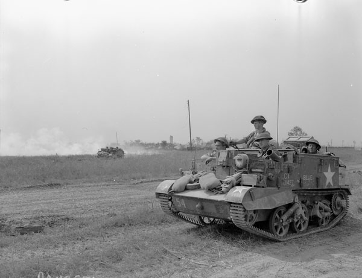

The 3-inch mortar could be broken down for a 3 man carry:

1.  Baseplate and Optical Sight (52 lbs)

2.  Barrel and spare Parts Bag (51 lbs)

3.  Bipod and one case of bombs (36 lbs)

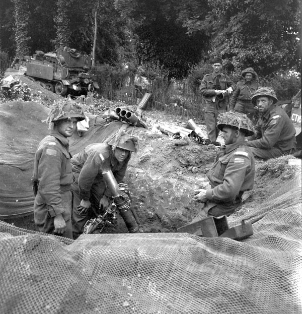

The High Explosive shell weighed 10 lbs and had a range of 500 to 2,800
yards.

Prior to the invasion at Dieppe, the RRC was located at Possingworth
Park, Sussex in southern England before setting off from Newhaven to
Dieppe. After the disaster, they returned to Possingworth Park to start
the rebuild. They moved to Littlehampton near the southern coast,
spending time training in Inverary, Scotland before returning to Hosham,
south of London. In June 1944, they moved to Eastry, Kent to prepare to
head to France. The vehicles were loaded at Tilbury Docks on the Thames
Estuary, then the troops were bussed to Newhaven at the South of England
to be transported to Juno beach. On the evening of 06 Jul, they anchored
just off of Juno, and in the morning landed at Courseulles.

# RRC In Normandy

## Organization

The Royals were part of:

Second Canadian Infantry Division,

> 4th Infantry Brigade
>
> Royal Regiment of Canada
>
> Essex Scottish and
>
> Royal Hamilton Light Infantry.

The Royals spent a few days in a concentration area north of Bazenville,
southwest of Juno Beach.

The map shows the Royal Regiment of Canada’s progress from landing on
Juno Beach to the end of their involvement in Operation Totalize.
Clicking on the [Interactive
Map](https://pd-allen.github.io/docs/html/RRC.html) opens the route in a
new browser window. Hovering the mouse over a marker shows the date and
place and clicking on the marker provides details of the daily action.

## First Action -Eterville 11 July 1944

On 11 July, the RRC moved up to Eterville, on the front line for their
first action since being obliterated at Dieppe. They took over from the
Glasgow Highlanders, who wasted no time departing the location. The
Regiment vehicle convoy got mixed up with the marching troops resulting
in a massive traffic jam, made worse by the departing Highlanders. The
Highlanders left their dug in equipment and took the RRC’s hardware,
much to the chagrin of the supply staff who said you can’t do that, the
serial numbers won’t match!

The Regiment was under observation from Hill 112 and subject to almost
constant shelling. Eterville formed a salient a bump in the line that
stuck out into enemy territory. The Germans infiltrated the RRC lines at
night and had to be chased back every morning. Due to constant shelling,
dead Germans and Canadians lay in the hot sun for days. Despite not
having been involved in any active conflict, in five days, the RRC had
suffered 15 killed and 67 wounded in their first combat exposure. The
intensity of the shelling was evidenced by the fact that a high
percentage of casualties were a result of direct hits on the prepared
slit trenches.

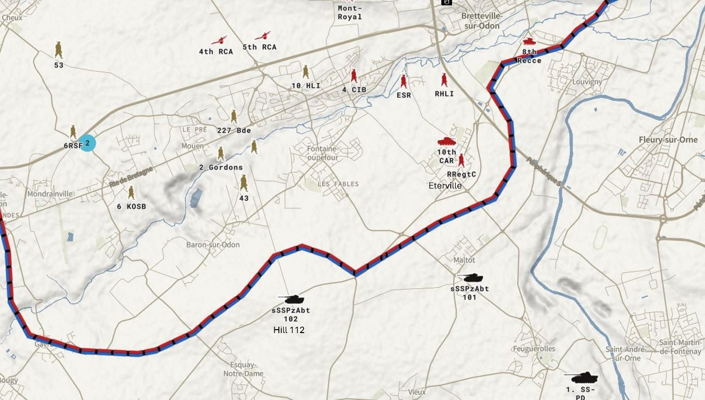

A memorial commemorates the Royals’ first action in Normandy. The
8th Recce Squadron also named on the monument.

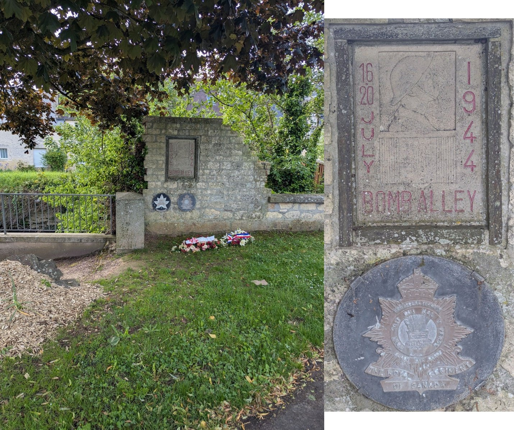

The circled locations show the Royal’s actions in July 1944:

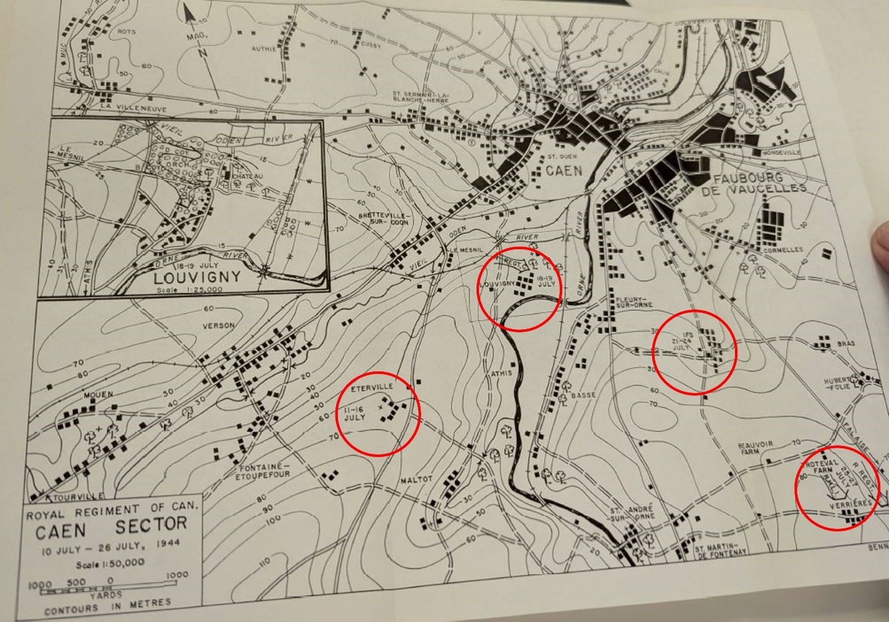

## Operation Atlantic – Louvigny 18 July 1944

The Regiment’s first offensive action was as part of Operation Atlantic.
Their objective was to protect the 5th Brigade’s right flank
and take the village of Louvigny, which included a chateau with a walled
orchard. At 5PM, D Company Commander, Major Fairhead, ordered “The Royal
Regiment of Canada will Advance” then marched off through the wheat
field from Le Mesnil, confident his troops would follow. As they
advanced, the Germans let them come then lashed out with machine gun and
small arms fire from camouflaged positions. As there was nowhere to
hide, the Regiment charged forward and overran the machine guns. The
Major and most of the officers and NCOs were immediately gunned down and
most of the casualties happened in the first few minutes.

Sergeant Tyson of the 3-inch mortar platoon reorganized D Company and
led the assault through the orchard. The mortar platoon, including Uncle
Les, had been attached to provide direct mortar fire during the advance.
The Royals could not contact Battalion Headquarters for artillery
support, but the mortars provided effective smoke and high explosive
coverage to very good effect.

Throughout the night the mortars were busy, firing more that 6,000
rounds into German Positions. At first light the Royals cleared the
Orchard and when they entered Louvigny discovered the Germans had
withdrawn across the Orne River. By 0900 Louvigny had been cleared. In
their first action, the Royals had suffered 34 killed and 77 wounded.

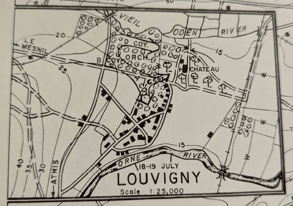

The grateful Mayor of Louvigny sent the following letter to the Mayor of
Toronto, the Royals’ home base.

> *04 Aug 1944*
>
> *To the Mayor of the City of Toronto*
>
> *Ontario, Canada.*
>
> *On July 18, 1944, the Royal Regiment of Canada launched its attack to
> liberate the village of Louvigny. Thanks to the valor of its soldiers,
> the operation succeeded, and by the following morning, the liberation
> was complete.*
>
> *In the village, which had suffered greatly from bombs and shells,
> only 28 out of 600 inhabitants had managed to evade the German
> evacuation orders by hiding and surviving the vicissitudes of the
> fighting. They joyfully went to meet their liberators amidst the
> mostly destroyed houses; they celebrated the sons of Canada with an
> enthusiastic and fraternal welcome.*
>
> *They truly were the image of a wounded but undefeated France*
>
> *I want to be here, with you, with the people of your great city, to
> express our gratitude to the glorious Royal Regiment of Canada, which,
> on an unforgettable summer evening in 1944, at the cost of great
> sacrifice, gave us something more precious than life: Liberty.*
>
> *Long live Canada!*
>
> *Long live the Allies!*
>
> *(signed) Jules Hollier-Larousse*
>
> *Mayor of Louvigny*

This attitude was typical of the liberated French population. In many
cases the Allies shelled their villages to rubble, but Liberation was
the only thing that mattered. Typical village destruction south of Caen.

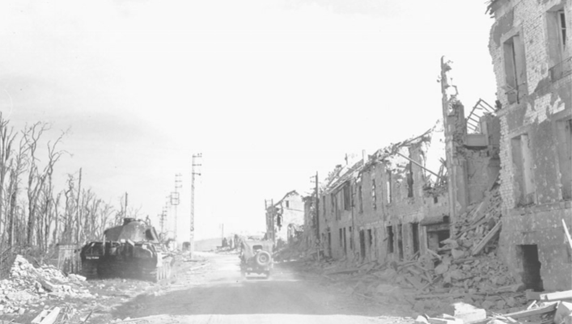

There is a memorial in Louvigny to the Royals’ fallen located on a
small, lovingly cared for, plot of land in the centre of the village. I
love these small memorials as they reflect the appreciation of the
community for the sacrifice of soldiers from far away. I visited on a
quiet Sunday morning with only the occasional jogger for company.

To me this is a great memorial. It is located close to where the action
happened in the heart of the village, is very well maintained, tells the
story of the battle and commemorates the fallen. You don’t need to know
anything about the action to acknowledge the loss.

The story of the action.

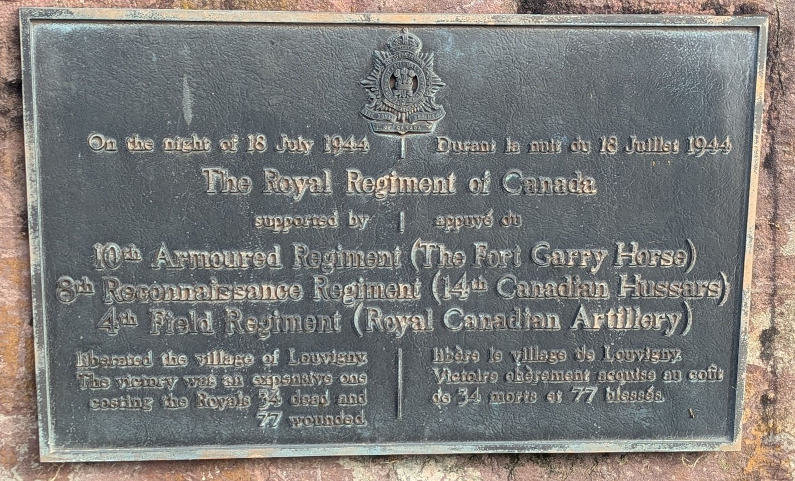

A plaque commemorates the fallen in the taking of Louvigny.

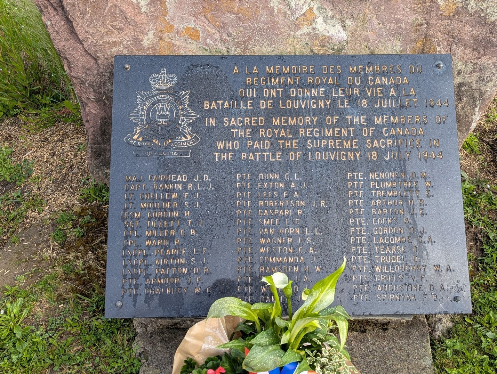

The tankers of the Fort Garry Horse are also remembered.

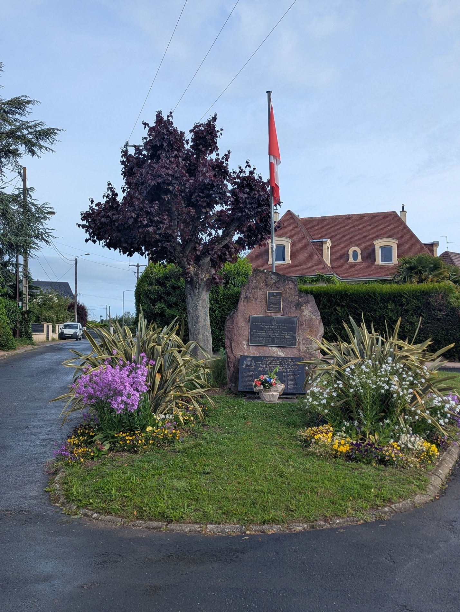

After the battle, the Royals moved back to Bretteville-sur-Odon and
were, for the first time in 10 days, out of mortar range. They received
a draft of 6 officers and 74 other ranks to boost the strength to 36
officers and 658 other ranks.

## Operation Spring - Verierres Ridge 25 July 1944

### Action

Operation Spring was to consist of three phases: first, take a line from
May-sur-Orne – Verrieres – Tilly-la Campaign; secondly a line from
Fontenay-le-Marmion-Rocquancourt-Point 122; and thirdly exploit the
advance.

The Royals were supposed to pass through the Royal Hamilton Light
Infantry (Riley’s) after they took the village of Verrieres and take
Rocquancourt, but at 0300 the Riley’s start line hadn’t been cleared so
they had to fight their way to the start, delaying the action. The
planned artillery program had long been executed so there was no
artillery support for the advance. At 1030, the Royals bypassed the
village of Verrieres and advanced with the tanks of C Squadron
1st Hussars. As soon as the tanks crested Verrieres Ridge
they were attacked by anti-tank guns and dug in Tiger Tanks. In a few
minutes, the Hussars lost 15 of 19 tanks and retreated down the ridge.

The Royals C Company then crested the Ridge and the German Army rose
from the wheat fields and killed or captured the entire company. B
Company dug in and fought off multiple counterattacks. The next day D
Company prepared to attack but the advance was cancelled. The Royals
remained on Verrieres Ridge for four days, fending off heavy shelling
and many counterattacks. The Royals ended up with 42 killed, 110 wounded
and 10 taken prisoner. On 28 Jul, they received 254 replacements and on
03 Aug, received an additional 282 replacements, almost completely
replacing the initial cadre who landed on 7 Jul at Juno beach.

Canadians suffered 450 killed and more than 1,000 wounded in Operation
Spring. The Black Watch were the hardest hit with 112 killed, 119
wounded and 82 taken prisoner.

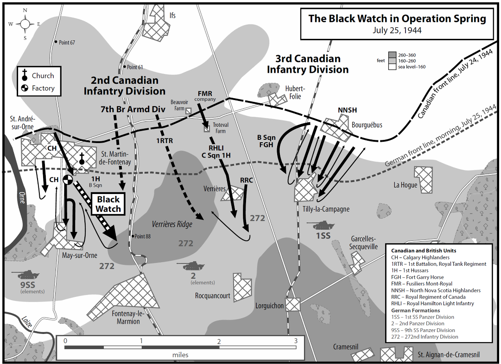

### Hill 67 Memorial

Just north of Verrieres Ridge is the Hill 67 Canadian Memorial, one of
the most important Canadian memorials in Normandy. The memorial was
dedicated on 06 Jun 2010 and created by the Canadian Battlefields
Foundation, a private organization spearheaded by veterans, and the
people of Saint‑Martin‑de‑Fontenay who supported the project, secured
the site, and helped fund construction.

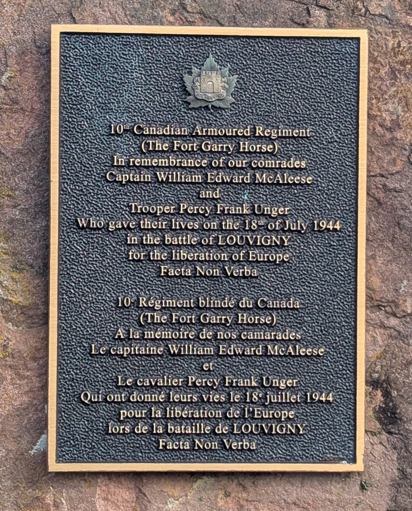

Hill 67, part of Verrieres Ridge, was taken by the Calgary Highlanders
on 18 Jul and was the start point for Operation Spring. Canadian
Historian Terry Copp was a Director of the Foundation and provided the
histography for the project.

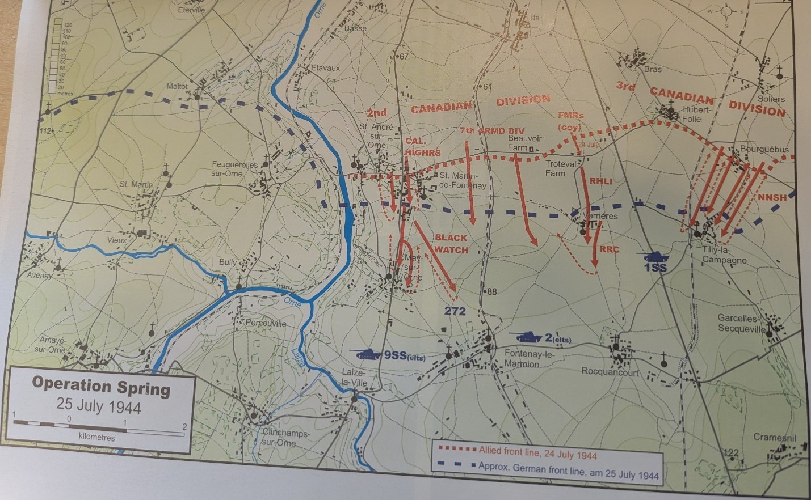

On the approach to the memorial there are the crests of all of the
2nd Division Units, including all off the infantry, artillery
and tank regiments as some of the less celebrated ones including the
Royal Canadian Ordinance Corps Mobile Laundry and Bath Unit.

The Royal Regiment of Canada plaque.

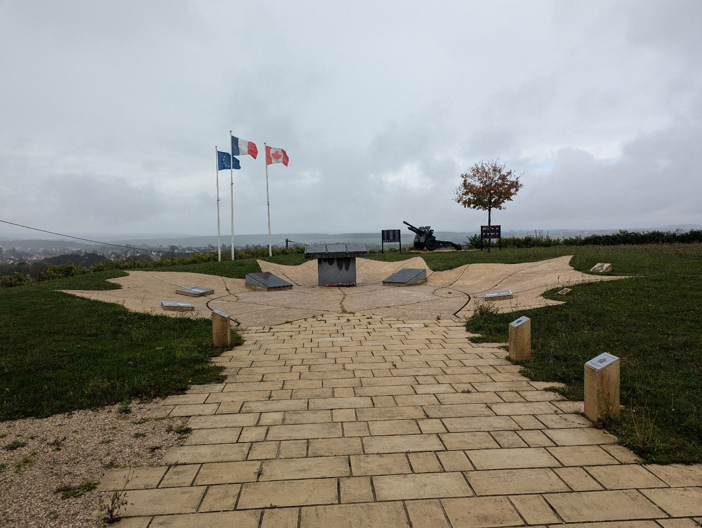

As well, there are very detailed information boards, with maps of all
phases of the advance to Falaise.

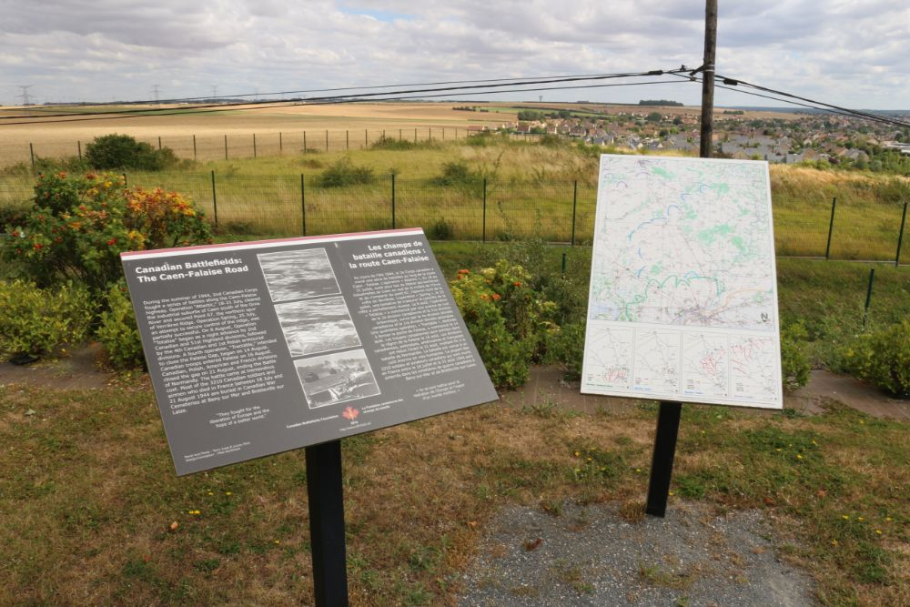\
I like the presentation of the maps, showing the progress from OPs
Atlantic – Spring – Totalize – Tractable. You may not be able to tell
from my photos, but all the maps have the same extent and scale so you
can understand the progress of each operation.

There are also plaques describing individual unit actions throughout the
battle.

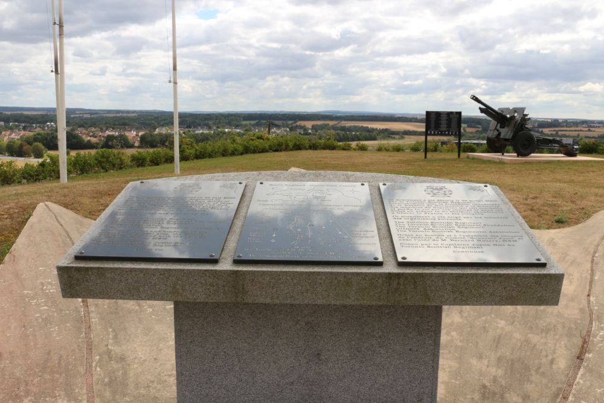

There is a well-deserved tribute to the Artillery. They played a key
role in the success of the infantry and armoured units, but because they
are not in the front lines are seldom honoured or even included on maps.
The 25-pounder gun was the cornerstone of the artillery in Normandy.

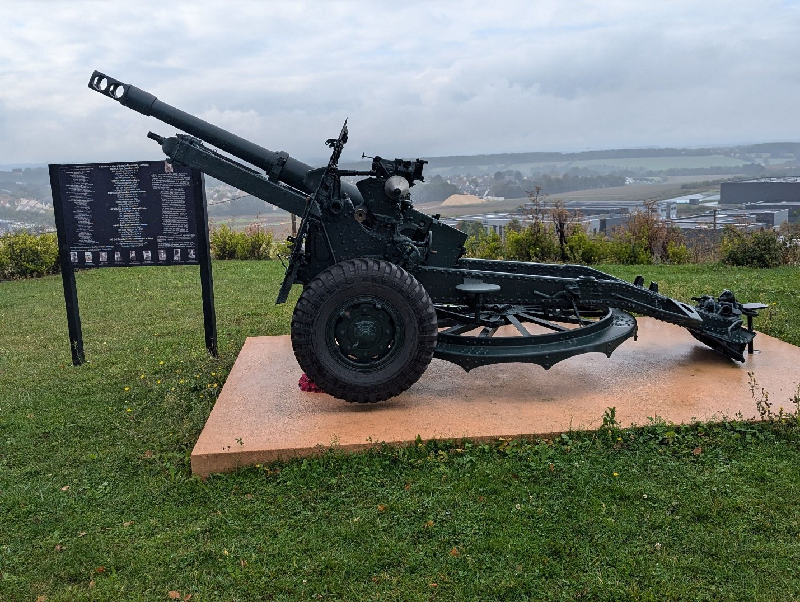

The list of all the Artillery Units that operated in Normandy.

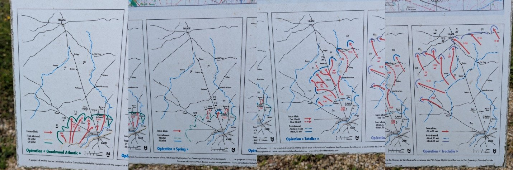

The back of the memorial commemorates the 463 gunners killed in Normandy
and provides a quick tutorial how the guns calculate the location of
their rounds.

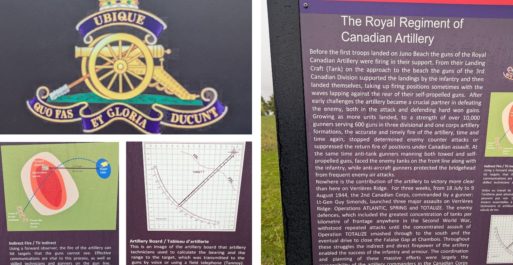

The view from the memorial looking south to St Martin and St Andre.

A view of Verrieres Ridge where the Royals advanced and the Black Watch
of Canada got decimated.

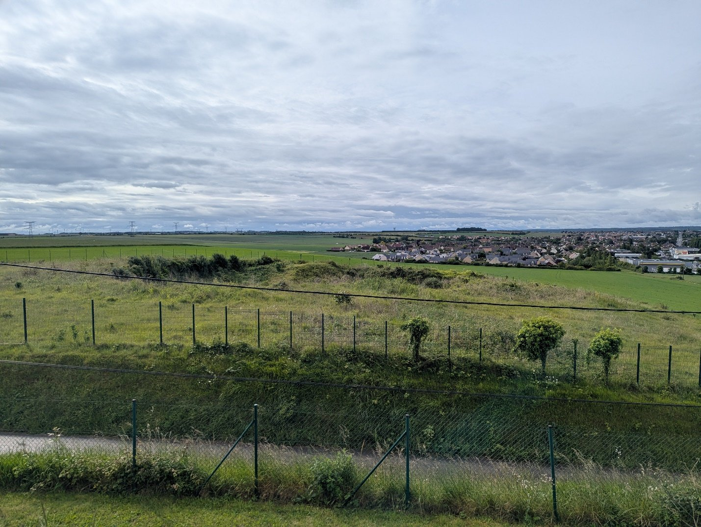

The Hill 67 Memorial is a modern, accessible memorial with great views,
descriptive information boards that acknowledges all of the units that
contributed to the Canadian successes in Normandy.

## Operation Totalize – 8-10 Aug

### Plan

Second Canadian Army Commander LGen Guy Simmonds was unhappy with the
Canadian performance in Operations Atlantic and Spring, so he decided on
a completely different approach for Operation Totalize.

He planned a two-phase attack, starting out with a massive 1,000
aircraft bombardment at 2300 on 07 August, followed by a creeping
artillery barrage then a 4-column assault with tanks and armoured
personnel carriers, followed by unmounted infantry to clear all the
strongpoints that were bypassed in the initial assault, with the goal of
taking Rocquancourt and Point 122. Phase 2 would be led off by a second
bombardment by the US Army Air Force at 1300 on 08 Aug, followed by a
push by the Canadian 4th Armoured Division and the
1st Polish Division to exploit the breakthrough to the high
ground surrounding Falaise.

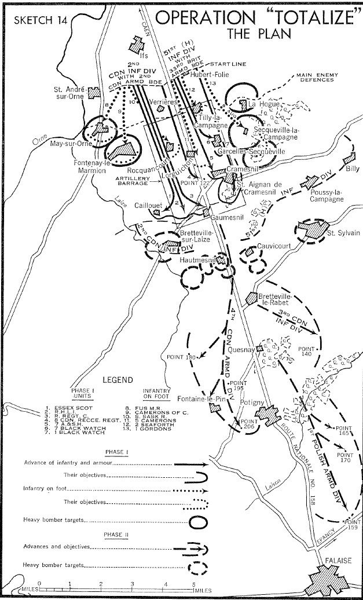

### Kangaroos

To allow the infantry units to keep up with the Tanks, Simonds got
permission from the US to remove the guns from the US 105 mm
self-propelled M7 Priests that had been loaned to the Canadians, to be
converted to Kangaroos that carried approximately 10 soldiers in each
vehicle. Canadian and British Gunners had used the Priests since D-Day
and had recently converted to Sextons that used the same ammunition as
the towed 25 pounder guns. The Original M7 Priest.

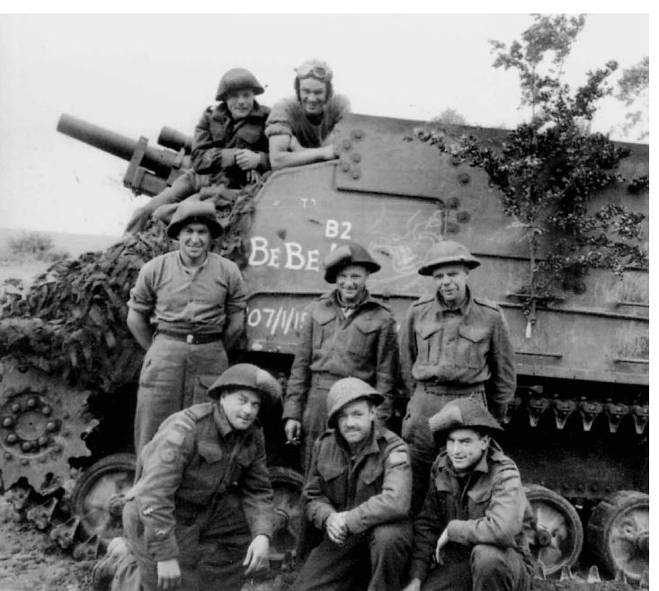

Through a massive effort by Canadian and British Engineers, 78 Kangaroos
were converted to personnel carriers, provided with extra armour and
overhauled the engine and drive trains to ensure the vehicles were
reliable. The converted Kangaroos.

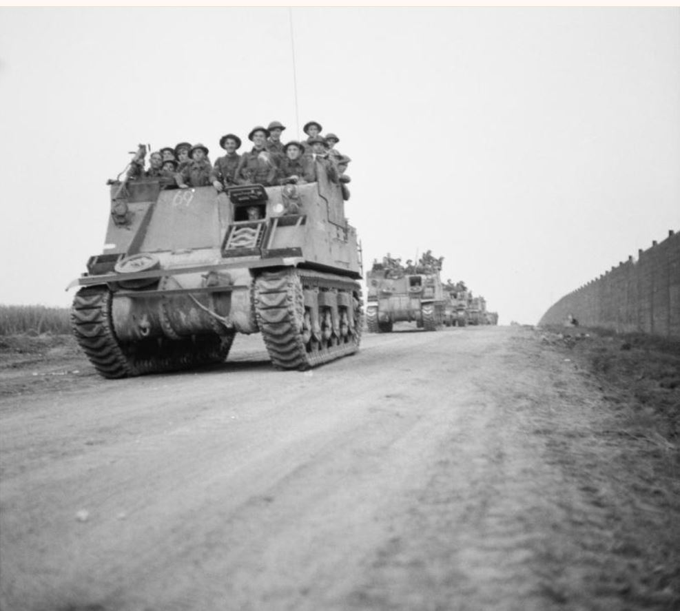

Halftracks were rushed over from the UK for the remaining infantry
units.

### RAF Bombing

At 2300 07 Aug, 1,018 bombers attacked the German strong points along
the route. The artillery fired coloured smoke to highlight the targets
and the bombing was fairly effective. Due to the dust raised by the
initial runs, 347 bombers did not drop their loads for fear of hitting
the troops on the ground.

At 2345, the 700-gun artillery barrage commenced, the largest
concentration of guns since D-Day. The artillery executed a rolling
barrage, time to keep pace with the armoured advance. The aircraft
bombing concentrated on the flanks of the advance and the artillery
operated in the middle along the line of advance. The artillery was very
effective at keeping the Germans’ head down but did not take out any
hard points.

### Armoured Advance

The Armoured units were assembled in 4 columns and proceeded head to
tail. In order to keep them on course, Radio beacons were installed in
the navigation tanks, artillery fired target-marking shells,
anti-aircraft guns fired tracers and lights were placed along the path
every 150 m. They also employed searchlights to bounce off the clouds to
provide additional illumination. The troops thought it had a ghostly
appearance and feared it would silhouette their tanks. It was
universally referred to as Monty’s Moonlight.

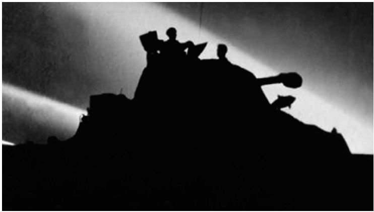

The Crab Flail tanks led the way, operating like snowplows on a 4-lane
highway to a clear a path 4 vehicles wide. The typical convoy is shown
below. The columns had tanks followed by Kangaroos and Half-tracks with
infantry, self-propelled M-10 anti-tank vehicles, towed 25 lb artillery
guns and Engineer battalions.

This is what the column looked like prior to starting off.

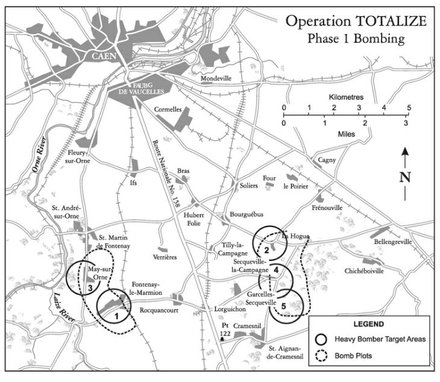

The dust kicked up by the Flail tanks and the armoured columns meant the
best the driver could do is see the taillights of the vehicle in front
of him. This approach had never been tried before, so despite the
guidance assistance, a number of vehicles went off course, ran into each
other or got stuck in bomb craters.

The attack was very successful and broke through the German Lines in
several places. The Canadians were held up by fog and stronger than
expected resistance but managed to take all of their objectives by noon,
prior to the start of Phase 2.

## Royal Regiment of Canada

### Initial Assault (from the War Diaries)

According to the original timings little more than one and a half hours
was allotted for the entire move from the forward Form Up Points to the
Brigade dispersal point, approximately1½ miles south-west of POINT 122.
Several factors contributed to upset earlier calculations. Obstacles in
the form of sunken roads, shell and bomb craters prevented the columns
from pursuing the geometrically straight course that had been intended.
The situation was further complicated by the fact that the enemy laid
down a heavy concentration of smoke. Enemy shelling and mortaring were
not as heavy as might be expected, but it certainly possessed
considerable nuisance value at about this point, "B" Coy became entirely
separated from the remainder of the column. Their Kangaroos got stuck in
shell holes so they hitched a ride with the RHLI column and found
themselves in the RHLI position at first light. The Royals were supposed
to pass West of Rocquancourt but ended going to the east of the village.
They were supposed to go to the dispersal point, dismount and take their
individual objectives.

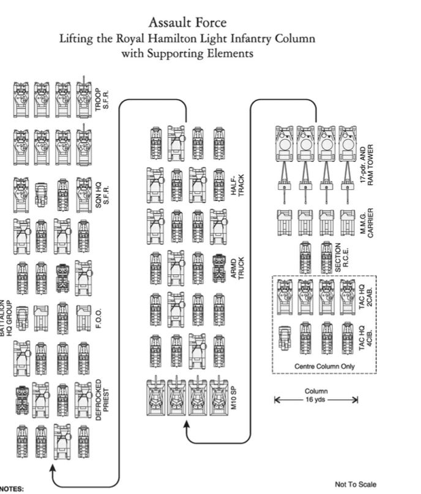

At 0300 hrs, the remainder of our column while somewhat scattered at
times had passed through the Brigade dispersal area and turned
north-west. The original point at which we intended to cross the
railroad tracks to move to our objective was not located by the leading
tanks, and our column eventually crossed the tracks about a mile to the
north. The original plan.

By 0430 hrs the Battalion less "B" Coy and some elements of "C" Coy was
concentrated in the low ground between the railway tracks and POINT 122.
The absence of part of our forces, the change in the direction from
which the attack was to be launched and, above all, the urgent necessity
for prompt action in order to reach the objective before daylight
necessitated considerable changes in our plan. Change of plan.

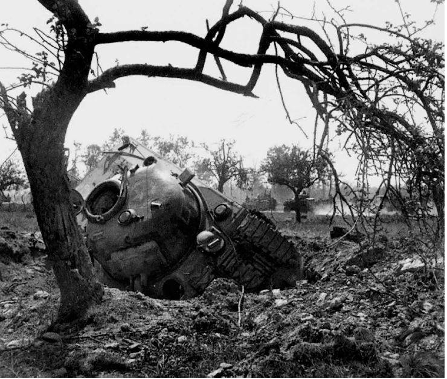

It was of paramount importance that the dense concentration of vehicles
be relieved before first light exposed them to enemy observation. "D"
Coy were complete, and "A" Coy were complete insofar as personnel were
concerned although they were now loaded on five Kangaroos instead of the
original eight as three had suffered mechanical breakdowns en route. The
CO, therefore, ordered "A" Coy to proceed with all possible speed to
their original objective while "D" Coy was to take the copse which had
originally been the objective of "B" Coy.

Faint signs of daylight were already beginning to appear as "A" Coy
moved forward up the hill followed by "D" Coy. They were fortunate in
quickly recognizing their objective, and the Kangaroos were driven right
into the orchard without encountering any opposition. As the platoons
moved towards their respective areas heavy small-arms fire came skimming
over the top of the hill from the south. It is suspected, although never
confirmed, that this fire came from our own tanks who were making a
belated attempt to support our troops onto their objective. "D" Coy were
equally successful in reaching their objective, and the remainder of the
Battalion and supporting arms moved up at 0600 hrs.

View of the battlefield just in the area where C company was dug in.
Very flat land with no cover. I thought it was very appropriate that
poppies dotted the fields.

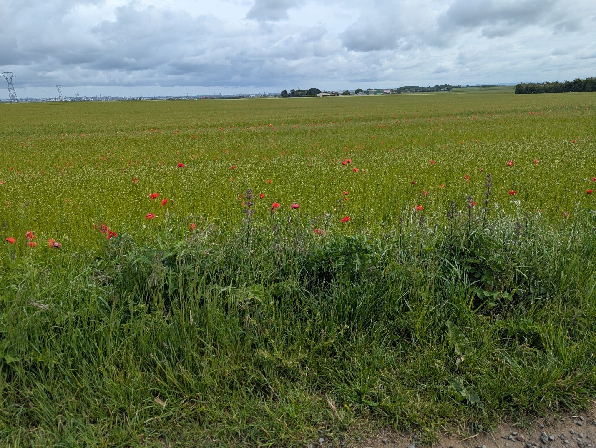

### German Counterattack

At about 0830, the first counterattack was launched. Two Panther and two
Tiger tanks attacked up the Caen Falaise Highway and got within a few
yards of the Battalion Headquarters. The HQ was on the east side of the
road and the Toronto Scottish Medium Machine Gun (MMG) Regiment and the
Royals’ 3-inch mortar platoon were on the right side of the road. The
men were still digging their slit trenches when the tanks appeared and
systematically knocked out the MMG and mortar platoon carriers. Small
arms and mortar ammunition exploded as the carriers were destroyed. The
Royals lost all 7 of their carriers and all mortars were destroyed. A
number of Canadian tanks from the South Alberta Regiment moved in and
the Germans were beaten off. Miraculously, only 3 mortar men were
wounded. This is most likely where Les Allen was wounded getting hit by
shrapnel in his right shoulder. German counterattack.

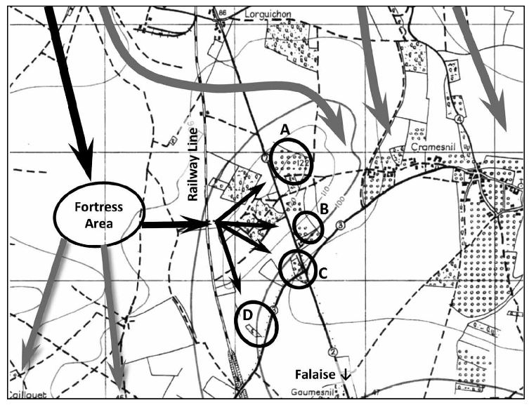

After the attack the Royals looked back from Hill 122 and were
disconcerted to see the extent of the observation that had been enjoyed
by the Germans. Every move the Royals had made over the last month had
been plainly visible to the enemy.

Later that afternoon, the Royals were ordered to take Gaumesnil and with
the support of the South Alberta Tanks, consolidated their hold by 1700.
The Royals got off very lightly, with only 4 killed and 37 wounded,
including Uncle Les Allen. This would be the final action for the Royals
in Op Totalize.

The first phase of Operation Totalize had been a great success. Phase
two would not fare as well.

### Tank Ace Michael Wittmann

German Tank Ace Michael Wittmann was in Cintheaux with the First Panzers
when Op Totalize commenced. Wittmann was credited with 143 kills,
including 14 tanks and 15-20 other vehicles on 13 Jun in Villers-Bocage,
Normandy. The majority of the rest of his kills were credited on the
Eastern Front mostly against Russian T-34 tanks. Wittmann had become a
cult hero in Germany and his success in Normandy was used for
propaganda.

Around 1200 Wittmann attacked with 8-10 Tiger tanks. He led his crew in
a wild charge directly at the Allies. His motto was straight ahead,
never stop, get through and gain an open field of fire. Wittmann was
leading his troops to a kill zone.

The Sherbrooke Fusilier tanks were to the West and “A” Squadron
Northamptonshire Yeomanry UK tanks were to his east. Wittmann’s tank was
hit and exploded, blowing off the turret. One of his troops said the
shot came from the right so would have been from the Yeomanry.

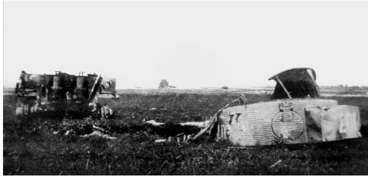

This has been the accepted story for many years but a report from a
French civilian who inspected the tank said the only hole that could
have caused the explosion was on the left side of the tank. From the
map, the Fusiliers were much closer. In his book, No Holding Back, Brian
Reid, a well-respected Historian devotes an entire Annex to the question
of “Who Killed Michael Wittmann?” and concludes it was likely a
Sherbrooke Fusilier.

Although it makes no difference who actually took Wittmann out, this
topic is still hotly debated and flares up from time to time. Wittmann’s
crew had been buried in a communal grave near his tank. He and his crew
were found in 1983 and buried in the La Cambe German cemetery in
Normandy, the largest German cemetery in France with over 21,000
burials. Wittman’s grave has attained cult status and is used to
perpetuate the myth that the Germans were better soldiers than the
Allies.

## Op Totalize Phase 2

### Bombing

Phase 2 of Operation Totalize was to commence at 1230 with a second
aerial bombing, this time conducted by the US Army Air Force, followed
by a push to the high ground around Falaise by the 4th
Canadian Armoured Division and the 1st Polish Armoured
Division. The bombing took place in two waves, in a west to east
direction along the front line to minimize the chances of friendly fire
incidents. A total of 678 B-17s participated and the flight path
resulted in maximum exposure, resulting in 10 aircraft shot down and 294
damaged. 184 aircraft aborted their mission due to flak and low
visibility at the targets. As seen below, the bulk of the bombing did
not hit the intended targets.

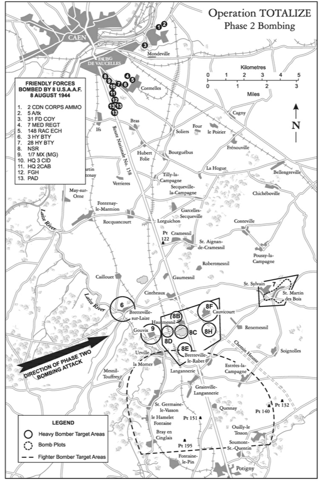

The second bombing wave, starting at 1330 had to contend with haze as
well as dust and smoke from the original runs and were much more
erratic. Two 12 plane sections veered off and headed north towards Caen
before inadvertently releasing their bombs on Canadian and Polish
troops. They inflicted heavy casualties on Canadian and Polish Artillery
and the 3rd Infantry Division. The Allies suffered
approximately 315 casualties with 65 killed and 250 wounded included
MGen Keller the 3rd Division Commander. The North Shore
Regiment alone suffered over 100 casualties.

The bombing was not effective and allowed the Germans time to
significantly improve its defences. Several Canadian 2nd
Division armoured units had lobbied to press forward to Falaise
immediately after taking their objectives early in morning of 8 August,
but the inability/unwillingness to cancel the bombing Simonds had
lobbied so hard for, as well as the lack of supplies and artillery
support ended up with an 8 hour pause that doomed the second phase of
Totalize.

Traffic congestion, and slow clearing of the defences by 2nd
Div, and possibly hesitation of the green 4th Armoured
Division caused them to get off to a very slow start and further doomed
the operation.

# Uncle Les is Wounded

We will leave Op Totalize at the end of Phase I and follow Uncle Les on
his journey. Les was wounded in the right shoulder by shrapnel.

## Regimental Aid Post

He would have been picked up by stretcher bearers and taken by jeep or
universal carrier to the Regimental Aid Post (RAP) located 200-600m
behind the front line. The RAP was staffed by the Battalion Medical
Officer and 2–3 orderlies. They provided Immediate life‑saving measures
like morphine, field dressings, tourniquets, splints, did a quick triage
and prepared the casualty for evacuation.

Private Hackett 18 Canadian Field Ambulance providing a drink to a
wounded soldier.

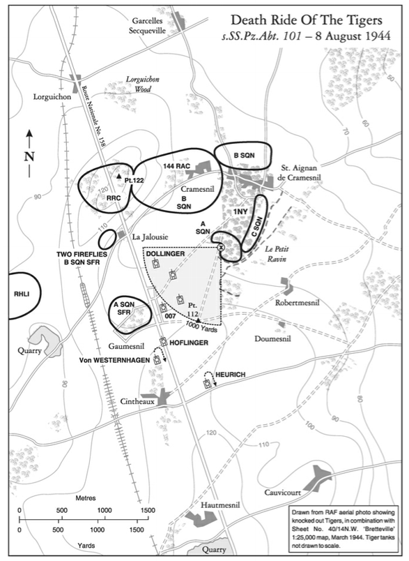

## 18 Canadian Field Ambulance

Les’ next stop was the 18 Canadian Field Ambulance (CFA). The CFA
provides forward medical support immediately behind the assault
brigades. They provide Casualty triage, prioritizing the wounded,
emergency surgery, resuscitation and Causality evacuation to the
Casualty clearing station. There were approximately 500 casualties on 08
Aug due to heavy fighting and the friendly fire incident with the US
Bombers.

The unit consisted of a Commanding Officer, 6-8 doctors, 6-10 Nurses,
and about 100 Other Ranks who were stretcher bearers, ambulance drivers,
Operating Room Orderlies, Clerks and support personnel. On 08 Aug, 18
CFA had moved up just behind the lines north of Cintheaux.

## 3 Casualty Clearing Station (Ifs)

The next phase of Les’ evacuation was being sent to 3 Casualty Clearing
Station located near Ifs just south of Caen.

3 CCS was the major forward surgical centre for II Canadian Corps. Its
responsibilities included Immediate major surgery, Shock treatment &
resuscitation, X‑ray diagnostics, Post‑operative stabilization and
routing stabilized patients to base hospitals at Bayeux, Courseulles,
Douvres and back to the UK.

A CCS was far more capable than a Field Ambulance Main Dressing Station
(MDS) — essentially a mobile surgical hospital with full operating
theatres. 3 CCS was staffed with 12-15 Doctors, 20-30 Nurses, and
150-200 Other Ranks who were stretcher bearers, ambulance drivers,
Operating Room Orderlies, Clerks and support personnel. On 08 Aug there
were so many casualties that 3CCS moved a temporary unit just behind the
front lines at Cintheaux.

> *From 3 CCS War Diary on 08 Aug, by 1600 more than 300 casualties had
> been unloaded. At one time 20 Ambulance cars were in the yard awaiting
> to unload. Reception and resuscitation were jammed so it was necessary
> to simply unload them on the ground. 110 were so placed at one time.
> Fortunately, it was a warm sunny day. Our entire canvas setup could
> scarcely accommodate the number of casualties. MGen Keller,
> 3rd Division Commander was among the casualties, suffering
> bomb wounds on his left forearm as a result of the US bombing. Our
> surgeons worked until 0430 to clear the backlog.*

## 11 Canadian General Hospital (CGH) Taplow 

Les was evacuated to the UK on 10 Aug and admitted to 11 Canadian
General Hospital in Taplow, Buckinghamshire, UK.

Following the outbreak of World War II, construction on a new, expanded
hospital at the Cliveden estate site commenced in January 1940,
replacing many of the original World War I structures to accommodate
wartime medical needs. A 600-bed military hospital—was completed by June
1940 and formally presented to the Canadian Army for immediate use. The
rebuilt hospital was renamed the Canadian Red Cross Memorial Hospital to
commemorate Canadian soldiers who died in World War I, reflecting its
origins while underscoring renewed national commitment to Allied medical
support. Fully funded by the Canadian Red Cross Society and the Canadian
government at a total cost of approximately £300,000, it was equipped
with medical supplies shipped from Canada and staffed primarily by
personnel from the Canadian Royal Army Medical Corps.

Its primary purpose was to treat wounded Allied soldiers, sailors, and
airmen, ultimately caring for over 25,000 patients during the conflict.
By 1943, operational control of the hospital was transferred to British
authorities amid shifting wartime priorities, though it retained strong
Canadian affiliations through ongoing equipment donations and
commemorative ties. It continued serving as a military facility until
the war's end in 1946, after which preparations began for its handover
to civilian use.

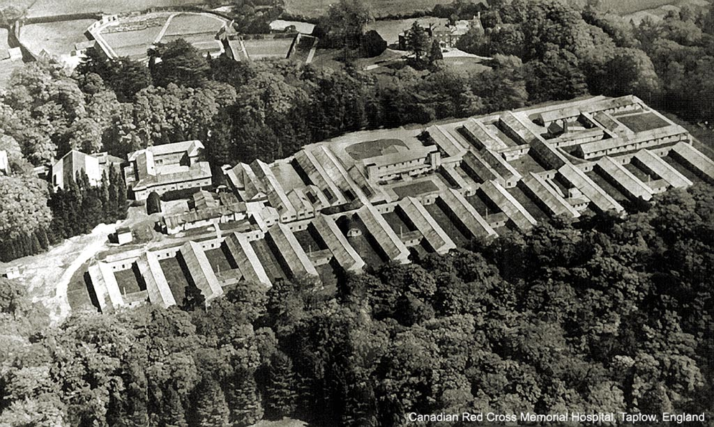

## 23 Canadian General Hospital Leavesden

On 12 Aug, Les was transferred to 23 Canadian General Hospital (CGH) in
Leavesden, UK, where he was hospitalized for over 6 weeks. While there,
he was nursed by Mary MacDonald who introduced him to her 18-year-old
daughter Jean. On December 31, 1944, Les and Jean were married in
Scotland.

The Leavesden Asylum/Hospital and was constructed by the Metropolitan
Asylums Board between 1868 and 1870 for the purpose of “administering
care for the numerous *quiet and harmless imbeciles"* who were an all
too familiar sight in the streets of metropolitan London during those
times.

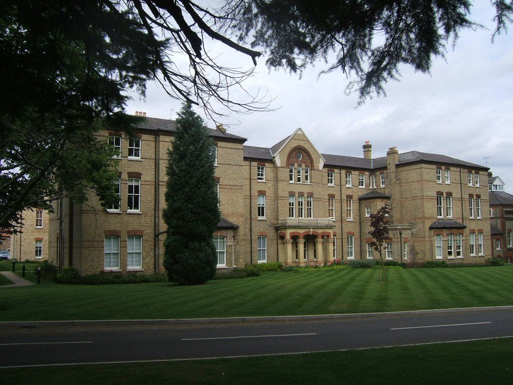

During World War II, the Leavesden site was requisitioned by the
Emergency Medical Service and placed under the control of University
College Hospital. In 1943, the facility was designated as the No. 23
Canadian General Hospital. It served as a primary recovery and medical
hub for Canadian military personnel during the later stages of the war.
The No. 23 Canadian General Hospital was a 1,200-bed military facility.
Operating from a 40-acre annex previously used for Dunkirk evacuees, it
treated wounded Canadian soldiers before transitioning into the Khaki
University of Canada in 1945.

It was the second-to-last Canadian hospital unit to sail overseas from
Canada. The unit crossed the Atlantic and was fully deployed in the
United Kingdom by June 1944, coinciding directly with D-Day.

The hospital had 35-45 Doctors, 70-80 nurses and about 200 support
staff. 23 CGH provided surgical and acute trauma care, specialized
diagnostic care, convalescence and rehabilitation care and conducted
Medical Boards to determine the long-term status of the patients.

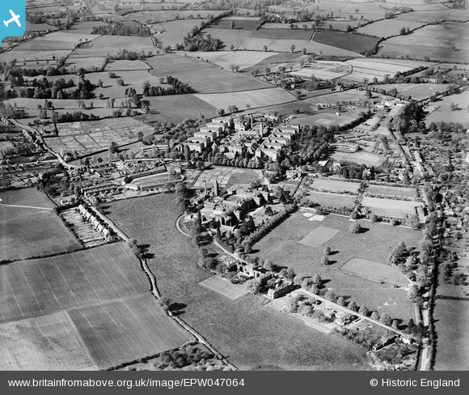

## Post Hospital Release

Les was released from hospital on 25 Sep 1944 and assigned to 3 Canadian
Infantry Replacement Unit (CIRU) in Bramshott Camp, Hampshire. 3 CIRU
was part of the Canadian reinforcement system that kept infantry
battalions filled during the heavy fighting in Italy and Northwest
Europe. This unit held soldiers like Les, recovering from wounds and
assessed their medical categories to determine if they were fit to serve
in front line units.

On 30 Oct, he was granted permission to marry Jean MacDonald on or after
26 Dec 1944. The same day he was found guilty of being Absent Without
Leave (AWL) for 3 days (no doubt visiting Jean!) and was reverted to the
permanent rank of private and forfeited 4 days pay.

On 13 Nov 1944, Les was assigned to 2 Canadian Infantry Training
Regiment (CITR) also in Bramshott Camp. 2 CITR was a combat‑readiness
training formation, not a medical unit. Its job was to retrain, harden,
and prepare infantry soldiers—including those returning from wounds—for
return to front‑line battalions. A wounded soldier sent to 2 CITR was
already medically healed and now needed military conditioning, weapons
re‑qualification, and administrative processing before going back to the
field.

On 31 Dec 1944, Les married Jean MacDonald in Scotland. Jean’s address
was listed as 18 Newkirk Square, Bearden, Dumbarton Shore, Scotland.

Due to his shoulder wound, Les was unable to do any heavy lifting or
wear a pack. He worked as a kitchen helper while awaiting his medical
assessment. On 16 Feb 1945 Les received a PULHEMS assessment of 1311111.
PULHEMS is an acronym describing the assessment.

| **Position** | **Letter** | **System Assessed** |
|----|----|----|
| **1** | **P** | Physical capacity — general stamina, physique, endurance |
| **2** | **U** | Upper limbs — arms, shoulders, hands |
| **3** | **L** | Lower limbs — legs, feet, locomotion |
| **4** | **H** | Hearing |
| **5** | **E** | Eyesight |
| **6** | **M** | Mental capacity — intelligence, learning ability |
| **7** | **S** | Stability — emotional and psychological fitness |
|  |  |  |

The 3 for the Upper Limbs meant a significant limitation that may
require restricted duty. It was recommended that he be assigned as a
driver in a static unit. However, it was decided Les should be returned
to Canada so he was assigned to 1 Canadian Repatriation Depot (CRD) in
Woking Surrey to await repatriation. On 18 Apr 1945 he was sent home and
assigned to 2 District Depot in Toronto on 27 Apr 1945. He was granted
30 days repatriation leave and on 01 Jun had a reassessed PULHEMS score
of 1211111, with 2 indicating minor issues with his shoulder. The
comments on his assessment read:

> *A capable soldier who has a praiseworthy army career. Married in
> Scotland, his wife is still in the UK. He is most anxious for a
> discharge. Pte Allen intends to apply for a compassionate discharge in
> order to assist in the carrying on of his father’s logging business.*
>
> *He would prefer to be placed in the North Bay area. The army
> experience of Pte Allen would commend him for Instructional Duties on
> the 3-inch mortar. He could also serve as a Driver-Mechanic.*
>
> *He is recommended for Instructor or Driver-Mechanic duties or
> Employment type B. (Not fit for front line duties, but fit for Base or
> Limited Duties)*

Les had 45 months of service, 21 months overseas in UK and France. He
had been a Corporal in a mortar platoon. He had 138 priority points. In
the Canadian Army in WWII, 138 priority points meant a soldier was
high‑priority for repatriation to Canada after VE‑Day. This score placed
him well above average, making him eligible to go home early in the
demobilization process, ahead of lower‑point soldiers.

This led to Les being discharged from the Army on 17 Jul 1945 and
returned to Balsam Creek to work for his father.

# Life After the War

## Trucking

When Les and Jean returned from Europe, Les went to work for his father,
Orillian at his mill on the North River Road. They lived in one of the
houses that were at Orillian’s camp. Les bought a truck and went to work
hauling logs out of the bush to the mill. In the late 1940’s, the mill
caught fire and burned down. Some of the houses burned too. Orillian
decided to build a new Mill a couple of miles East of Balsam Creek and
obtained the timber rights for an area near by. A photo of the giant log
being hauled by Les’ truck with my father Doug Allen in the foreground
and Mel Hummel sitting on the log.

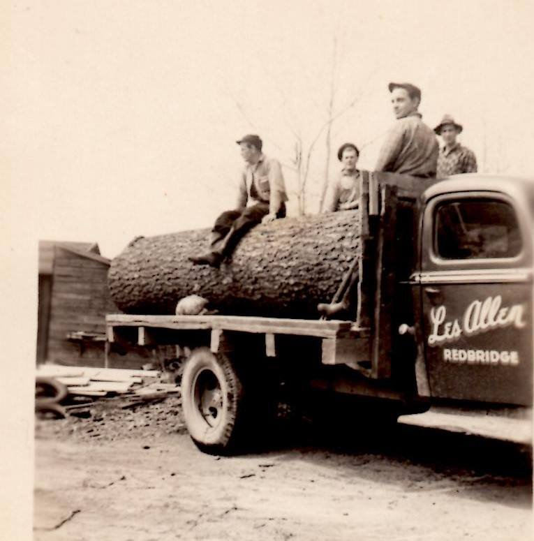

Les and Jean enjoyed their life back in Phelps Township and decided to
buy a lot on Highway 63 in an area known as Zero Corners. It was across
the highway from the land the Women’s Institute had purchased with the
intention of building a park to honour the retuning soldiers.

Jean was active in the Women’s Institute and her status as a War Bride
meant she was front and centre for the Memorial Park, The Women’s
Institute vision for the park grew and came to be the place that many of
younger members of the community enjoyed. First came the playground
complete with swings and teeter totters, built by the men who came back
from he war. The first event there was a community picnic. Next came the
Ball Diamond and Les and all the other Allen boys greeted with great
happiness. The Memorial Park was located on the forks of the North River
and was enjoyed by all. Photo of Jean.

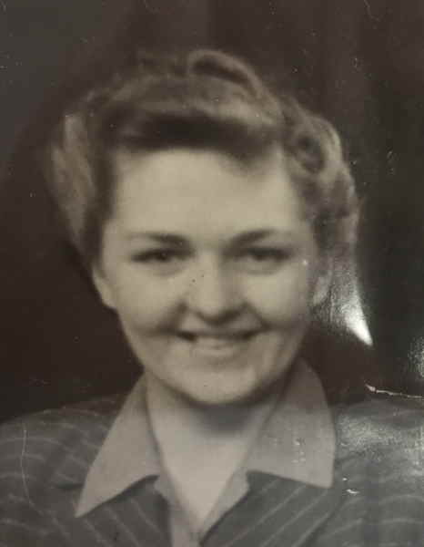

The ladies of the WI held penny sales, and dinners and just about
anything to earn enough money to build a hall. That hall was used for
dances, dinners and many wedding celebrations. In later years, the first
permanent library in Phelps township was set up in a back closet.
Finally, a War Cenotaph was built to honour the men killed during the
war. The Women’s Institute sponsored a fall fair every year. It was
great to get time off classwork to run races, take part in competitions
and show off our handiwork and baking.

Later, after much work and penny sales, a group worked hard to build a
permanent library that is much used by the community. Sadly, the Women’s
Institute Hall became too unsafe to use and was torn down. The Memorial
Park today contains the Library, Cenotaph, Volunteer Fire Hall, Baseball
diamond, Hockey Rink and the Rec Centre, all much used by the community.
The women who made it all happen must look down on this with so much
pride.

When so much of the “old mill” was destroyed, Les and Jen decided to
move the old bunk house from back the North River Road to their property
on the highway. They fixed it up nicely for their family. In 1947, their
first son, Leslie MacLeod (Mac)was born and in 1950, Kenneth James.

Jean’s parents, George and Mary MacDonald emigrated from Scotland to
Canada to be near their only daughter. George went to work at the paper
mill in Temiscaming Quebec, about 20 miles away. At first George and
Mary lived with Les and Jean and George commuted to Quebec with some of
the other men who lived in Phelps and worked for the Mill. When Les
re-enlisted George and Mary moved to Temiscaming and rented and
apartment just up the street from the mill. Mr and Mrs MacDonald with
Mac and Kenny.

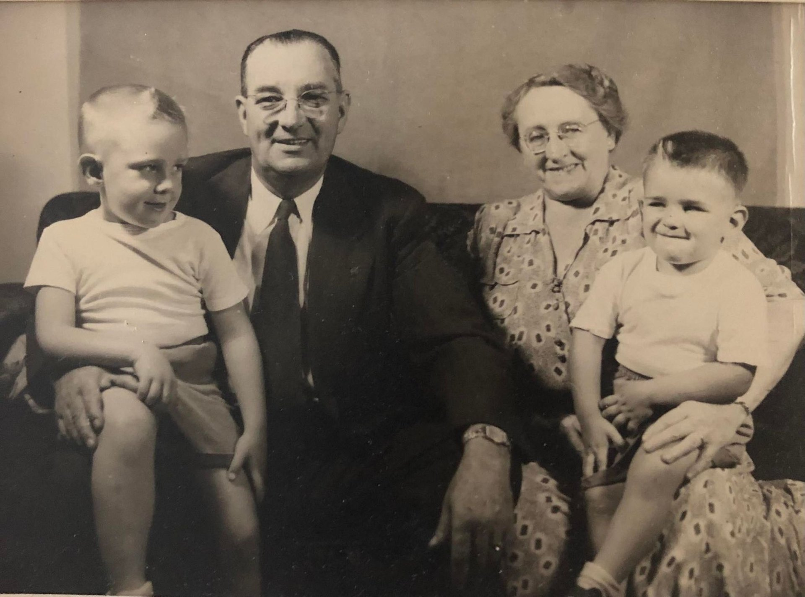

## RCAF

Les joined the Royal Canadian Air Force in August 1951 as an Electrical
Technician, serving in Camp Borden, Centralia, North Bay, Chatham, Val
d’Or and retiring from Camp Borden in May 1969. Les worked mostly on the
front-line interceptors of the day the CF-100 Canuck and CF-101 Voodoo
operating in defence of North America.

The CF-100 was the only designed in Canada military interceptor and one
of the first all weather night fighter. 692 aircraft were built by Avro
Canada. The CF-100 was introduced in 1953 and served for more than 3
decades. After being removed from front-line service it was used as a
Reconnaissance and Electronic Warfare aircraft. On 10 Aug 1972, the day
I was inducted into the Canadian Forces, 414 EW Squadron returned to
North Bay.

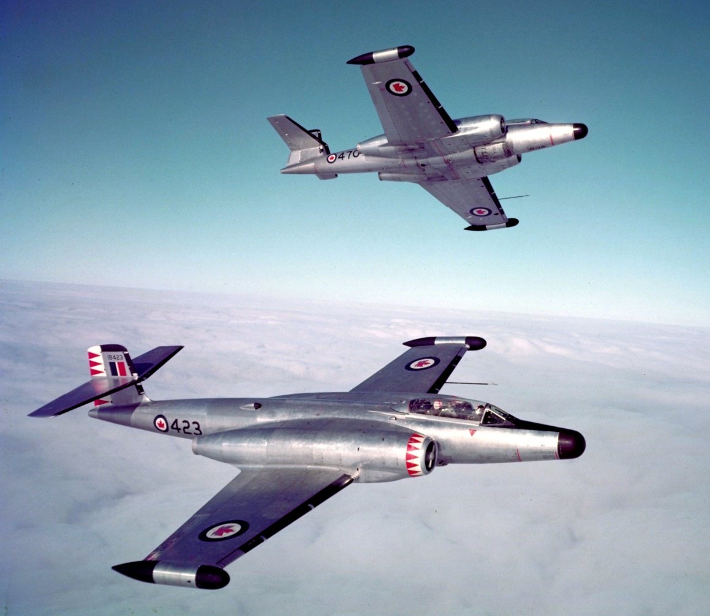

The CF101 Voodoo was sold to Canada to provide an air defence capability
after the ill-fated cancellation of the CF105 Avro Arrow program. The
Voodoo carried Nuclear Air to Air Missiles that were maintained and
controlled by US Air Force Personnel. Like the Canuk, the Voodoo
remained in service until the 1980s when the CF100, CF101 and CF104 were
all replaced by the CF18. The Voodoo in the background with a CF104 in
the foreground.

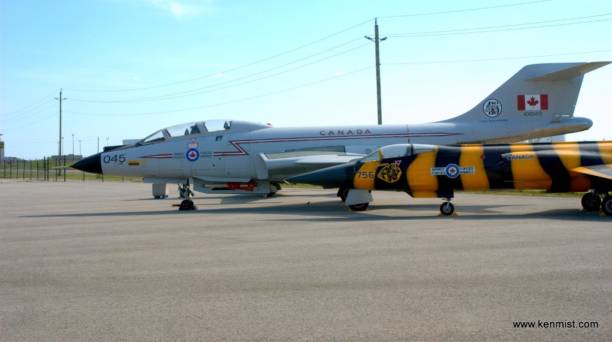

A photo of Les batting while playing for the RCAF team. My father, Doug
Allen, is catching.

Les was promoted to Corporal in Oct 1954 and Sergeant in Apr 1966. Their
third son Rob was born in 1958.

While in Centralia in 1953 Les was selected for the Queen’s Coronation
Contingent to participate in Princess Elizabeth’s Coronation on 03 Jun
1953. Apparently, Les was selected because he was exactly 6 feet tall as
were the remainder of the RCAF contingent. Canada sent the largest
contingent of any Commonwealth realm; 180 men marched in the procession,
while 320 lined the route in the area near Canada House. In total, there
were some 700 active members of the Canadian military involved.

The Coronation carriage the Canadian Honour Guard.

A photo of the RCAF march past. Les is second from the right in the
front rank.

This is the route they marched in London.

Tragically, Jean passed away in Jun 1959 at the young age of 33. Les
married Bernadette Brooks in Oct 1965.

After retirement from the RCAF on 01 May 1969, Les worked as a parking
supervisor in North Bay. He passed away on 31 May 1971 at the age of 48.

# Bretteville-sur-Laize Canadian War Cemetery

In order to pay tribute to the fallen Royals, I visited the
Bretteville-sur-Laize cemetery located in the heart of the Op Totalize
Battlefield, just north of Cintheaux. The cemetery has 2844 burials, all
but 52 Canadian. There are 2714 Army members, 78 Air Force, 3 Navy and
78 Unknowns.

A dedicated gardener keeping the grounds in top shape.

When I visit a cemetery, I usually try to photograph all the headstones
of a particular unit. I was going to do this for the Royal Regiment of
Canada until I realized there were 119-unit burials dating from 11 Jul
to 31 Aug. I took a bunch of photos; here is a sample.

From their landing on 7 Jul until the end of August, the Royals suffered
186 killed and approximately 400 wounded. Over all Canadians suffered
5,000 killed and 13,700 wounded throughout the Normandy campaign,
causing a manpower shortage that would plague Canadians for the rest of
the war.

As always, the grounds are immaculately kept and full of colour.

## Typhoon Pilots

Whenever I am in a cemetery, I try to take photos of regiment members of
the person I am following, as well as other headstones that catch my
eye. I am often drawn to RCAF members. One of the pictures I took was of
Flight Lieutenant T.A. Bugg. When I learned his story, I looked at the
other 3 pilots killed trying to take out the same bridge. One of the
reason the Aircrew are interesting is that the war diaries list every
aircrew for every mission, so you can see the importance of the mission
and how often each person flew.

By early July, the 3 Canadian Typhoon Squadrons, 438, 439 and 440 were
operating out of B9 Airfield at Lantheuil, just south of Juno Beach.
This allowed the Typhoons to be at the front lines in 15 minutes.

\
Lantheuil Airfield was marked out on 11 Jun 1944 and construction was
started the next day. The runway was complete on 22 Jun, and 143 Wing
arrived on 27 June. Due to the muddy airfield, it was decided to track
the Runway on 05 Jul, and the work completed by 8 Jul.

### J11316 Flight Lieutenant Theodore Bugg 

On 12 Aug 1944, taking off at 1900, in another attempt to take out a
bridge, Flight Lieutenant Theodore Bugg, age 23, of RCAF 438 Squadron,
the same squadron as my relative Robert McKenzie, flying Typhoon MN687
was shot down bombing a bridge across the River Orne near Haut-des-Vers.
He was hit by flak during his bombing run and exploded in mid air. He
was not seen to bale out, and the location of his remains were unknown.
Theodore, “Tud”, had just returned from leave at noon the same day. He
left behind a Wife and child.

Theodore joined the Air Force on 28 May 1941 at the age of 20 in
Hamilton, ON and received his wings on 24 Apr 1942. He spent a year as a
flight instructor and arrived in England on 9 Nov 1943. He married Ruth
Smillie on 21 Feb 1942 in Niagara Falls, ON where he had spent his final
year of high school.

In Jan 1946, the RCAF Overseas Headquarters received a letter from M
Maurice Adam, Mayenne France stating the remains of a pilot was buried
in the garden of Mlle Neveu at 5 Haut-des-Vers. M Adam had found an ID
bracelet with the name Ted Bugg, J11316 Love Ruth. Theodore went down
very close to the Bridge now known as Pont des Canadians. The point
indicates his temporary burial site.

In Jul 1946, his remains were reinterred in Bretteville-sur-Laize
cemetery.

His epitaph reads:

I have fought a good fight,

I have finished my course,

I have kept the faith.

Theodore went down very close to the Bridge now known as Pont des
Canadiens. There is a plaque to the 4 Typhoon pilots, all RCAF Members,
killed on 12 Aug 1944 trying to take out the Bridge.

Once I saw this, I had to look at the other pilots as well.

### J20587 Flying Officer Ernest James Allen

On 12 Aug 1944, taking off at 1355, Flight Officer Ernest Allen, age 23,
of RCAF 439 Squadron, flying Typhoon MN553 was shot down bombing a
bridge across the River Orne near Haut-des-Vers. Due to low cloud, they
were flying lower than normal and his aircraft was hit by flak while he
tried to acquire the target. Ernest bailed out landing approximately 4
km from the bridge near Mesnil-Hubert-sur-Orne. His body was recovered
by Canadian Ground troops and was temporarily buried close to where he
was found. He was later reinterred in Bretteville-sur-Laize Cemetery.

Ernest enlisted on 5 Oct 1939 in Edmonton, AB and initially served as a
clerk. He remustered to Pilot on 28 Feb 1942 and received his wings on 6
Nov 1942. He married Zella Tuplin on 17 Sep 1943 in Edmonton, AB, then
arrived in England on 19 Oct 1943. Zella was a Corporal in the RCAF
Canadian Records Office in London, so they would have been able to meet
up occasionally. The War Diary indicated that Ernest had recently flown
to England to ferry a replacement aircraft and got a chance to see
Zella. A bittersweet moment. He got to see Zella one last time but
didn’t know it would be the last time.

### J28180 Flying Officer John Francis Dewar

On 12 Aug 1944, taking off at 1750, Flying Officer John Dewar, age 20,
of RCAF 440 Squadron, flying Typhoon MP122 was shot down bombing a
bridge across the River Orne near Haut-des-Vers. His aircraft was hit by
flak, burst into flames and crashed. He was not seen to bale out. This
was his second run at this bridge, having previously attacked at 1355.

John was born on 20 May 1924 and signed up in London, ON just after his
18th birthday on 26 May 1942. He had done his medical on 1
May 1942 but had to wait until his birthday to enlist. He received his
wings on 9 Jul 1943 and went overseas on 9 Jan 1944. His recruitment
picture shows how young he looked.

Bretteville-sur-Laize Cemetery was established in 1944 and it is likely
that John was buried there soon after the cemetery was established.
There is a letter in his file informing his family that the graves had
been renumbered but his remains had not been moved. A picture of his
original grave marker.

### J22034 Flying Officer Ronald Olaf Moen

On 12 Aug 1944, taking off at 1355, Flying Officer Ronald Moen, age 21,
of RCAF 439 Squadron, flying Typhoon MN310 was shot down bombing a
bridge across the River Orne near Haut-des-Vers. His aircraft was hit by
flak, and smoke was see coming from the radiator. He flew straight North
accompanied by F/O Brown of his section. He jettisoned his coupe top and
side door at approximately 1000 ft and appeared to be attempting a
forced landing. However, the aircraft appeared to stall at 80 feet,
turned to starboard and hit the ground with its starboard wingtip. The
aircraft exploded on impact. During the fighting the village was
deserted, but the mayor later reported that the remains of the plane
were scattered over a very large area and damage to the houses and
fields was extensive. Parts of the plane were discovered but only a
scrap of silk parachute and a small portion of his trousers were found.
Likely Ronald was blown up on impact. A slightly less graphic letter was
sent to his parents.

The War Diaries noted Ronald (“Dickie”) was the squadron comedian and
artist who was at the centre of any squadron pranks.

Ronald’s crash site.

Flying Officer Moen has no known grave and is commemorated on Panel 247
of the Runneymede Memorial. The Air Forces Memorial at Runnymede
commemorates by name over 20,000 men and women of the air forces, who
were lost in the Second World War during operations from bases in the
United Kingdom and North and Western Europe, and who have no known
graves. They served in Bomber, Fighter, Coastal, Transport, Flying
Training and Maintenance Commands, and came from all parts of the
Commonwealth. Some were from countries in continental Europe which had
been overrun but whose airmen continued to fight in the ranks of the
Royal Air Force.

Ronald’s photo.

Flying Officer Moen enlisted in Saskatoon SK on 24 Nov 1941 at the age
of 18. He received his wings on 12 Dec 1942 and spent almost a year in
Debert with 123 Squadron instructing on operating aircraft in the
cooperation with the army. He arrived in England 17 Dec 1943 and was
assigned to 439 squadron.

### Summary

Three different squadrons took at least 4 separate unsuccessful attempts
to take out the bridge at Haut des Vers. They normally attack with a
four-plane section, each dropping 2-1000 lb bombs, so they dropped 32
bombs without hitting the target, indicating the difficulty to take out
a point target.

I find the stories of the fallen tragic but fascinating. Every person
has a unique story and digging into their service really helps focus on
their sacrifice. Going to a cemetery is overwhelming, I always find
specific people and look at their lives. Many of these young men are the
same age I was when I joined the military and someone else could easily
be writing about me and my RMC buddies.

# Bibliography

Copp, T and Bechthold M, The Canadian Battlefields in Normandy, Laurier
Centre for Military Studies, Waterloo ON, 2004

Goodspeed, Maj DJ, Battle Royal – A History of the Royal Regiment of
Canada, Charters Publishing Company, Brampton ON, 1962.

Graves, D, Always Ready -A History of the Royal Regiment of Canada, The
Royal Regiment of Canada Association, Toronto ON, 2017.

Reid, B, No Holding Back – Operation Totalize Normandy, Stackpole Books,
Maryland, US, 2009.

Saunders, T, Operation Totalize, Pen and Sword Publishing, South
Yorkshire, 2019.

Tout, K, A Fine Night for Tanks: The Road to Falaise, The History Press,
Cheltenham UK,1998.

War Diaries, The Royal Regiment of Canada.

Zuehlke, M, Breakout from Juno, Douglas&McIntyre, Vancouver, BC, 2011.

# 
