# Venray Burial Rededication

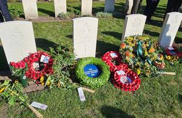

# Introduction

On 07 October, I visited the Venray Military Cemetery for the
Rededication of 4 Bomber Crew burials. The four had been previously
identified as unknowns but had recently been identified through an
in-depth investigation by the Commonwealth War Graves Commission (CWGC).
The CWGC does not permit exhumation to allow DNA analysis, preferring to
preserve the sanctity of the burial. They have very stringent rules to
ensure the bodies are properly identified, so the analyses must provide
irrefutable evidence of the member’s identification before the
headstones are changed.

Among those present were family members, the Mayor of Venray,
representatives of the British and Australian embassies, military
representatives of the Royal Air Force, Royal Army, Royal Navy, Royal
Australian Army, and Royal Australian Air Force, and adoptive parents.
Under a radiant autumn sun, a beautiful ceremony paid final respects to
the four fallen crew members of Lancaster PD374, which was shot down
near the German village of Horstgen on December 8, 1944.

The town of Venray, 40 km east of Eindhoven near the German border, was
liberated by Allied troops in the middle of October 1944, and the
burials in the cemetery date from October 1944 to March 1945.

Venray War Cemetery contains 692 Commonwealth burials of the Second
World War, 30 of them unidentified, and one Polish burial.

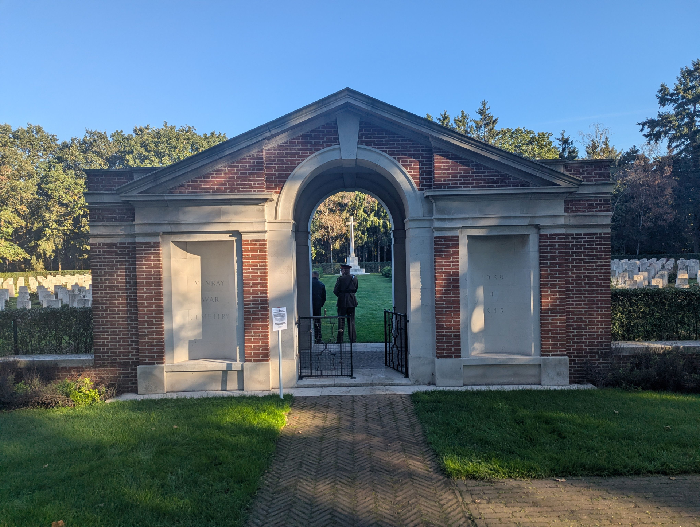

## The Flight

On 08 December 1944 Lancaster PD374 of 218 Squadron took off from
Methwold in Norfolk at 0825 heading for Homberg- to attack the Meerbeck
oil plant. 136 Lancasters, all from 3 Group were involved in the attack
and only 1 aircraft lost. The weather over the target was clear and
fair, the flak (Anti Aircraft Fire) was intense, but no fighters were
encountered. The raid opened well but smoke quickly obscured the target
and bombing then became quite scattered.

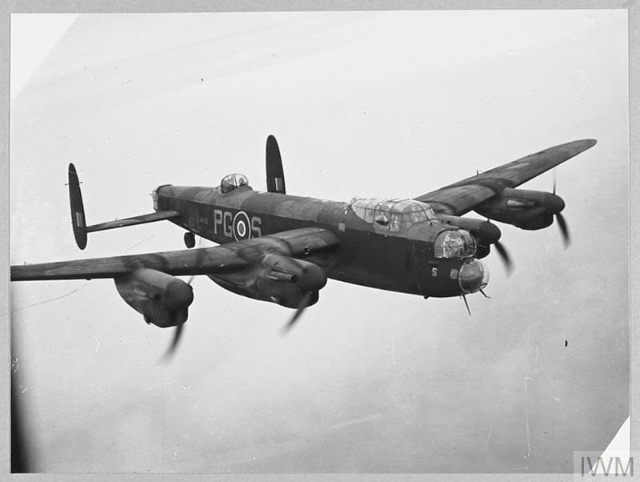

PD374 was hit by flak and was last seen on fire and gradually losing
height heading toward Horstgen. Around 1030 2 km east of Horstgen, the
plane nose dived and a into a field. Four parachutes were seen to open
before the crash. Three of these were captured by Police and became
Prisoners of War (PoWs). The fourth, PO Tales, was captured then
executed by the SS. The remaining three bodies were found in the
aircraft. PO Tales and the other three bodies were buried in the
cemetery at Dachsberg without a Christian burial or military honours.

Their bodies were exhumed in the Autumn of 1945 by American forces and
reinterred in the American Cemetery at Margraten, near Maastricht. Their
initial burial location was incorrectly recorded and abbreviated to
Dachs, so when the records were turned over to the British in 1949, they
tried to match the bodies to a different crash and ultimately determined
the place did not exist, so buried the bodies as unknowns. As a result,
their names were recorded on the Runneymede Memorial that commemorates
missing aircrew. Recent work by the CWGC successfully identified the
unknowns.

## The Crew

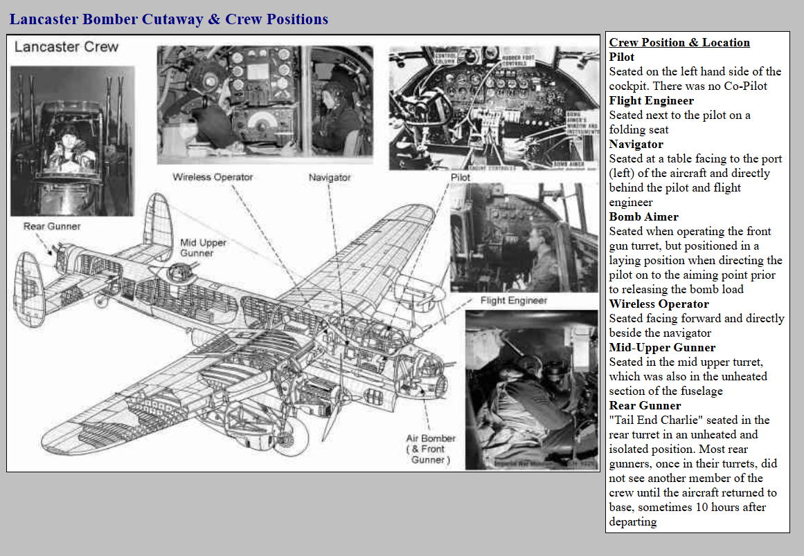

> Pilot: Flying Officer Leslie Hough RAAF Age 26 Killed in Action
>
> Flight Engineer: Pilot Officer John Tales RAF Age 26 Murdered
>
> Navigator: Flight Sergeant John Clifford, RAF Age 21, Prisoner of War
>
> Bomb Aimer: Flying Officer John Barron, RAF, Age 20, Prisoner of War
>
> Wireless Operator/ Air Gunner: Sergeant Henry Burnside RAF Age 22,
> Killed in Action
>
> Mid Upper Gunner: Sergeant John Lawson RAF Age 21, Killed in Action
>
> Rear Gunner: Sergeant Kenneth Lee RAF Age 19, Prisoner of War

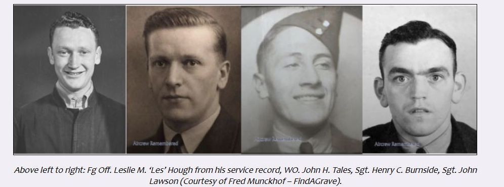

As was usual for Bomber crews, this group trained together at 26
Operational Training Unit in Buckinghamshire, before joining 218
Squadron on 10 August 1944. The Crew had completed 13 missions before
their crash.

### Flying Officer Leslie Hough

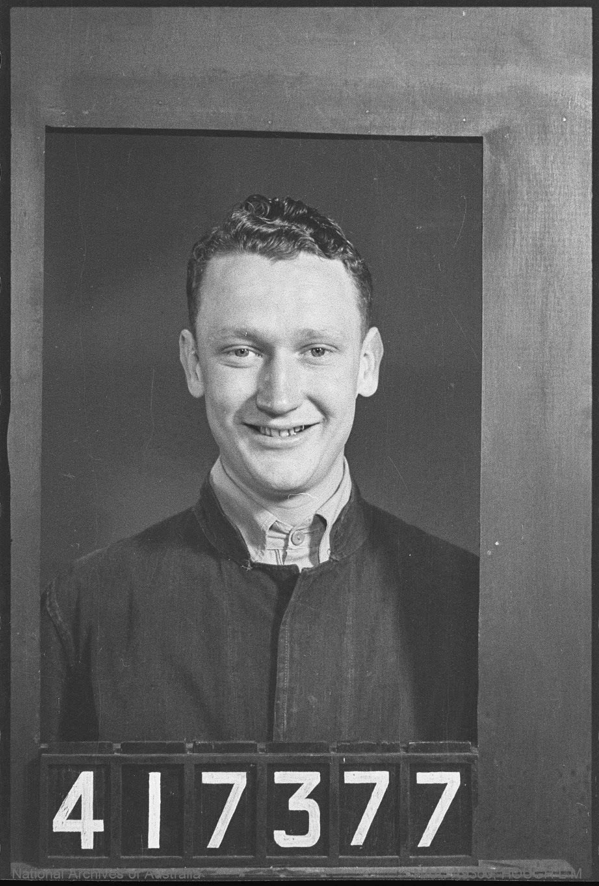

Leslie Hough, the Australian pilot, enlisted in pilot training in April
1942, and conducted his initial flight training in Australia before
being shipped to the UK via the United States. He did his advanced
flying training at 21 Advanced Flying Unit at Kidlington, then
operational bomber training at 26 OTU. Hough remained at the controls of
the aircraft until the final moments of the flight to allow other crew
members to escape.

A surviving crew member said:

> *With that last glance I saw Les Hough, that kindly, raucous,
> irreverent, competent, sometimes irascible and very Australian
> skipper, sitting there stubbornly keeping a burning wreck airborne
> while his crew bailed out. Like the good Aussie he was, he stuck by
> his mates until the end.*

### Pilot Officer John Tales

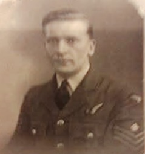

PO Tales enlisted in the RAF in 1939 and trained as a Flight Engineer.
He married Megan Stringer in 1940 and tragically his wife passed away a
year later due to Tuberculosis, so he was a widower at 23. He had
completed a full 30 mission tour with 209 squadron before becoming an
instructor. Despite being one of the few who survived through a full
tour, he declared the RAF was his life and volunteered for a second
tour.

PO Tales successfully parachuted out of the burning aircraft but was
then captured by civilians and beaten up before being handed over to a
Policeman and two SS Soldiers who took him away on a motorcycle. A short
time later two shots were heard by a local farmer named Johannes
Quernhorst, who ran to the scene to find PO Tales mortally wounded in
the road. A doctor was called but Tales died before the doctor arrived.
PO Tales was buried with the other three casualties.

### Sergeant Henry Burnside

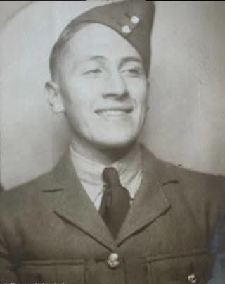

Sergeant Burnside enrolled in the RAF in May 1942 at age 20 and trained
as an Air Gunner and Wireless Operator in October 1943 and joined the
crew at 26 OTS.

### Sergeant John Lawson

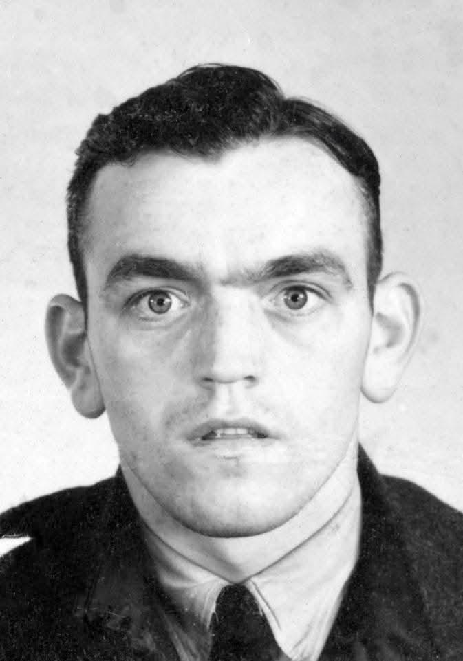

John enlisted in the RAF in July 1943 at the age of 20. He trained as an
Air Gunner and was the Mid Upper Gunner on PD374.

# The Ceremony

The very solemn and dignified ceremony was conducted by Group Captain
Ruth Hake, RAF Deputy Chaplin-in-Chief. In her address Group Captain
Hake quoted Queen Elizabeth, a phrase that really struck a chord with
me:

> *Grief is the price you pay for love.*

In an interview after the service Ruth said:

> *It is my immense privilege to conduct the ceremony for Fg Off Hough,
> Plt Off Tales, Sgt Burnside and Sgt Lawson today. They gave their
> lives in defence of our nation, and in dedicating their graves today
> with their names rightfully in place, we are able finally, to honour
> that debt that we all owe to them and their loved ones.*

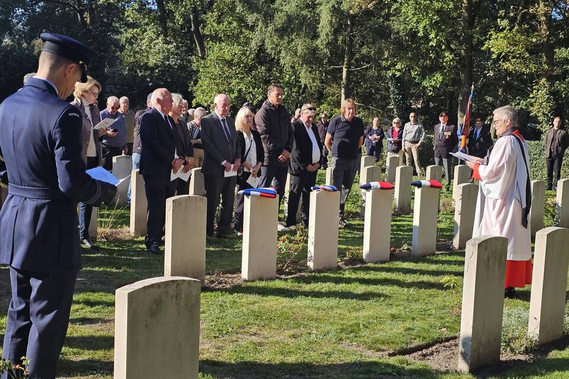

Along with several prayers and the last post was the Kohima Epitaph that
I think of every time I visit a cemetery:

> *When you go home tell them of us and say:*
>
> *‘For your tomorrow, we gave our today.’*

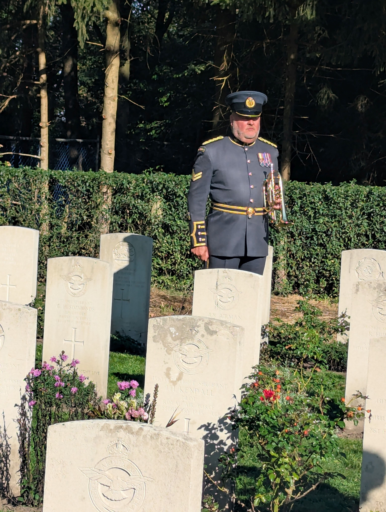

One of the readings, called The Lancaster appears to have been written
specifically for the ceremony.

> ***The Lancaster***
>
> *She lifted into the morning sky,*
>
> *Her four great Merlins calling clear:*
>
> *A Lancaster bound for distant skies,*
>
> *With seven men who conquered fear.*
>
> *Some came from Britian’s ancient shores,*
>
> *One from Australia’s sunlit land;*
>
> *But once they climbed aboard that plane,*
>
> *They flew as one – a single band.*
>
> *The darkness held no thought of rank,*
>
> *No measure made of where they’d grown.*
>
> *The trust that bound a bomber crew*
>
> *Was stronger far than flesh and bone.*
>
> *For some, that flight became their last,*
>
> *The starts receiving their final breath.*
>
> *Their youth was given for our peace,*
>
> *Their courage shining beyond death.*
>
> *The Lancaster returned no more,*
>
> *Yet neither did their spirit fade,*
>
> *For every life they touched endures,*
>
> *And every debt is still repaid.*
>
> *So let us stand in grateful silence,*
>
> *Remembering those who dared to fly.*
>
> *Not British only, nor Australian*
>
> *But brothers beneath one sky.*

A Dutch Colour guard was present with about 150 mostly Dutch attendees,
a strong gathering for a Wednesday morning.

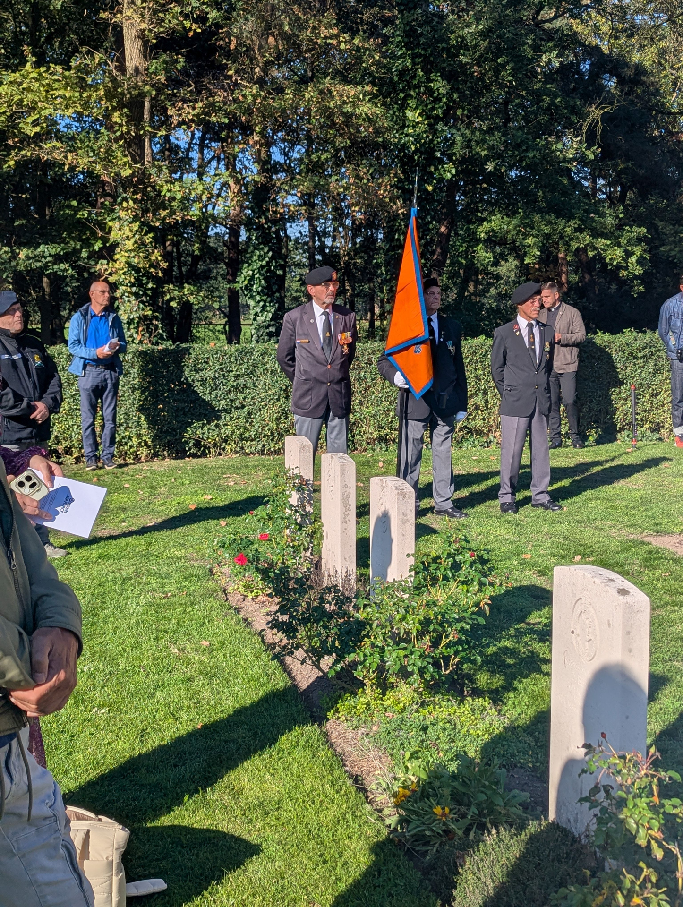

All four servicemen had family members present, celebrating the closure
of finally having identified the fallen. A photo of the family members
all holding pictures of their relatives.

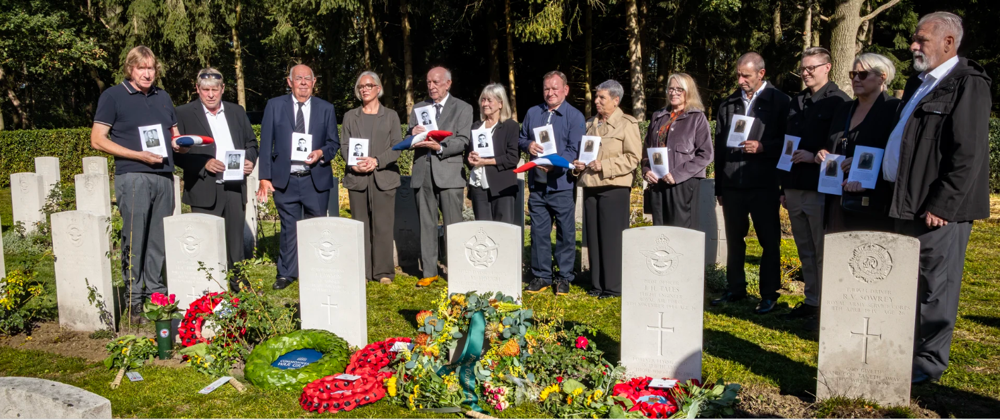

National flags were presented to the family members and wreathes laid
from several organizations.

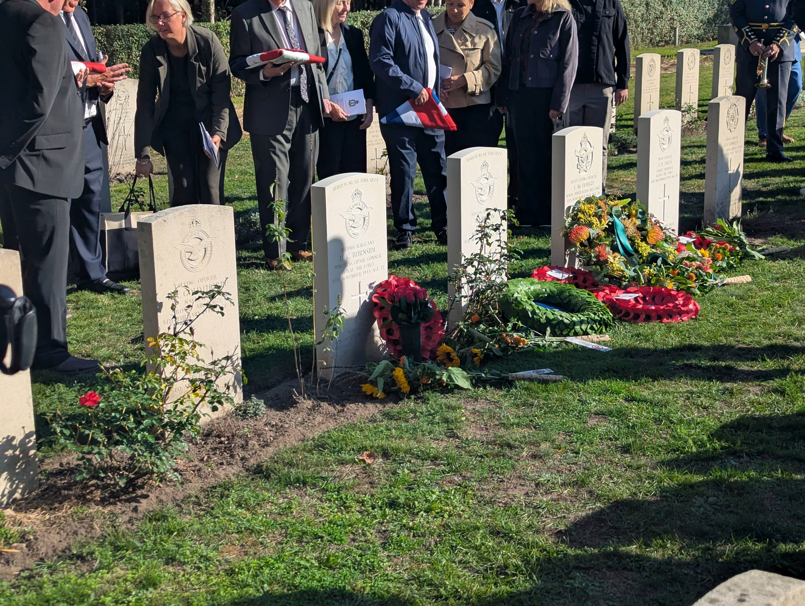

The four Headstones.

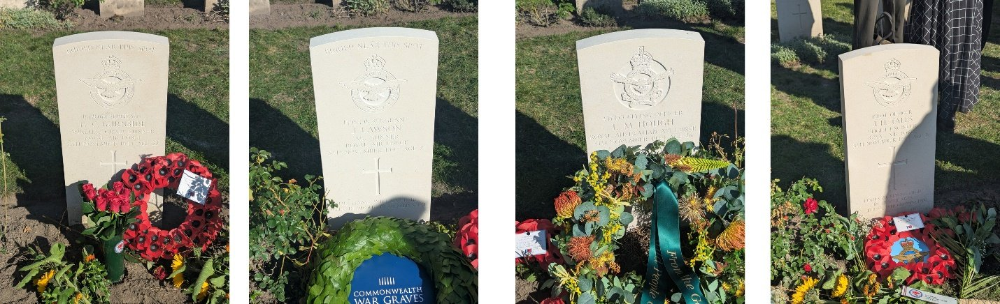

Burnside, Lawson, Hough, Tales

Interestingly, the headstones of Burnside and Lawson both say Buried
Near this Spot, indicating that their graves could not be uniquely
identified. Hough, the Australian, and Tales, the member who was
executed had artifacts that allowed them to be uniquely identified, but
the other two did not.

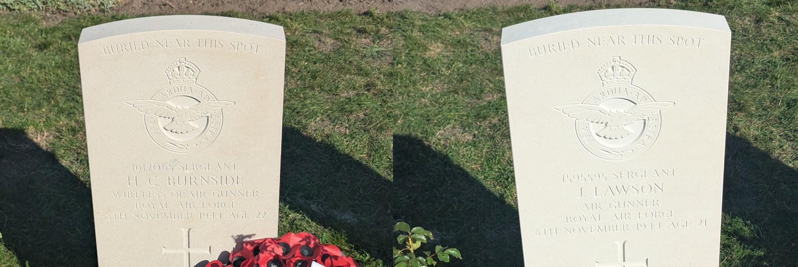

Family members for each service member.

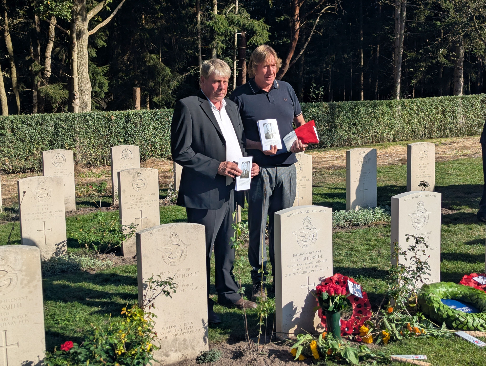

Sergeant Burnside

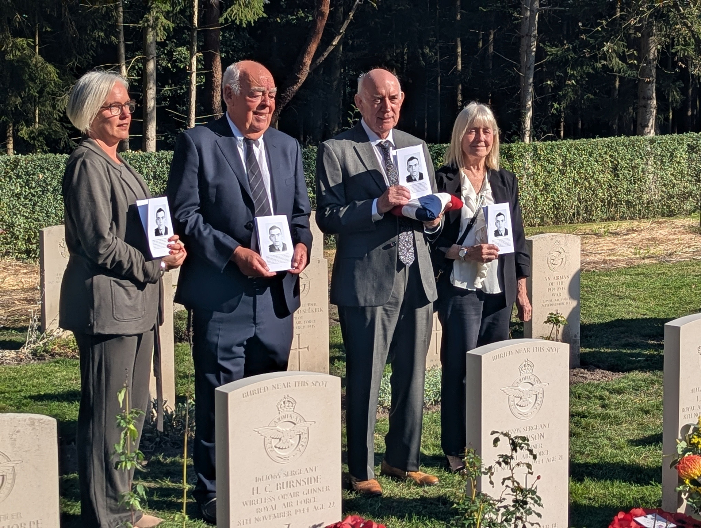

Sgt Lawson

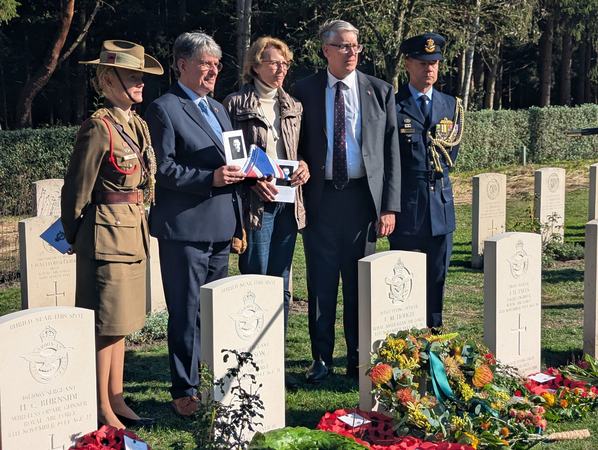

Flt Lt Hough with Australian Army and Air Force Representatives

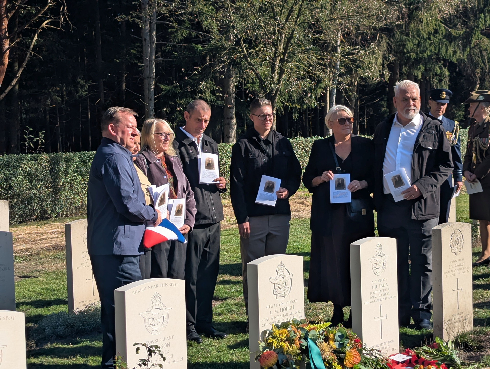

WO Tales

The Joint Casualty and Compassionate Centre (JCCC) was responsible for
the research, identification and burial of British casualties worldwide.
JCCC Caseworker, Tracey Bowers, said: 

> *Today we honour the British and Australian airmen who served and died
> together during World War 2. To have so many families present here
> today has made this occasion especially poignant and seeing them
> interacting with members of the local community who have adopted these
> graves incredibly moving.*

# Flight Sergeant Boleslaw Filipiak – Polish Air Force – Lancaster NG501

Air Gunner, Flight Sergeant Filipiak is the lone Polish Serviceman
buried at Venray, so I was curious of his story. He flew for 300
Squadron out of RAF Faldingworth, one of two bomber squadrons that
operated out of the UK. The remaining crew were all killed and buried in
four different locations in Belgium, the Netherlands and one in Germany.

**Crew Members**

All crew members aboard perished:

- **Flt Lt Władysław Wyganowski** (Pilot, Age 31) — Buried at the
  British War Cemetery in Hotton, Belgium.

- **Sgt Jacek Filek** (Flight Engineer, Age 25) — Buried at the Polish
  War Cemetery in Lommel, Belgium.

- **Sgt Edmund Kulikowski** (Navigator) — Buried at the Polish War
  Cemetery in Lommel, Belgium.

- **Józef Babiarz** (P/O / Ppor.) — Buried at the Polish War Cemetery in
  Lommel, Belgium.

- **Stefan Chętnicki** (Kpr.) — Buried at the Polish War Cemetery in
  Breda, the Netherlands.

- **J. R. Horobiowski** (Kpr.) — Buried in Kleve, Germany.

- **B. Filipiak** (Kpr.) — Buried in Venray, the Netherlands.

 All the crew perished on impact except for Jacek Filek, who managed to
parachute to safety but was tragically murdered by German forces upon
capture.

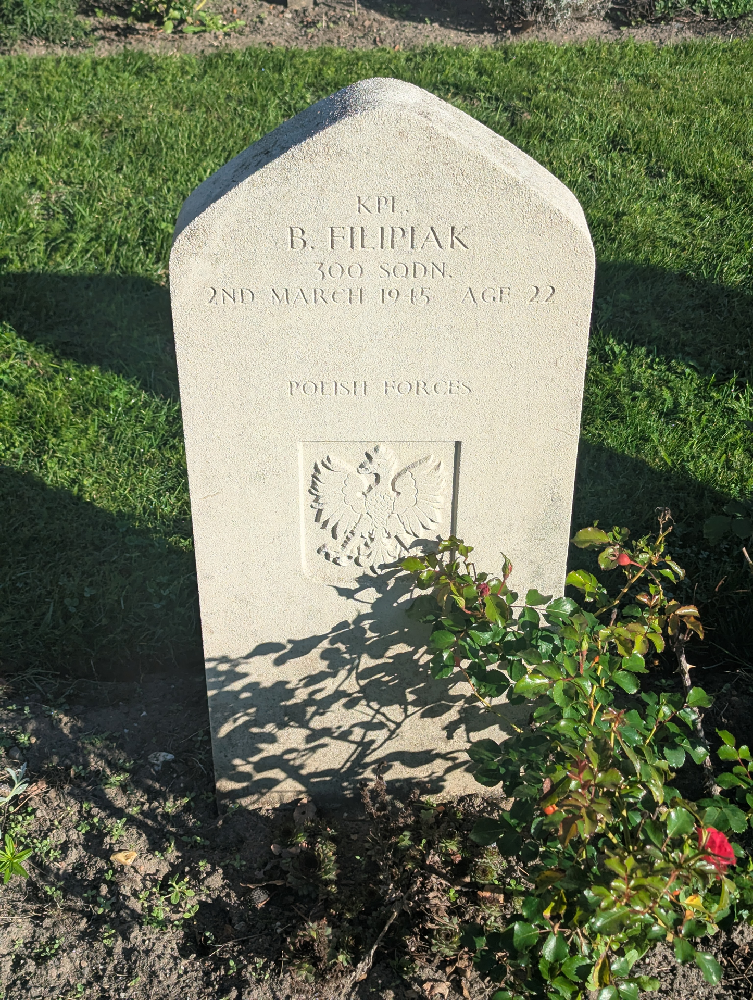

NG501 was involved Daylight raid on Cologne (Köln), Germany, taking off
from RAF Faldingworth, Lincolnshire at 07:14 AM. The aircraft was hit by
enemy anti-aircraft fire and/or fighter aircraft during the operation
and crashed on fire in the vicinity of Zülpicher Straße and Gottfried
Straße in Cologne.

# Final Thoughts

A beautiful, moving ceremony held on a perfect fall day. It was very
gratifying to see the care and respect shown to the service members and
great to see the number of family members in attendance. It was also
wonderful to see the number of Dutch people who attended the ceremony.
The respect they have for their liberators is still strong 82 years on.
There have been a number of rededication ceremonies this fall, I was
happy to be able to attend this one.

RAF Bomber Command (UK, Canada, Australia, New Zealand, Poland, & Allied
Nations) suffered between 55,573 to 58,438 killed. RAF Bomber Command
experienced one of the highest casualty rates of any branch in the
Western Allies. Out of 125,000 aircrew who served, approximately 45%
were killed in action or training.

I enjoy researching Air Force stories, partly because the squadron
records list every participant of each mission so you can get a good
appreciation of their flights. The International Bomber Command Centre
(IBCC) also has details of every Bomber Command loss and links the
records by crew so you can see who else was killed on the flight.

<https://losses.internationalbcc.co.uk/loss/213611/>

Many of the fallen are also commemorated in the Aircrew Remembered
website where additional details of the crew and the actions are
available:

<https://aircrewremembered.com/hough-leslie.html>

While at the Cemetery, I collected a few additional bomber crews that I
will take a look at in the next post.
